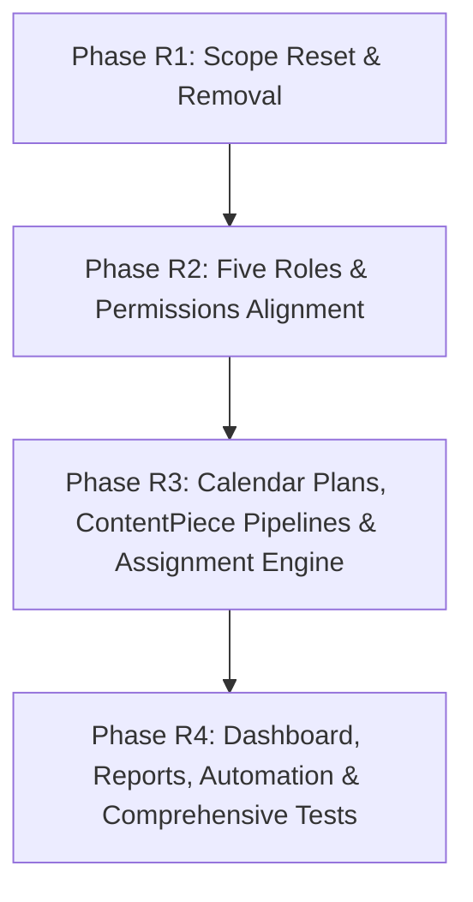

# HACA Marketing OS: Master Build Plan (Scope Reset: Phases R1 – R4)

**Date:** 24 October 2026  
**Status:** Approved Master Scope Reset  
**Target:** Conversion of HACA Marketing OS to Work and Team Only (HACA Only)  
**Source of Truth:** [docs/SCOPE_RESET.md](file:///c:/Users/ADMIN/OneDrive/Desktop/HACA/TECH/docs/SCOPE_RESET.md) and [docs/CONTENT_FLOW.md](file:///c:/Users/ADMIN/OneDrive/Desktop/HACA/TECH/docs/CONTENT_FLOW.md)

---

## 1. Overview & Phased Roadmap Strategy

The transition under the Scope Reset restructures all remaining work into **four sequential, self-contained phases (Phases R1 through R4)**. Each phase represents an isolated milestone that compiles, passes all lint and tests, and delivers working functionality before advancing to the next.

---

## 2. Phase-by-Phase Execution Specifications

### Phase R1: Scope Reset & Removal

* **Scope:** Clean slate removal of all out-of-scope modules, models, routes, jobs, UI pages, and configuration. Set up single-brand mode (HACA only).
* **Backend Removals:**
  * Delete API modules: `apps/api/src/modules/leads/` (LSQ adapter, Lead model, lead routes, sync service), `apps/api/src/modules/campaigns/` (Campaign model, routes, controller, service), and `apps/api/src/modules/targets/` (MonthlyTarget model, routes).
  * Remove from `apps/api/src/server.js`: route registrations for `/api/leads`, `/api/campaigns`, `/api/targets`, `/api/datacenter`.
  * In `apps/api/src/modules/jobs/processors.js`: remove `lsq_live_sync` worker and any WhatsApp inbound auto-task creation logic.
  * In `apps/api/src/config/env.js`: remove all `LSQ_*` environment variable validations.
  * In `apps/api/src/modules/workItems/model.js`: remove fields `campaignId`, `relatedOKR`, `relatedTarget`, `leadsGenerated`, `qualifiedLeads`. Replace campaign indexing with `calendarPlanId` and `contentPieceId`.
  * In `packages/shared`:
    * Remove permission keys: `target.view`, `target.manage`, `campaign.view`, `campaign.manage`, `lead.view`, `datacenter.view`.
    * Remove enums for campaign status, campaign goal types, expected outcomes, lead sources (19), and funnel stages (12).
    * Remove Business Impact dimension from performance dimension list (4 dimensions remain: Output, Efficiency, Quality, Collaboration).
* **Frontend Removals:**
  * Delete UI pages: `apps/web/src/pages/campaigns/` (`CampaignsPage.tsx`, `CampaignDetailPage.tsx`), `apps/web/src/pages/leads/` (`LeadFunnelPage.tsx`), and `apps/web/src/pages/datacenter/` (`DataCenterPage.tsx`).
  * In `apps/web/src/App.tsx`: remove routes for `/campaigns`, `/campaigns/:id`, `/leads`, `/data-center`.
  * In navigation menus (`Navbar.tsx`, `Sidebar.tsx`): remove menu items for Campaigns, Leads, and Data Center.
  * Apply single-brand mode: permanently hide brand pickers, multi-brand dropdowns, and profile selection tabs across all views.
* **Database & Data Cleanup:**
  * Database backup completed via `mongodump` into `backup-before-scope-reset/`.
  * Export documents from `campaigns`, `monthlytargets`, `leads`, `dataissues`, and `syncruns` to JSON archive, then delete collections from active database.
  * Run atomic migration script on `WorkItem` to unset `campaignId`, `relatedOKR`, `relatedTarget`, `leadsGenerated`, and `qualifiedLeads`. Keep all work items intact.
* **Tests:** Update existing test suites to remove references to campaigns, targets, leads, and LSQ.
* **Acceptance Criteria:** `npm run build`, `npm run lint`, and all remaining backend and frontend tests pass. No routes, models, or UI references to Leads, Campaigns, Targets, or LSQ exist.

---

### Phase R2: Five Roles & Permissions Alignment

* **Scope:** Establish exact five canonical role keys (`admin`, `creative_head`, `executive`, `sm_manager`, `team_member`). Align CASL permissions, resolveScope, and route guards. Replace departmental lead distinctions with the dedicated `creative_head` and `sm_manager` roles.
* **Backend Changes:**
  * In `packages/shared`:
    * Update role keys: `ROLE_KEYS = ['admin', 'creative_head', 'executive', 'sm_manager', 'team_member']`.
    * Add new permission keys: `calendar.plan` (plan creation & submission), `calendar.approve` (plan verification & approval).
    * Update `ROLE_PERMISSIONS` map:
      * `admin`: all keys derived from `PERMISSION_KEYS`.
      * `creative_head`: `portal.view`, `people.view`, `people.assign`, `calendar.view`, `calendar.approve`, `work.view`, `work.create`, `work.assign`, `feedback.give`, `feedback.view`, `blocker.resolve`, `analytics.team`, `report.view`, `report.configure`, `automation.manage`.
      * `sm_manager`: `portal.view`, `people.view`, `calendar.view`, `calendar.plan`, `work.view`, `work.create`, `work.assign`, `feedback.view`, `blocker.resolve`, `analytics.team`, `report.view`.
      * `executive`: read-only keys (`portal.view`, `people.view` [masked], `calendar.view`, `work.view`, `feedback.view`, `analytics.team`, `report.view`).
      * `team_member`: `portal.view`, `calendar.view`, `work.view.own`, `work.update.own`, `work.request`, `feedback.view.own`, `feedback.reply`.
  * Update `resolveScope(user, filters)`:
    * Single-brand mode (HACA only).
    * `personScope: 'all'` for `admin`, `creative_head`, `sm_manager`, and `executive`.
    * `personScope: 'self'` for `team_member`.
  * Security & boundary guards:
    * Ensure `executive` receives HTTP 403 on all POST, PUT, PATCH, DELETE endpoints across all modules.
    * In People API (`/api/people`), mask email and phone for executive callers.
    * Only `admin` can create users, change roles, or grant elevated roles (`admin`, `creative_head`, `executive`).
    * `creative_head` can edit operational fields (`departmentId`, `jobRole`, `workPreferences`, `reportsToIds`, `weeklyCapacityHours`) for `sm_manager` and `team_member`, but cannot touch `admin`, `executive`, or `creative_head` accounts.
    * `sm_manager` cannot approve plans or review stages.
  * Role migration script: update existing `Person` records in MongoDB (`marketing_head` $\rightarrow$ `creative_head`, `team_lead` $\rightarrow$ `sm_manager`).
* **Frontend Changes:**
  * Update role cards and badge components for the five roles.
  * Root redirect: `admin`, `creative_head`, `sm_manager`, and `executive` redirect to `/dashboard`; `team_member` redirects to `/my-work`.
  * Navigation menus: conditionally render menu items based on the updated permission map. Hide `/my-work` for `executive`.
* **Tests:** Permission matrix unit tests verifying exact allow/deny rules for all five roles across all active endpoints.
* **Acceptance Criteria:** All five roles log in and access authorized views. Executive has complete read-only visibility with zero write permissions. Creative Head manages team operating fields but cannot manage user accounts.

---

### Phase R3: Calendar Plans, ContentPiece Pipelines & Assignment Engine

* **Scope:** Implement Calendar Plans (Monthly or Project), plan upload & interactive grid, Creative Head verification & row approval flow, ContentPiece model, sequential stage WorkItem generation, intelligent auto-assignment engine with work preference matching, and the Content Tracker table view on `/calendar`.
* **Backend Changes:**
  * Implement `CalendarPlan` model and service in `modules/calendarPlans/`:
    * Fields: `kind` (`Monthly`, `Project`), `title`, `period`, `status` (`Draft`, `Submitted`, `Changes requested`, `Approved`), `createdById`, `submittedAt`, `reviewedById`, `reviewedAt`, `rows[]`.
    * Row schema: `postingDate` (or final date), `topic`, `contentType`, `needsScript` (boolean), `needsShoot` (boolean, Reel only), `contentLink` (draft link), `remarks`, `status`, `reviewComment`, `contentPieceId`.
  * Plan upload & validation endpoint (`/api/calendar-plans/preview` and `/api/calendar-plans`): CSV/Excel parser with schema validation preview.
  * Plan review endpoints:
    * Submit plan: `/api/calendar-plans/:id/submit` (SM Manager).
    * Verify plan: `/api/calendar-plans/:id/approve-all`, `/api/calendar-plans/:id/approve-rows`, `/api/calendar-plans/:id/request-changes` (Creative Head only).
  * ContentPiece & Pipeline stage generator in `modules/contentPieces/`:
    * When rows are approved, generates `ContentPiece` records and sequential stage `WorkItems`.
    * Due dates counted backward from final date $F$:
      * Design postable: Content $F-6$, Design $F-3$, Post $F$.
      * Design non-postable: Content $F-5$, Design $F-2$ (final done on design approval; no Post).
      * Reel A (with script, with shoot): Script $F-10$, Shoot $F-7$, Edit $F-4$, Post $F$.
      * Reel B (no script, with shoot): Shoot $F-7$, Edit $F-4$, Post $F$.
      * Reel C (no script, no shoot): Edit $F-4$, Post $F$.
      * Skipped stages marked `isSkipped: true` ('Not needed').
  * Stage hand-off & sequencing service:
    * When a review stage is marked Approved or a non-review stage marked Done, sets `unlockedAt` on the next stage.
    * A stage cannot start until the previous stage is approved or done.
  * Deadline shift helper: One-click adjustment shifting all unstarted stage deadlines when final date shifts.
  * Auto-Assignment recommendation service:
    * Evaluates candidate owners using `Person.workPreferences[]` (`Content`, `Script`, `Design`, `Shoot`, `Edit`, `Post`), workload strictly $<85\%$, and bandwidth before deadline.
    * Returns recommendation with clear rationale.
    * SM Manager confirms all with one click or overrides; overrides logged in `AssignmentOverride`. Open stages show 'Needs owner'.
  * Content Tracker query endpoint (`/api/calendar/content-tracker`): Aggregates ContentPieces with their stage WorkItems into Social view and Design view tables.
* **Frontend Changes:**
  * Update `/calendar` page:
    * Tab 1: Month Calendar View.
    * Tab 2: Calendar Plans (plan list, Excel/CSV upload modal with syntax preview, interactive grid entry, and submission).
    * Tab 3: Content Tracker (Social view and Design view tables with stage status chips and quick-add row).
  * In `/feedback`: add **Plan Approvals** queue for Creative Head (approve all, approve selected rows, or add line-item comments) alongside **Stage Approvals** queue.
  * Assign Stages modal/interface for SM Manager: 1-click confirmation of recommendations or manual override.
  * Stage Stepper component on Single Work Detail page (`/work/:id`).
* **Tests:**
  * Plan upload and validation unit tests.
  * Plan approval flow permission tests (SM Manager cannot approve; Creative Head can approve/request changes).
  * Auto-generation of stage work items with exact due-date offsets.
  * Auto-assignment recommendation tests verifying work preference matching and capacity exclusion ($>85\%$).
  * Sequential unlocking enforcement (locked stages cannot transition).
* **Acceptance Criteria:** SM Manager can upload/type plans and submit. Creative Head can approve rows. Approved rows auto-generate ContentPieces and stages. Auto-assignment recommends valid candidates. Content Tracker renders Social and Design views.

---

### Phase R4: Dashboard, Reports, Automation & Comprehensive Tests

* **Scope:** 8-section Team Dashboard, 4 core reports, 6 automation rules, 4 objective performance dimensions, complete end-to-end testing, and production hardening.
* **Backend Changes:**
  * Dashboard aggregation service (`modules/dashboard/service.js`) compiling all 8 sections:
    1. Month plan status (plan status, planned vs done)
    2. KPI strip (Planned, Completed, In Progress, At Risk [due in 72h not in review], Blocked, Pending Approval, Overdue)
    3. Today's priorities
    4. Production stats & trend (by content format)
    5. Team workload (healthy, high, overloaded)
    6. Issues and blockers (unresolved blockers and unclassified flags)
    7. Waiting for approval (items awaiting Creative Head decision)
    8. Recent activity
  * 4 Core Reports in `modules/reports/`:
    1. **Weekly Work Report** (Mondays 08:00 IST)
    2. **Monthly Performance Scorecard** (Last day 23:59 IST, targets removed)
    3. **Creative Production Report** (Fridays 18:00 IST)
    4. **Team Performance Digest** (1st of month 09:00 IST)
  * 6 Automation Rules in `modules/automation/`:
    1. `month_end_report`
    2. `overdue_escalation` (owner immediate, SM Manager after 4h)
    3. `todo_escalation` (no status change for 3 days)
    4. `blocker_dependency_alert` (instant ping to dependency owner)
    5. `revision_pattern_flag` (auto-flag on 4 revisions or average + 1)
    6. `weekly_report`
  * 4 Performance Dimensions in `modules/people/metrics.js`: Output, Efficiency, Quality, Collaboration.
  * Turnaround calculation: $\text{Published Date} - \text{First Stage Start Date}$.
* **Frontend Changes:**
  * Implement 8-section Dashboard layout on `/dashboard`.
  * Reports screen (`/reports`): interactive in-app report viewer, "Generate Now" for Creative Head & Admin, and rule controls.
  * Feedback & Issues screens: root-cause classifier modal for Creative Head and blocker resolution flow.
* **Tests:**
  * Complete end-to-end integration test (`phase_r_e2e.test.js`) covering full lifecycle:
    Plan Creation $\rightarrow$ Submission $\rightarrow$ Creative Head Approval $\rightarrow$ Stage Generation $\rightarrow$ Auto-Assignment $\rightarrow$ Contributor Execution $\rightarrow$ Review & Revision Feedback $\rightarrow$ Publication $\rightarrow$ Turnaround $\rightarrow$ Dashboard Metrics $\rightarrow$ Reports.
  * Route-table permission walk testing all 5 roles across all active endpoints.
* **Acceptance Criteria:** Dashboard displays live metrics across all 8 sections. All 4 reports generate accurately. All 6 automation rules execute without duplicates. Full test suite passing with 0 errors.

---

## 3. Retained Historical Artifacts

All historical work items, deliverables, and activity events remain completely intact in MongoDB. Cloudinary assets stay fully accessible. The pre-reset codebase and database state are preserved under git tag `pre-scope-reset` and backup directory `backup-before-scope-reset/`.
