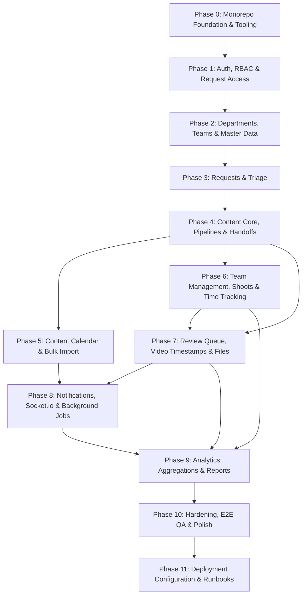

# Master Build Plan: Marketing Workflow & Content Management Portal

This document outlines the phased build plan for turning requirements and architecture into a production-grade application.

---

## Phase Overview & Dependency Graph

---

## Detailed Phase Breakdown

### Phase 0: Monorepo Foundation & Tooling
- **Scope**: npm workspaces monorepo structure (`apps/api`, `apps/web`, `packages/shared`).
- **Backend Work**: Express 5 ESM scaffold, Zod-based `env.js`, Pino logger, central error handler, `/api/status` health check.
- **Frontend Work**: Vite + React 18 + TypeScript strict setup, Tailwind CSS, Lucide icons, base layout shell.
- **Shared Package**: TypeScript package with `tsup` build setup.
- **Infrastructure**: `docker-compose.yml` (MongoDB & Redis), `.env.example`, `.gitignore`, `.nvmrc` (Node 22 LTS).
- **Acceptance Criteria**: `npm run dev` starts all workspaces; lint and typecheck pass; API refuses startup with missing env vars.

### Phase 1: Authentication, RBAC & Request Access
- **Scope**: Common login, Request Access flow, Admin approvals, CASL permissions, mailer adapter.
- **Backend Work**:
  - Models: `User`, `AccessRequest`, `AuditLog`.
  - Roles: `admin`, `lead`, `team_lead`, `worker`, `sm_manager`, `dept_lead`, `dept_staff`, `viewer`.
  - Permission matrix mapped to CASL abilities.
  - Endpoints: `POST /auth/login`, `POST /auth/request-access`, `POST /auth/set-password`, `GET /auth/me`, `POST /auth/refresh`, `POST /auth/logout`.
  - Admin endpoints: `/admin/access-requests` (list, approve, reject, info), `/admin/users`.
  - Mailer adapter: `lib/mailer.js` (providers: `console`, `resend`, `smtp`).
  - First admin CLI seed: `scripts/seed-admin.js`.
- **Frontend Work**:
  - Unified Login page with "Request Access" modal.
  - Set-password page for 48-hour invite tokens.
  - `ProtectedRoute` and `usePermission` hook.
  - Admin Access Requests and User Management screens.
- **Acceptance Criteria**: Admin can seed and log in; guest can request access; admin approves; user receives invite link, sets password, and logs into correct dashboard.

### Phase 2: Departments, Teams, Master Data & Audit Log
- **Scope**: Organizational structure and Admin configuration.
- **Backend Work**:
  - Models: `Department`, `Team`, `Platform`, `Priority`, `HoldReason`, `ContentFormat`, `RequestType`, `Settings`.
  - Seed script for default teams (Content, Graphics, Cinematography, Editor), departments, formats, hold reasons.
  - Audit logging service for all mutations.
- **Frontend Work**:
  - Admin Master Data management (tabbed view for platforms, formats, hold reasons, request types).
  - Dynamic Form schema builder & renderer.
  - Teams & Departments management.
- **Acceptance Criteria**: Master data seeded and editable; dynamic form renderer correctly parses schema definitions.

### Phase 3: Requests & Triage
- **Scope**: Department request intake, triage inbox, status history.
- **Backend Work**:
  - Models: `Request`, `StatusHistory`.
  - Atomic counter for `MKT-YYYY-NNNN`.
  - Scoping: `dept_lead` sees all department requests; `dept_staff` sees only own; `lead` sees all.
  - Triage actions: Accept, Reject with reason, Request Info, Merge duplicates, Convert stub.
  - Central `TransitionService` for valid state transitions and audit history.
- **Frontend Work**:
  - Requester New Request wizard with dynamic forms, attachments, draft saving.
  - My Requests timeline view with comments and resubmission.
  - Lead Request Inbox with bulk triage and filters.
- **Acceptance Criteria**: Department requests follow proper scoping; status transitions record history; rejected items can be edited and resubmitted.

### Phase 4: Content Core, Pipelines & Handoffs
- **Scope**: Central `ContentItem` tracking, pipeline templates, task handoffs, worker queues.
- **Backend Work**:
  - Models: `ContentItem` (`CNT-YYYY-NNNN`), `PipelineTemplate`, `Task`, `Comment`.
  - Conversion of accepted requests into ContentItems with pipelines.
  - Automatic task creation on stage completion.
  - Workload endpoint with leave awareness.
- **Frontend Work**:
  - Lead Content Items table (TanStack Table) and pipeline stepper view.
  - Worker "My Tasks" board, list, and calendar views.
  - Team handoff queues ("Copy ready", "Footage ready").
- **Acceptance Criteria**: Completing a stage triggers the next team's task automatically; leave status prevents worker assignment suggestions.

### Phase 5: Content Calendar & Bulk Import
- **Scope**: Social media calendar, Excel import, capacity forecasting.
- **Backend Work**:
  - Models: `CalendarEntry`, `ImportBatch`.
  - Excel/CSV bulk import parser with dry-run error preview using `exceljs`.
  - Demand vs. capacity calculation.
  - Publish endpoint for Social Media Manager.
- **Frontend Work**:
  - FullCalendar view (month, week, list) with status colors.
  - Bulk import wizard with error preview table.
  - Team weekly capacity meter widget.
- **Acceptance Criteria**: Bulk import accurately validates rows; approved calendar entries generate content items with lead-time calculated deadlines.

### Phase 6: Team Management, Shoots & Time Tracking
- **Scope**: Shoot planner, time tracking, timesheet approvals, attendance.
- **Backend Work**:
  - Models: `Shoot`, `TimeEntry`, `LeaveRequest`.
  - Shoot completion releases video tasks to Editor queue.
  - Time logging (timer + manual) and timesheet approval by Lead.
- **Frontend Work**:
  - Shoot Planner calendar and call sheet view.
  - Task timer widget and weekly timesheet grid.
  - Team dashboards with skills matrix.
- **Acceptance Criteria**: Shoot marked Done unblocks Editor queue; logged times roll up into task actual hours.

### Phase 7: Review Queue, Video Timestamps & Files
- **Scope**: Direct signed uploads, video review player, approval flow.
- **Backend Work**:
  - Models: `Deliverable` (versioned `v1`, `v2`, etc.).
  - Direct Cloudinary signature generation route (`POST /uploads/sign`).
  - Review decisions: Approve, Request Changes (increments `revisionCount`), Reject.
  - Requester final confirmation step.
- **Frontend Work**:
  - Direct upload dropzone with progress bar.
  - Video review player with click-to-timestamp comments and version comparison.
  - Requester confirmation modal.
- **Acceptance Criteria**: 300MB video uploads directly to Cloudinary; timestamped comments seek video; version history tracked cleanly.

### Phase 8: Notifications, Socket.io & Background Jobs
- **Scope**: Domain event bus, real-time push, BullMQ workers.
- **Backend Work**:
  - Domain event bus triggering notification generator.
  - Socket.io authenticated handshake for instant push.
  - BullMQ workers: email queue, 24h deadline reminder, daily digest, recurring requests.
- **Frontend Work**:
  - Notification bell with unread count and real-time toast alerts.
  - In-app notification center and user preferences page.
- **Acceptance Criteria**: Live notifications arrive in real time; reminders run idempotently without duplicate sends.

### Phase 9: Reports & Analytics
- **Scope**: Department, team, individual, bottleneck, and scorecard reports.
- **Backend Work**:
  - Optimized aggregation pipelines over `StatusHistory`, `Task`, `TimeEntry`.
  - Efficiency score engine (40% on-time, 30% first pass, 20% speed, 10% volume).
  - Export streaming to Excel, CSV, and PDF.
- **Frontend Work**:
  - Interactive Recharts analytics dashboards per role.
  - Bottleneck analysis charts and management scorecard.
- **Acceptance Criteria**: Sub-2-second report responses; accurate calculations against test fixtures.

### Phase 10: Hardening, E2E QA & Polish
- **Scope**: Security audit, end-to-end tests, UX refinement, demo data.
- **Deliverables**:
  - Playwright E2E suites covering main user journeys.
  - `docs/SECURITY_REVIEW.md` addressing all OWASP/CASL items.
  - Realistic demo dataset script (`scripts/seed-demo.js`).
- **Acceptance Criteria**: All automated test suites green; security audit clean.

### Phase 11: Deployment Configuration & Runbooks
- **Scope**: Vercel frontend, Render backend/worker, Atlas, Cloudinary setup.
- **Deliverables**:
  - `vercel.json` and `render.yaml`.
  - `docs/DEPLOYMENT.md` complete runbook.
- **Acceptance Criteria**: Reproducible deployment configuration tested against staging environment.
