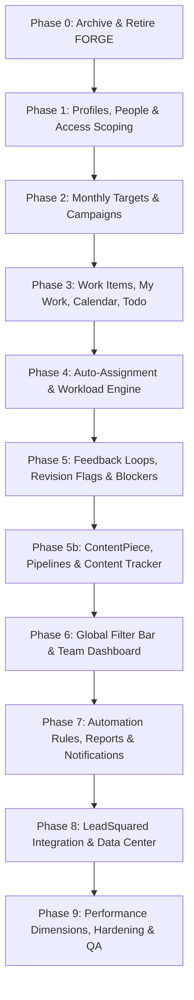

# HACA Marketing OS: Master Build Plan (Phases 0 – 9)

**Date:** 18 October 2026  
**Status:** Approved Master Plan  
**Target:** Conversion of HACA FORGE to HACA Marketing OS (V1 Team Workspace)  
**Source of Truth:** [HACA-Marketing-OS-Build-Spec.pdf](file:///c:/Users/ADMIN/OneDrive/Desktop/HACA/TECH/haca-forge/docs/HACA-Marketing-OS-Build-Spec.pdf) and [PROJECT_REPORT.md](file:///c:/Users/ADMIN/OneDrive/Desktop/HACA/TECH/haca-forge/docs/PROJECT_REPORT.md)  

---

## 1. Overview & Phased Roadmap Strategy

The transition from HACA FORGE to HACA Marketing OS occurs across 11 sequential, self-contained phases (Phases 0 through 9, including Phase 5b for Content Flow). Each phase represents an isolated milestone that compiles, passes all lint and tests, and delivers working functionality before advancing to the next.

---

## 2. Phase-by-Phase Execution Specifications

### Phase 0: Archive FORGE and Retire Out-of-Scope Modules

* **Scope:** Clean slate preparation. Remove retired FORGE modules (API, UI, seeds, tests) while keeping infrastructure (Auth, Sockets, BullMQ, Mailer, Uploads, Glass UI, Access Requests flow, Admin Users and Access Requests pages). Set up placeholder screens.
* **Backend Changes:**
  * Delete API modules: `audit`, `comments`, `content`, `deliverables`, `leave`, `masterData`, `pipelines`, `requests`, `shoots`, `tasks`, `teamAssignments`, `teams`, `time`.
  * **KEEP the `access/` module:** Retain the public Request Access flow and admin access-request logic as an Admin-only enabler.
  * Prune `apps/api/src/server.js` route registrations and socket listeners for retired modules.
  * In `apps/api/src/modules/jobs/processors.js`: remove every worker that queries a retired model (`Task`, `ContentItem`, `Request`, `ScheduledReport`). Keep BullMQ queue setup and worker entry in `lib/queue.js` and `server.js` so Phase 7 can register new jobs.
  * In `apps/api/src/modules/notifications/service.js`: remove every domain event listener for retired events (`request.*`, `task.*`, `content.*`, `deliverable.*`). Retain `Notification` model, notification routes, and Socket.io push infrastructure.
  * In `apps/api/scripts/seed.js` and `seed-demo.js`: strip all imports and logic that touch retired models. Retain only what the remaining modules need (e.g., initial user seed). Mark `seed-demo.js` as a stub to be rebuilt in Phase 9.
  * **KEEP `scripts/seed-admin.js`:** Retain for seeding the initial admin account.
  * In `packages/shared`: remove retired permission keys, role keys, and enums ONLY if nothing that stays imports them. Rebuild shared package with `npm run build` before running typecheck or lint in `apps`. Do NOT add new Marketing OS roles yet (reserved for Phase 1).
* **Frontend Changes:**
  * Remove retired web pages from `apps/web/src/pages/` (audit log, master data, settings, teams/departments, request triage, timesheets, shoot planner, file library).
  * **KEEP Admin Users and Access Requests pages:** Keep `apps/web/src/pages/admin/AccessRequestsPage.tsx` and `apps/web/src/pages/admin/UsersPage.tsx`. They will be adapted in Phase 1.
  * In `apps/web/src/App.tsx`: update `RootRedirect` to route every role directly to `/dashboard`. Keep role keys as they are for now so existing logins keep working.
  * Mount 14 Marketing OS placeholder routes behind `ProtectedRoute` (`/dashboard`, `/my-work`, `/calendar`, `/campaigns`, `/campaigns/:id`, `/work`, `/work/:id`, `/feedback`, `/workload`, `/todo`, `/issues`, `/leads`, `/data-center`, `/reports`, plus `/people` and `/admin/access-requests`). All render a clear placeholder page (*"Built in Phase N"*).
* **Data Model Changes:** None (all collections preserved in MongoDB).
* **Database & Asset Retention:**
  * Do NOT drop or delete any collection in MongoDB (`deliverables`, `tasks`, `requests`, `shoots`, `timeentries`, etc.).
  * Cloudinary URLs stay fully recoverable in the database and in the git tag `forge-v1-final`.
* **Migrations:** None.
* **Tests:**
  * Delete retired modules' test files together with the modules (`phase2.test.js` through `phase10_e2e.test.js`, `roles_v2_scoping.test.js`, `teamAssignments.test.js`).
  * Retain and ensure passing for `status.test.js` and `permissions.test.js`.
  * Every remaining test file must pass with 0 errors.
* **Risks:** Broken imports in kept infrastructure (`server.js`, `mailer.js`, `env.js`).
* **Acceptance Criteria:** `npm run build`, `npm run lint`, and `npm test` all pass. The app starts, users can log in, and all routes render with glass layout.
* **Dependencies:** Pre-migration tag `forge-v1-final` and database backup completed.

---

### Phase 1: Reference Data, Profiles, People & Access Scoping

* **Scope:** Seed 7 Profiles, 7 Departments, and fixed reference taxonomies. Establish 5-role model (`admin`, `marketing_head`, `executive`, `team_lead`, `team_member`). Establish `Person` model with `jobRole`, `profileAccess[]`, `reportsToIds[]`, `weeklyCapacityHours`, and `workPreferences[]`. Define approver job roles constant. Build `resolveScope(user, filters)`. Adapt Access Requests and Users pages. Seed demo users including SM Manager and Creative Head.
* **Backend Changes:**
  * Implement 5 canonical roles in `@mmp/shared`: `ROLE_KEYS = ['admin', 'marketing_head', 'executive', 'team_lead', 'team_member']`.
  * `ROLE_PERMISSIONS.admin = all PERMISSION_KEYS` (dynamically derived from `PERMISSION_KEYS`, so new keys are automatically granted).
  * `ROLE_PERMISSIONS.executive = ['portal.view', 'people.view', 'target.view', 'lead.view', 'datacenter.view', 'analytics.team', 'report.view']` (strictly read-only across all portal modules; zero write permissions).
  * `ROLE_PERMISSIONS.marketing_head` includes `portal.view` and `people.view`.
  * Define approver job roles constant in `@mmp/shared`: `APPROVER_JOB_ROLES = ['Creative Manager (TL)']`.
  * Define work preference stages in `@mmp/shared`: `WORK_PREFERENCE_STAGES = ['Content', 'Script', 'Design', 'Shoot', 'Edit', 'Post']`.
  * Permission keys:
    * `portal.view`: universal portal read-only access to all dashboard, work item, calendar, feedback, campaign, lead, datacenter, and report views.
    * `people.view`: read-only access to people directory with email and phone masked/omitted.
    * `user.approve` (Admin only): approve or reject access requests. Only admin can approve or grant `executive`.
    * `user.manage` (Admin only): create/invite users, change roles, grant admin/marketing_head/executive, suspend, reset passwords, force logout.
    * `people.assign` (Marketing Head): edit operational fields (`departmentId`, `jobRole`, `profileAccess`, `reportsToIds`, `weeklyCapacityHours`, `workPreferences`) of `team_lead` and `team_member`. Cannot modify or grant admin or executive accounts.
    * `reference.manage` (Admin only).
  * Implement `Person` schema/model in `modules/people/`:
    * Fields: `name`, `email`, `passwordHash`, `role`, `jobRole` (optional for admin/executive), `departmentId` (optional for admin/executive), `profileAccess`, `reportsToIds`, `weeklyCapacityHours` (optional for admin/executive), `workPreferences[]` (Content, Script, Design, Shoot, Edit, Post), `lastProfileId`, `status`.
  * `resolveScope(user, filters)`:
    * For `admin`: returns all profiles and all people (full access).
    * For `marketing_head`: returns assigned profiles (all by default) and all people in scope.
    * For `executive`: returns all profiles (all 7 by default) and `personScope: 'all'` (`allowedPersonIds = null`, `canAccessPerson: true`).
    * For `team_lead`: returns assigned profiles and own team (direct reports + same department).
    * For `team_member`: returns assigned profiles and self only.
    * Both `admin` and `executive` are strictly excluded from auto-assignment candidate pools, workload calculations, and performance metrics.
  * Seed 7 Profiles and 7 Departments.
  * Seed script: `scripts/seed-admin.js` creates the first admin from `ADMIN_SEED_EMAIL` and `ADMIN_SEED_PASSWORD`. `scripts/seed-demo-users.js` seeds test cohort including `executive@demo.haca.local`, SM Manager (`team_lead`, `Social Media Manager`, Social Media dept), and Creative Head (`team_lead`, `Creative Manager (TL)`, Design dept acting as approver).
  * `ActivityEvent`: logs every user, role, and access change. Any admin work actions are recorded with `actingAs: 'admin'`.
* **Frontend Changes:**
  * Adapt existing admin user management into People Setup (`/people`) and Access Requests (`/admin/access-requests`):
    * **Admin view:** full management (create user, set role, grant admin/marketing_head/executive, suspend, reset password, approve access requests).
    * **Marketing Head view (`/people`):** can edit operational assignment fields (`people.assign`) including `workPreferences` for `team_lead` and `team_member`. Cannot touch admin or executive accounts.
    * **Executive view (`/people`):** read-only view with contact information (email/phone) masked and management actions disabled.
    * Show `workPreferences` on My Account / user settings profile.
    * Hides `/my-work` completely from executive navigation and route access.
    * Hides all deliverable creation, auto-assignment, manual report generation, and status mutation buttons for executive across all screens.
  * RootRedirect in `App.tsx`:
    * `admin`, `marketing_head`, `executive`, and `team_lead` redirect to `/dashboard`.
    * `team_member` redirects to `/my-work`.
* **Data Model Changes:**
  * `Profile`: `{ name, code, active }`
  * `Department`: `{ name, code }`
  * `Person`: `{ name, email, passwordHash, role, jobRole, departmentId, profileAccess, reportsToIds, weeklyCapacityHours, workPreferences, lastProfileId, status }`
  * `AccessRequest`: `{ name, email, phone, department, requestedRole, reason, status, reviewedBy, reviewedAt }`
* **Migrations:**
  * Execute User to Person migration:
    * `admin` $\rightarrow$ `admin` (Active, all profiles)
    * `head`, `lead` $\rightarrow$ `marketing_head` (Active, all profiles)
    * `team_lead` $\rightarrow$ `team_lead` (Active, scoped profiles)
    * `worker`, `sm_manager` $\rightarrow$ `team_member` (Active, scoped profiles)
    * `management`, `viewer` $\rightarrow$ `executive` (Active, all 7 profiles, empty reportsTo)
    * `dept_lead`, `dept_staff` $\rightarrow$ `suspended` (Retained safely in database, cannot log in)
  * Support `scripts/migration-overrides.json` (`{ "email": "new_role" }`) applied after default map.
  * Convert active `TeamAssignment` records into `Person.reportsToIds[]` and archive the collection in MongoDB.
* **Tests:**
  * Admin holds all permission keys (derived test).
  * Executive holds only read permissions (`portal.view`, `people.view`, `target.view`, `lead.view`, `datacenter.view`, `analytics.team`, `report.view`) and receives HTTP 403 on all POST/PATCH/PUT/DELETE routes.
  * Only admin can grant `admin`, `marketing_head`, or `executive` roles.
  * Marketing Head cannot create or suspend users, and cannot edit admin or executive accounts.
  * Executive is excluded from assignment candidate queries and workload calculations.
  * People API masks email/phone for executive callers.
  * `resolveScope` tests for all 5 roles across profile boundaries.
* **Risks:** User lockout if admin account is not properly seeded or role permissions mapping fails.
* **Acceptance Criteria:** Admin can log in, approve access requests, and create users. Executive can log in and view all screens read-only with zero mutation permissions. Marketing Head can only edit operational fields of team members and leads. RootRedirect accurately directs roles.

---

### Phase 2: Monthly Targets & Campaigns

* **Scope:** Implement the top of the traceability chain: `MonthlyTarget` and `Campaign`. Campaigns strictly require `targetId` and `relatedOKR`.
* **Backend Changes:**
  * Implement `MonthlyTarget` model & service in `modules/targets/`: targets for revenue, leads, qualified leads, budget.
  * Implement `Campaign` model & service in `modules/campaigns/`: requires `targetId` and `relatedOKR`. Tracks status (`In Progress`, `At Risk`, `Completed`), goal type, spend actuals, and lead actuals.
  * API endpoints for target setting (Head only) and campaign management (Head & Team Leads).
* **Frontend Changes:**
  * Projects / Campaigns List page (`/campaigns`) with status badges and target links.
  * Campaign Detail page (`/campaigns/:id`) displaying campaign goals, related OKR, target progress, budget burn, and attached work items.
* **Data Model Changes:**
  * `MonthlyTarget`: `{ month, profileId, revenueTarget, leadsTarget, qualifiedLeadsTarget, budget, createdBy }`
  * `Campaign`: `{ name, profileId, targetId, relatedOKR, startDate, endDate, status, goalType, expectedOutcome, budgetAllocated, spendActual, leadsActual, ownerId }`
* **Migrations:** Seed initial targets for active profiles.
* **Tests:** Validation test enforcing rejection of campaigns without `targetId` or `relatedOKR`. Scoping tests ensuring Team Leads only see campaigns in their profiles.
* **Risks:** Missing OKR taxonomy; Head entering spend actuals manually.
* **Acceptance Criteria:** Campaign cannot be saved without selecting a valid Monthly Target and related OKR. List correctly filters by Profile.

---

### Phase 3: Work Items, My Work, Calendar & Todo

* **Scope:** The core unit of work: `WorkItem`. Implement Work Detail, My Work, Monthly Marketing Calendar, and Todo/Priorities. Add WorkItem stage fields, extend work types with 14 design requirements and Reel, and add content and assets link fields.
* **Backend Changes:**
  * Implement `WorkItem` model & service in `modules/workItems/`: requires `campaignId`; inherits `profileId`, `relatedOKR`, and `relatedTarget`.
  * Add stage fields to `WorkItem` schema: `contentPieceId` (FK to ContentPiece, empty for standalone work), `stageKey` (Script, Shoot, Edit, Post, Content, Design), `stageOrder`, `reviewRequired` (boolean), `unlockedAt`, `isSkipped` (boolean).
  * Add `contentLink` (Zoho Writer / Google Docs) and `assetsLink` (creative files / links) deliverable fields.
  * Extend work types in `@mmp/shared` with the 14 design requirement types (Static Post, Carousel Post, Story, Cover Image, Thumbnail, Meta Ad Creative, Class Announcement, Orientation Creative, Graduation Creative, Brochure, Certificate, Offer Creative, Custom Request, Placement Poster) and Reel (Poster = Static Post). Note: adding the CV stage later is a configuration change; CV stage (CV Status, Date, Owner) is parked and NOT included.
  * Central `transition.service.js` managing statuses: `Not Started`, `In Progress`, `Feedback`, `Pending`, `Blocked`, `Approved`, `Published`.
  * `Overdue` computed dynamically (`deadline < now` and status not `Approved`/`Published`).
  * Endpoints for `/work`, `/my-work`, `/calendar/work-items`, and `/todo`.
* **Frontend Changes:**
  * Single Work Detail page (`/work/:id`) with metadata header, status transition actions, contentLink/assetsLink, and Cloudinary deliverable links.
  * My Work page (`/my-work`) for team members: personal queue partitioned into Today, This Week, and Later.
  * Monthly Marketing Calendar (`/calendar`) using FullCalendar, displaying work items colored by department/profile.
  * Todo & Priorities page (`/todo`).
  * Generic filtered Work list (`/work`) for universal drill-downs.
* **Data Model Changes:**
  * `WorkItem`: `{ campaignId, profileId, relatedOKR, relatedTarget, title, workType, contentPieceId, stageKey, stageOrder, reviewRequired, unlockedAt, isSkipped, contentLink, assetsLink, departmentId, ownerId, deadline, estimatedEffortHrs, status, blockerReason, deliverableUrl, publishedUrl, revisions }`
  * `ActivityEvent`: `{ entityType, entityId, profileId, actorId, action, fromStatus, toStatus, metadata, timestamp }`
* **Migrations:** None (clean work items).
* **Tests:** State machine transition unit tests. Permission enforcement ensuring team members cannot transition unauthorized items. Dynamic overdue computation test. Stage fields and extended work types validation tests.
* **Risks:** High load on calendar query with deep population.
* **Acceptance Criteria:** WorkItem created inside Campaign with optional stage fields. Status transitions fire `ActivityEvent`. Overdue is computed dynamically without stored status. Extended work types validate successfully.

---

### Phase 4: Auto-Assignment Engine & Team Workload

* **Scope:** Auto-assignment recommendation engine and Team Workload view. Recommend owner based on workload, revisions, and availability. Never assign silently. For stage items, candidates come from `Person.workPreferences[]` instead of the department table. Support cross-department assignment by SM Manager.
* **Backend Changes:**
  * Implement auto-assignment engine in `modules/assignment/service.js`:
    1. Filter candidates:
       - For standalone work items: department candidates with `workloadPct < 85%` and available hours before deadline.
       - For stage items: candidates having that stage in `Person.workPreferences[]` (Content, Script, Design, Shoot, Edit, Post) instead of the department table, with `profileAccess` matching the piece's brand, `workloadPct < 85%`, and available hours before stage deadline.
    2. Rank by lowest `workloadPct`, lowest `avgRevisions`, and earliest availability.
    3. Return recommendation with clear rationale string (e.g., 'Recommended Owner: [Name]. Reason: lowest current workload ([X]%) + matching preference + available bandwidth.').
  * Support cross-department assignment by the SM Manager for content piece stages.
  * Support assign now or later: stages can be assigned at creation or left open ('Needs owner'), triggering an alert to the SM Manager when unlocked.
  * `AssignmentOverride` logging whenever Head or Team Lead (SM Manager) changes recommended owner.
  * Team workload aggregation endpoint (`/api/workload`): healthy (<65%), high (65-85%), overloaded (>85%).
* **Frontend Changes:**
  * Team Workload screen (`/workload`) displaying member capacity bars, workload bands, open work items, and overload alerts.
  * Auto-assignment recommendation modal/banner on work item creation and Assign Stages interface with override selector.
* **Data Model Changes:**
  * `AssignmentOverride`: `{ workItemId, recommendedPersonId, assignedPersonId, overriddenBy, reason, timestamp }`
* **Migrations:** Compute rolling 90-day baseline for existing persons (default `avgRevisions = 1.0`).
* **Tests:** Unit test auto-assignment ranking algorithms with varied workloads. Test stage item auto-assignment candidate retrieval from `workPreferences` across departments. Verify `AssignmentOverride` record creation.
* **Risks:** Division by zero if member has 0 weekly capacity hours (fallback to 40h).
* **Acceptance Criteria:** Creating work item without owner recommends candidate with reason. Stage items recommend candidates based on `workPreferences`. Overrides are recorded in database.

---

### Phase 5: Feedback Loops, Revision Flags & Blockers

* **Scope:** Structured 2-entry review threads, revision flags with root-cause classification, and blocker system with dependency-owner alerting. Enforce approver rule for review stages.
* **Backend Changes:**
  * `FeedbackEntry` model: round-based, reviewer feedback (`roundStatus = Revision Required` or `Approved`) followed by owner response (`isResponse = true`).
  * Approver rule enforcement: for review stages (Script, Content, Design, Edit), approvals and revision requests (`feedback.give`) are permitted ONLY by a team lead with job role `Creative Manager (TL)` (Creative Head), the Marketing Head, or Admin. The SM Manager assigns but does NOT approve.
  * Sheet 'Rejected' mapping: 'Rejected' in the sheet maps to `roundStatus: 'Revision Required'`. The stage returns to the owner (`In Progress`) and the revision is counted; it is not a final rejection.
  * Non-review stages (Shoot, Post) transition via 'Done and forward' without a feedback round.
  * `RevisionFlag` detection: automatically flag when revisions reach 4 or exceed owner's rolling average by >1.
  * Root cause classification endpoint (7 fixed causes). Escalation to Head after 48h unclassified.
  * `Blocker` model: owner marks item Blocked with 1 of 9 reasons. If waiting on content/feedback/data, mandatory `dependencyOwnerId` with immediate alert.
* **Frontend Changes:**
  * Feedback & Revision History screen (`/feedback`) with thread view and root-cause classifier modal.
  * Issues & Blockers screen (`/issues`) grouping active blockers and revision flags with inline actions (Notify / Classify).
  * Enforce approver gating in feedback UI: approve/revision buttons disabled for non-approvers.
* **Data Model Changes:**
  * `FeedbackEntry`: `{ workItemId, round, fromPersonId, roundStatus, text, isResponse, attachments }`
  * `RevisionFlag`: `{ workItemId, ownerId, revisionsCount, baselineAvg, rootCause, classifiedBy, classifiedAt, escalatedAt }`
  * `Blocker`: `{ workItemId, reason, dependencyOwnerId, notes, blockedAt, resolvedAt }`
* **Migrations:** None.
* **Tests:** Automatic trigger of `RevisionFlag` on 4th revision round. Mandatory `dependencyOwnerId` validation when blocker reason requires it. Approver rule permission tests verifying SM Manager cannot approve review stages while Creative Head, Marketing Head, and Admin can.
* **Risks:** Notification loops on repeated blocker toggling.
* **Acceptance Criteria:** WorkItem marked Blocked alerts dependency owner. Flagged revision requires root cause classification. Only authorized approvers can approve review stages.

---

### Phase 5b: ContentPiece, Pipelines, Stage Hand-Off & Content Tracker

* **Scope:** Introduce `ContentPiece` entity grouping sequential stage work items. Implement Design pipeline and Reel pipeline variants (A, B, C). Stage hand-off with sequential unlocking (stage cannot start until preceding stage is approved or done). Assign stages interface for SM Manager with work preference recommendations and cross-department assignment. Content Tracker table view on `/calendar` (Social view and Design view replacing legacy sheets) with brand filter, stage chips, and quick-add row. Creative Head approvals queue under 'Waiting for my approval' in `/feedback` and `/my-work`. Work Detail sequential stage stepper. Old FORGE pipeline and hand-off code is not carried over into the build, but stays readable in git tag `forge-v1-final` as a reference for Phase 5b. (Note: CV stage is parked and NOT included).
* **Backend Changes:**
  * Implement `ContentPiece` model and service in `modules/contentPieces/`:
    * Fields: `code`, `topic`, `contentType`, `profileId`, `campaignId` (links to standing monthly brand campaign), `finalDate`, `pipeline`, `needsScript`, `needsShoot`, `contentLink`, `assetsLink`, `remarks`, `createdById`, `status`, `turnaroundDays`.
  * Pipeline stage generator: When a ContentPiece is created, auto-generates stage WorkItems with computed due dates offset from final date F:
    * Design, postable: Content F-6, Design F-3, Post F
    * Design, not postable: Content F-5, Design F-2 (approved by F)
    * Reel A (with script, with shoot): Script F-10, Shoot F-7, Edit F-4, Post F
    * Reel B (no script, with shoot): Shoot F-7, Edit F-4, Post F
    * Reel C (no script, no shoot - program-video based): Edit F-4, Post F
    * Skipped stages marked `isSkipped: true` ('Not needed') and bypassed by deadlines, workload, and alerts.
  * Stage hand-off & sequencing service: When a review stage is marked Approved or a non-review stage marked Done, unlocks the next stage (`unlockedAt` timestamp). A stage cannot start until the previous stage is approved or done.
  * Deadline shift helper: One-click adjustment shifting all unstarted stage deadlines when final date F changes.
  * Content Tracker query endpoint (`/api/calendar/content-tracker`): Aggregates ContentPieces with their stage WorkItems into Social view and Design view shapes, scoped by brand Profile.
  * Creative Head approvals queue endpoint (`/api/feedback/pending-approvals`): Lists items awaiting Creative Head review, oldest first.
* **Frontend Changes:**
  * Content Tracker view on the Calendar screen (`/calendar`):
    * Dedicated table view with Social view and Design view tabs.
    * Stage status chips with color coding.
    * Brand filter replacing the sheet brand tabs.
    * Quick-add row at the top for fast inline creation.
    * Row click opens the piece with its sequential stage stepper.
  * Assign Stages modal/drawer for SM Manager: displays recommended owners per stage from `workPreferences` with workload %, allows overrides across departments, and logs overrides.
  * Stage Stepper component on Single Work Detail page (`/work/:id`): visual pipeline progress bar showing completed, active, and locked stages, with deliverable links and history.
  * Creative Head 'Waiting for my approval' queue in `/feedback` and `/my-work`.
* **Data Model Changes:**
  * `ContentPiece`: `{ code, topic, contentType, profileId, campaignId, finalDate, pipeline, needsScript, needsShoot, contentLink, assetsLink, remarks, createdById, status, turnaroundDays, stageWorkItems }`
* **Migrations:** None (starts fresh from clean monthly standing campaigns).
* **Tests:**
  * Creation of ContentPiece automatically generates correct sequential stage WorkItems with exact due-date offsets.
  * Stage locking enforcement: stage cannot be started or transitioned until prior stage is approved or done.
  * Approver rule enforcement: only Creative Head (`Creative Manager (TL)`), Marketing Head, or Admin can approve review stages.
  * SM Manager can assign across departments; auto-assignment matches work preferences.
  * Content Tracker endpoint respects role scoping and brand filter.
* **Risks:** Pipeline stage generation performance; stage dependency deadlocks.
* **Acceptance Criteria:** SM Manager can create a ContentPiece, auto-generate stages, and assign across departments. Stages unlock sequentially upon approval. Content Tracker renders Social and Design views with color chips. Creative Head can approve from queue.

---

### Phase 6: Global Filter Bar & Team Dashboard

* **Scope:** Universal URL-synced global filter context, 9-section Team Dashboard, and Dashboard pipeline numbers (pieces by stage, waiting approval, needs owner, behind schedule).
* **Backend Changes:**
  * Dashboard aggregation service (`modules/dashboard/service.js`) compiling all 9 sections under `resolveScope(user, filters)`.
  * Section-specific aggregations: Targets strip, KPI strip, Today's Priorities, Creative Production stats (including pipeline numbers: pieces by stage, waiting approval, needs owner, behind schedule), Campaign Progress, Team Workload, Lead Funnel snapshot, Issues & Blockers, Recent Activity.
* **Frontend Changes:**
  * Global Filter context (`Profile`, `Department`, `Owner`, `Campaign`, `Date/Month`, `Status`) synchronized to URL query parameters.
  * Universal breadcrumb / navigation chain: every KPI number, person, and campaign links directly to its underlying record or filtered list.
  * Team Dashboard screen (`/dashboard`) implementing all 9 sections with frosted glass styling, live card counters, and pipeline stage metrics.
* **Data Model Changes:** Compound indexes on `profileId + departmentId + status + deadline`.
* **Migrations:** None.
* **Tests:** Verification that changing Profile filter updates all 9 dashboard widgets in a single state change. Verification of pipeline stage aggregations. Drill-down link destination tests.
* **Risks:** Heavy aggregation query latency on dashboard load; mitigate with Lean projections and compound indexes.
* **Acceptance Criteria:** Changing Profile dropdown updates every dashboard card simultaneously. Pipeline stage numbers reconcile with active pieces. Clicking any metric opens the exact filtered list.

---

### Phase 7: Automation Rules, Reports & Notifications

* **Scope:** 7 core Automation Rules and 6 scheduled Report Definitions, including Creative Production report by stage with approval and revision counts.
* **Backend Changes:**
  * `AutomationRule` model and execution runner in `modules/automation/`:
    1. `month_end_report` (Last day 23:59)
    2. `overdue_escalation` (Owner immediate, Team Lead after 4h)
    3. `todo_escalation` (No status change for N days)
    4. `blocker_dependency_alert` (Instant ping)
    5. `revision_pattern_flag` (Auto-flagging)
    6. `lsq_live_sync` (Inbound sync runner)
    7. `weekly_report` (Monday 08:00)
  * `ReportDefinition` model and generation service for the 6 reports: Weekly Marketing Report, Monthly Performance Scorecard, Creative Production Report (broken down by stage with approval and revision counts), Lead Funnel & CPL Report, Team Performance Digest, Campaign Deep-Dive.
  * HTML email generation and in-app report viewer.
* **Frontend Changes:**
  * Reports & Automation screen (`/reports`) with rule pause/resume toggles, last-run logs, and "Generate Now" on-demand exports.
  * Creative Production Report view showing stage-by-stage throughput, approval rates, and revision counts.
* **Data Model Changes:**
  * `AutomationRule`: `{ ruleKey, name, trigger, action, active, lastRunAt, config }`
  * `ReportDefinition`: `{ name, cadence, recipients, scope, lastGeneratedAt, templateConfig }`
* **Migrations:** Seed standard 7 rules and 6 report definitions.
* **Tests:** Idempotency tests ensuring BullMQ job restarts do not emit duplicate notifications. Scheduled report email dispatch mock tests. Creative Production report stage aggregation tests.
* **Risks:** Rate limits or failures in mailer transport.
* **Acceptance Criteria:** Reports can be generated manually via "Generate Now" or on schedule. Creative Production report accurately details stage approval and revision numbers. Overdue items trigger escalation notifications.

---

### Phase 8: LeadSquared (LSQ) Integration & Data Center

* **Scope:** Read-authoritative LSQ sync, inbound-lead-to-task creation, CPL/CPQL calculation, Lead Funnel screen, and Data Center hygiene console.
* **Backend Changes:**
  * LSQ API adapter (`modules/leads/lsqAdapter.js`) with fixture fallback and idempotency on `lsqLeadId`.
  * Lead sync worker reading stages (12 funnel stages) and lead sources (19 sources).
  * Auto-task creation: WhatsApp Inbound leads automatically spawn a WorkItem assigned to WhatsApp Marketer.
  * Calculated metrics: $CPL = \frac{\text{Spend}}{\text{Ad Leads}}$, $CPQL = \frac{\text{Spend}}{\text{Qualified Leads}}$, $\text{Qualified \%} = \frac{\text{Qualified}}{\text{Total}}$.
  * Data hygiene service flagging unassigned leads, invalid stages, or missing profiles.
* **Frontend Changes:**
  * Lead Funnel screen (`/leads`) showing 12-stage visual pipeline, conversion rates, and source breakdown.
  * Data Center screen (`/data-center`) showing sync health, orphan leads, and unmapped sources (Head can resolve/re-assign).
* **Data Model Changes:**
  * `Lead`: `{ lsqLeadId, profileId, leadSource, stage, score, ownerEmail, syncStatus, rawData, createdAt }`
* **Migrations:** Seed demo lead dataset for offline testing.
* **Tests:** Verification that no route permits updating a lead's status (read-only constraint). Task auto-creation on WhatsApp Inbound leads. CPL/CPQL math unit tests.
* **Risks:** LSQ API downtime, missing webhook, or schema variations.
* **Acceptance Criteria:** LSQ leads sync idempotently. Inbound WhatsApp lead creates WorkItem. Lead Funnel renders metrics accurately.

---

### Phase 9: Performance Dimensions, Hardening & QA

* **Scope:** 5 performance dimensions (Output, Efficiency, Quality, Collaboration, Business Impact) plus stage turnaround and approval metrics. Complete end-to-end verification, performance profiling, responsive glass UI review, and final production build.
* **Backend Changes:**
  * Performance dimension calculation service in `modules/people/metrics.js`.
  * Stage turnaround metrics calculation: `publishedAt - firstStageStartedAt` in days.
  * Pipeline approval rate and revision rate metrics.
  * Production index optimizations and MongoDB query profiling.
  * Strict security headers, rate limiting verification, and sanitized logs.
* **Frontend Changes:**
  * Mobile responsiveness audit (360px layout validation).
  * Glassmorphism UI consistency check across all 14 screens.
  * Accessible keyboard navigation and empty states review.
  * Display turnaround days and stage throughput on relevant views.
* **Data Model Changes:** Production indexing on all collections.
* **Migrations:** Final reference data check and validation.
* **Tests:** Comprehensive end-to-end test suite (`phase9_mos_e2e.test.js`) testing complete workflow from Target $\rightarrow$ Campaign $\rightarrow$ ContentPiece $\rightarrow$ Stage WorkItems $\rightarrow$ Feedback $\rightarrow$ Report. Verification of stage turnaround and approval metric formulas.
* **Risks:** Performance lag on complex aggregations; CSS blur rendering lag on mobile devices.
* **Acceptance Criteria:** All 14 screens fully functional. Full test suite passing with 0 lint errors. Lighthouse performance & accessibility score > 90. Turnaround metrics compute accurately.

---

## 3. Data Migration & Archival Plan

### 3.1 What to Migrate (Transform in Place)

1. **`User` $\rightarrow$ `Person` Comprehensive 10-Key Role Map:**
   The database currently holds 36 users across legacy and Roles v2 keys. The Phase 1 migration script maps every key that can exist in the database:
   * **`admin` $\rightarrow$ `admin`:**
     * IT / System Owner outside the creative hierarchy. Full access across all profiles and screens.
     * `status: 'active'`.
   * **`lead`, `head` $\rightarrow$ `marketing_head`:**
     * Granted org-wide access by default (`profileAccess = [all 7 profiles]`).
     * `status: 'active'`.
   * **`management`, `viewer` $\rightarrow$ `executive`:**
     * Company management / C-suite role. Full read-only view of portal across all 7 profiles, zero write permissions.
     * `status: 'active'`, empty `reportsToIds`, `jobRole` and `departmentId` optional.
   * **`team_lead` $\rightarrow$ `team_lead`:**
     * Retains assigned department and profile access.
     * `status: 'active'`.
   * **`worker`, `sm_manager` $\rightarrow$ `team_member`:**
     * `worker` maps to `team_member` with appropriate creative `jobRole`.
     * `sm_manager` maps to `team_member` with `jobRole: 'Social Media Manager'`.
     * `status: 'active'`.
   * **`dept_lead`, `dept_staff` $\rightarrow$ `suspended`:**
     * Legacy requester roles outside the Marketing OS specification are deactivated (`status: 'suspended'`).
     * All suspended accounts are explicitly logged in the migration report output.
   * **Baseline Attributes:**
     * `weeklyCapacityHours`: set to 40 by default.
     * `profileAccess`: defaults to all 7 profiles until customized by the Marketing Head in `/people`.
     * `lastProfileId`: initialized to the primary `HACA` profile.

2. **`TeamAssignment` Conversion to `Person.reportsToIds[]`:**
   * In HACA FORGE / Roles v2, `TeamAssignment` records stored worker-to-team-lead relationships (`workerId`, `teamLeadId`, `active`).
   * **Migration Logic:** For each `User`, query `TeamAssignment.find({ workerId: user._id, active: true })`.
   * Extract all active `teamLeadId` values and assign them to `Person.reportsToIds = activeTeamAssignments.map(ta => ta.teamLeadId)`.
   * **Collection Retention:** The `teamassignments` collection is **archived in MongoDB** (do NOT drop the collection) to preserve assignment history.

3. **`Department`:**
   * Map existing dynamic departments to the 7 fixed operational departments (`Design`, `Video Production`, `Social Media`, `SEO & Content`, `WhatsApp`, `Performance Marketing`, `Tech`).

### 3.2 What to Archive (Retain in MongoDB, Disconnect from Application)

The following collections are retained in MongoDB for historical records but completely disconnected from API routes, models, and UI:
* `requests` and `counters` (Intake forms retired)
* `contentitems` and `tasks` (Multi-stage pipelines retired)
* `deliverables` (Proofing studio retired)
* `shoots` (Shoot planner retired)
* `timeentries` (Timesheets retired)
* `leaverequests` (Attendance retired)
* `accessrequests` (Self-registration retired)
* `auditlogs` (Old audit screens retired)
* `pipelinetemplates` (Automated derivation retired)
* `scheduledreports` (Old 6 reports retired)
* `teamassignments` (Migrated into `reportsToIds`, retained for audit)

All active operations begin cleanly on `Campaigns`, `WorkItems`, `FeedbackEntries`, `RevisionFlags`, `Blockers`, `Leads`, `AutomationRules`, and `ReportDefinitions`.
