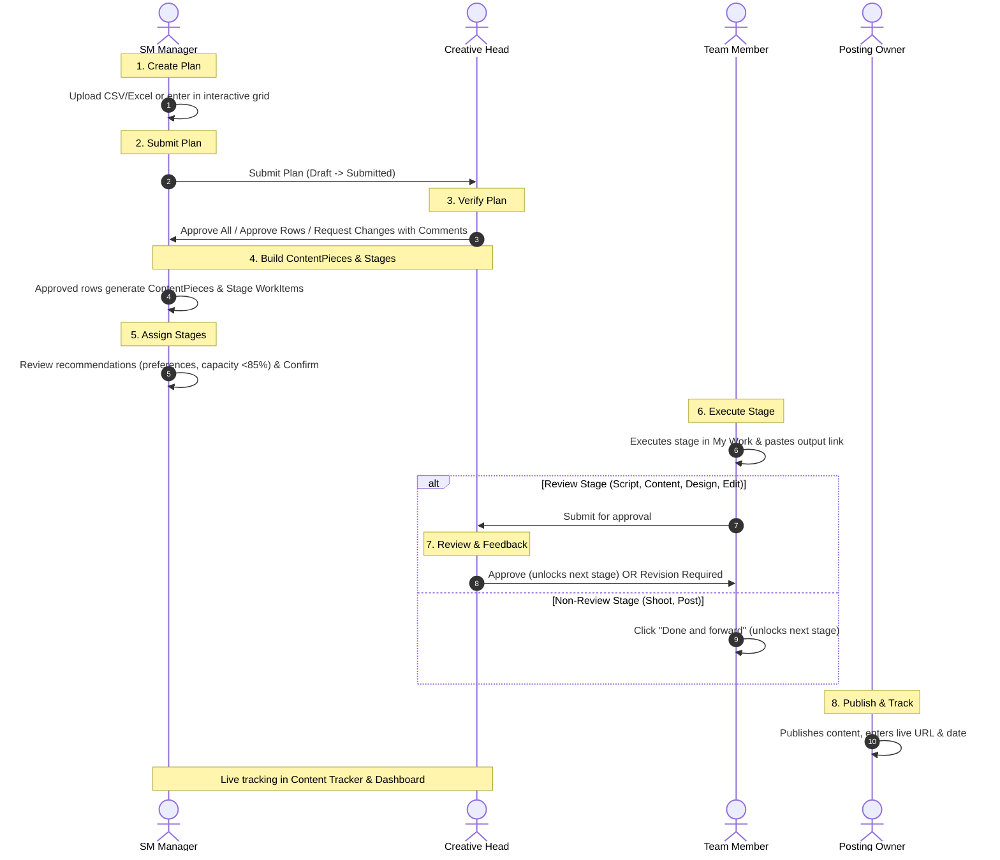

# SM Content Flow Specification: HACA Marketing OS

*Content calendar plans, verification & approvals, stage pipelines, assignments and tracking*  
*Source of Truth: [docs/SCOPE_RESET.md](file:///c:/Users/ADMIN/OneDrive/Desktop/HACA/TECH/docs/SCOPE_RESET.md)*  
*System Boundary: WORK and TEAM only, for HACA only. CV stage (CV Status, Date, Owner) is parked and not included.*

---

## 1. What the Team Does & How the Portal Solves It

The portal replaces legacy spreadsheets (Sheet A: SM CONTENT and Sheet B: Design sheets) with a unified, verified digital workflow:
- **Sheet A (SM CONTENT):** One row per social piece with posting date, topic, format (Poster, Carousel, Reel), owners for script/shoot/edit, approval status, and published link.
- **Sheet B (Design Requirements):** 14 design types (Static Post, Carousel Post, Story, Cover Image, Thumbnail, Meta Ad Creative, Class Announcement, Orientation Creative, Graduation Creative, Brochure, Certificate, Offer Creative, Custom Request, Placement Poster).
- **Problems Removed:**
  - Date format inconsistencies and impossible chronological sequences (published date before posting date).
  - Out-of-order execution (editing started before script/footage is approved).
  - Invisible blockers, overloaded team members, and untracked revision cycles.
  - Multi-brand clutter: operates in **single-brand mode** for **HACA**.

---

## 2. Roles in this Flow

| Role Key | Spec Title | Responsibilities in Content Flow |
|---|---|---|
| **`creative_head`** *(was marketing_head)* | Creative Head | **Approves plans and review stages:** Verifies and approves calendar plans (approve all, approve selected, or request changes with comments); reviews and approves deliverables on review stages (`Script`, `Content`, `Design`, `Edit`); requests revisions with notes; classifies revision root causes; edits team operating fields. **Cannot upload plans or create users.** |
| **`sm_manager`** *(was team_lead)* | SM Manager | **Main operational planner:** Uploads or types calendar plans (Monthly or Project), submits plans to Creative Head, assigns/auto-assigns stage owners based on work preferences, confirms assignments with 1-click or overrides, sets and shifts deadlines, resolves blockers, tracks all stages in Content Tracker. **Cannot approve plans or review stages.** |
| **`team_member`** | Creative Contributor | **Worker:** Sees assigned stages in `/my-work`. Executes work, updates status, pastes deliverable links, submits review stages to Creative Head or clicks Done and forward for non-review stages (`Shoot`, `Post`), replies to feedback, marks Blocked, requests work from SM Manager. Sees only own items. |
| **`executive`** | Executive Leadership | **Read-only viewer:** Total visibility into dashboard, calendar plans, content tracker, workload, and reports. Zero write/mutation permissions (HTTP 403). Contact details masked. |
| **`admin`** | System Owner | **IT / System Admin:** System administration, user management, and access request approvals. Holds all permissions. Excluded from workload and candidate pools. |

*Approver rule:* Approvals belong strictly to the `creative_head` (or `admin`). The SM Manager assigns and orchestrates, but **cannot approve**.

---

## 3. The 8-Step Lifecycle

### Detailed Lifecycle Steps:

### Step 1: Create Calendar Plan
The SM Manager initiates a **Calendar Plan** (kind: `Monthly` or `Project`, title, period).
- **Excel / CSV Upload:** Standard downloadable template with client-side validation preview that checks for missing topics, invalid dates, or unknown content types before commit.
- **Interactive Grid:** Direct tabular entry.
- **Row Schema:** `postingDate` (or final date), `topic`, `contentType`, `needsScript` (boolean), `needsShoot` (boolean, Reel only), `contentLink` (draft link), `remarks`.

### Step 2: Submit Plan
SM Manager reviews the drafted plan and submits it. Status transitions: `Draft` $\rightarrow$ `Submitted`.

### Step 3: Creative Head Verification & Approval
The Creative Head reviews the plan in **Feedback & Revisions $\rightarrow$ Plan Approvals**:
- **Approve All:** Approves all rows in the plan in one click.
- **Approve Selected:** Approves valid rows and flags others.
- **Request Changes:** Leaves line-item comments on specific rows (`Changes requested`). The SM Manager revises and resubmits.

### Step 4: ContentPiece & Stage WorkItems Generation
When rows are approved, the system automatically creates a **ContentPiece** record for each row and constructs its sequential stage **WorkItems** based on the pipeline mappings below. Due dates are counted backward from the final date $F$.

### Step 5: Intelligent Stage Auto-Assignment
For each generated stage, the system suggests an owner based on:
1. `Person.workPreferences[]` matching the stage key (`Content`, `Script`, `Design`, `Shoot`, `Edit`, `Post`).
2. Current workload percentage strictly below **85%**.
3. Available bandwidth before stage deadline.
- **No silent assignment:** Recommendations display with explicit rationale. The SM Manager confirms all with one click or manually overrides. Unassigned stages show `"Needs owner"`.

### Step 6: Worker Stage Execution
Creative contributors see their assigned work in `/my-work`:
- Worker clicks **Start Work** (`In Progress`).
- Worker pastes deliverable link (Zoho Writer, Google Doc, Figma, Drive, or video link).
- **Review Stages:** Worker clicks **Submit for approval**.
- **Non-Review Stages:** Worker clicks **Done and forward**, immediately unlocking the next stage.

### Step 7: Creative Head Review & Revision Guardrails
The Creative Head reviews submitted deliverables:
- **Approved:** Stage is marked Approved; next stage is unlocked (`unlockedAt` timestamp set).
- **Revision Required:** Specific feedback note attached; stage returns to worker (`In Progress`), incrementing the revision count.
- **Revision Flag:** When revisions reach 4 or exceed owner baseline by $>1$, a `RevisionFlag` is raised and classified by the Creative Head.

### Step 8: Publishing & Turnaround Tracking
The posting owner publishes the content, sets status to `Published`, and enters the live URL and date.
- **Turnaround (Days)** is automatically computed ($\text{Published Date} - \text{First Stage Start Date}$).
- Progress is audited live in the **Content Tracker** across all management roles.

---

## 4. Pipeline Definitions

Every piece is a **ContentPiece** that groups its stages. **Each stage is a normal Work Item** with its own owner, deadline, and status.

### 4.1 Design Pipeline (Posters and all design requirements)

| # | Stage | Done by | Reviewed by | Output |
|---|---|---|---|---|
| 1 | **Content** | Content creator (Writer preference) | Creative Head (Content Approval) | Content document link |
| 2 | **Design** | Graphic Designer (Design preference) | Creative Head (Design Approval) | Assets link / uploaded files |
| 3 | **Post** *(only for postable types)* | Posting owner (Post preference) | None (Done and forward) | Published date and live URL |

*Completion rule:* Non-postable design items are **final done** upon Design Approval. Postable items proceed to Post.

### 4.2 Reel Pipeline

Configured when the row is created via two toggles: **Needs script?** and **Needs shoot?**:

| Variant | Conditions | Sequential Stages |
|---|---|---|
| **Variant A** | With script, with shoot | `Script` (reviewed) $\rightarrow$ `Shoot` $\rightarrow$ `Edit` (reviewed) $\rightarrow$ `Post` |
| **Variant B** | No script, with shoot | `Shoot` $\rightarrow$ `Edit` (reviewed) $\rightarrow$ `Post` |
| **Variant C** | No script, no shoot (program-video based) | `Edit` (reviewed) $\rightarrow$ `Post` |

| Stage | Done by | Reviewed by | Output |
|---|---|---|---|
| **Script** | Writer or `workPreferences: Script` | Creative Head (Script Approval) | Script document link |
| **Shoot** | Anyone with `workPreferences: Shoot` | None (Shoot Done) | Footage folder link |
| **Edit** | Video Editor or `workPreferences: Edit` | Creative Head (Edit Approval) | Rendered video link |
| **Post** | Posting owner or `workPreferences: Post` | None (Published) | Published live URL and date |

*Skipped stages:* Unneeded stages are marked `isSkipped: true` ("Not needed") in the tracker and bypassed by deadlines, workload, and alerts.

### 4.3 Type-to-Pipeline Mapping

| Content Type | Pipeline | Has Post Stage? |
|---|---|---|
| **Reel** | Reel (Variant A, B, or C) | Yes |
| **Static Post**, **Carousel Post**, **Story**, **Poster** | Design | Yes |
| **Cover Image**, **Thumbnail** | Design | No (Final done on Design Approval) |
| **Meta Ad Creative** | Design | No (Final done on Design Approval) |
| **Class Announcement**, **Orientation Creative**, **Graduation Creative**, **Offer Creative**, **Brochure**, **Certificate**, **Placement Poster**, **Custom Request** | Design | No (Final done on Design Approval) |

---

## 5. Due-Date Calculation Rules (Counted Back from Final Date $F$)

| Pipeline | Stage Due Dates |
|---|---|
| **Design, postable** | Content $F-6$, Design $F-3$, Post $F$ |
| **Design, not postable** | Content $F-5$, Design $F-2$ (approved by $F$) |
| **Reel Variant A** | Script $F-10$, Shoot $F-7$, Edit $F-4$, Post $F$ |
| **Reel Variant B** | Shoot $F-7$, Edit $F-4$, Post $F$ |
| **Reel Variant C** | Edit $F-4$, Post $F$ |

- **Turnaround Window:** Approvals are expected within 1 working day of submission.
- **One-Click Shift:** If the final posting date changes, the SM Manager can shift all unstarted stage deadlines in one click.

---

## 6. Review vs. Non-Review Stage Rules

- **Review Stages (`Script`, `Content`, `Design`, `Edit`):**
  - Owner clicks **Submit for approval**.
  - Approver: `creative_head` (or `admin`). The SM Manager cannot approve. An owner cannot approve their own stage.
  - Decision: **Approved** (sets `unlockedAt` on next stage) or **Revision Required** (returns to owner, increments revision count).
- **Non-Review Stages (`Shoot`, `Post`):**
  - Owner clicks **Done and forward**, providing deliverable link/date. Unlocks next stage immediately.
- **Locked Stages:** A stage cannot be started until the previous stage is approved or done.

---

## 7. Assignment Engine & Work Preferences

- **Who Assigns:** SM Manager assigns or confirms recommendations. Creative Head approves only.
- **Work Preferences:** Admin or Creative Head assigns preferences in `/people`: `Content`, `Script`, `Design`, `Shoot`, `Edit`, `Post`.
- **Candidate Qualifications:** Has matching stage in `workPreferences`, current workload strictly $<85\%$, and bandwidth before deadline.
- **Ranking:** Lowest `workloadPct`, then lowest `avgRevisions`, then earliest availability.
- **Cross-Department Assignment:** SM Manager can assign across departments (e.g., Writer from Content, Designer from Design, Editor from Video) on any content piece.
- **Assign Now or Later:** Stages can be assigned at plan creation or left open ("Needs owner"), alerting the SM Manager when unlocked.

---

## 8. Content Tracker View

The Content Tracker lives on the **Calendar** screen (`/calendar`):
- **Tabs:** Month View, Calendar Plans (upload & grid), and Content Tracker (table view).
- **Tracker Views:**
  - **Social View:** Tracks social calendar items (Reels, Static Posts, Carousels, Stories) with posting date, topic, stage chips, live link, and turnaround.
  - **Design View:** Tracks collateral and design requirements with deadline, topic, stage chips, and assets link.
- **Stage Chips:** Color-coded status chips (Not Started, In Progress, Feedback, Blocked, Approved, Done, Skipped).
- **Drill-down:** Clicking any row opens Single Work Detail (`/work/:id`) with the visual stage stepper.
