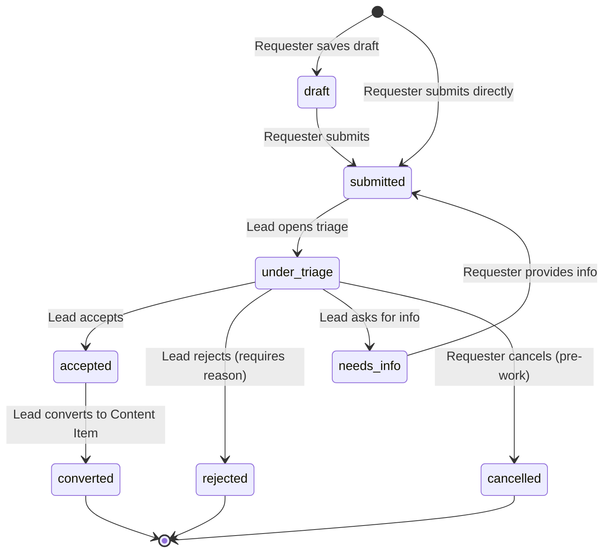
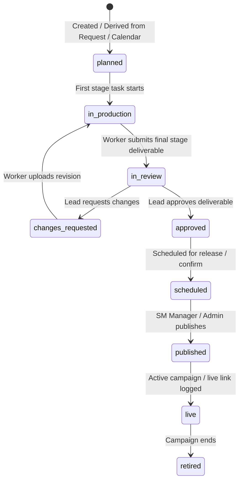
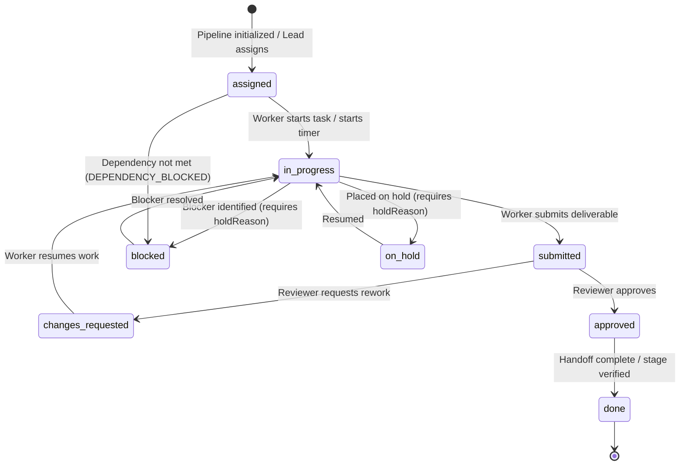
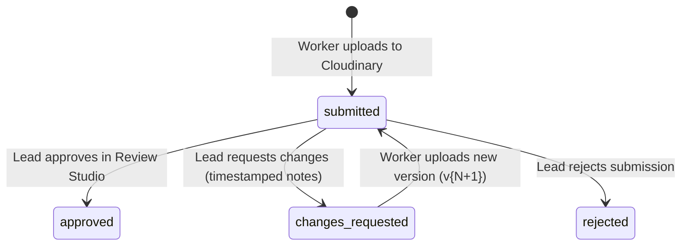
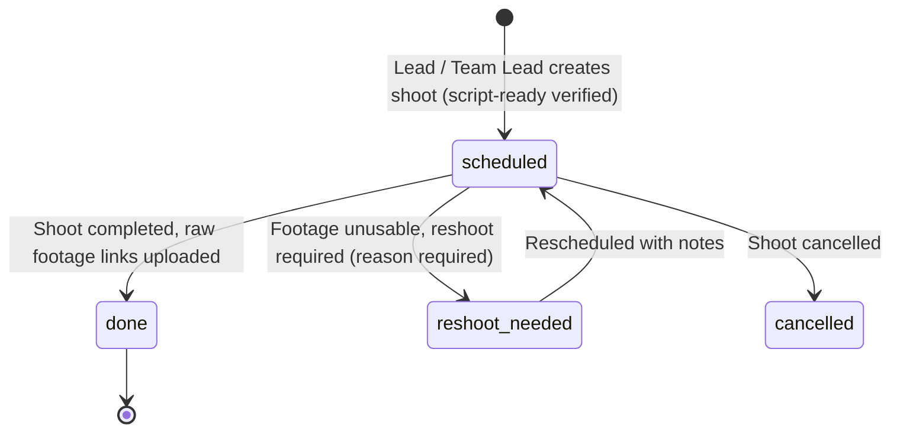

# HACA FORGE: Current Roles, Permissions, and Features Reference Manual

> **Document Purpose**: This document provides an exhaustive, field-level reference of all currently implemented user roles, access control permissions, data models, workflows, and functional features within **HACA FORGE** (Marketing Operations & Workflow Engine). Use this document as the single source of truth when referring to existing functionality, modifying permissions, adding new roles, or expanding features.
>
> **Current Version**: 1.0 (Phase 0 through Phase 9 Complete)  
> **Tech Stack**: React 18, Vite, TypeScript, TailwindCSS (Frosted Glassmorphism UI), Express 5, Node 22 LTS, MongoDB / Mongoose, Socket.io, BullMQ / Redis, Pino, Zod, Cloudinary.

---

## Table of Contents
1. [System Architecture Overview](#1-system-architecture-overview)
2. [Roles Taxonomy & User Profiles](#2-roles-taxonomy--user-profiles)
3. [RBAC Permission Matrix (CASL Engine)](#3-rbac-permission-matrix-casl-engine)
4. [Organizational Taxonomy (Teams & Departments)](#4-organizational-taxonomy-teams--departments)
5. [State Machines & Lifecycle Workflows](#5-state-machines--lifecycle-workflows)
6. [Detailed Feature Modules](#6-detailed-feature-modules)
   - [6.1 Authentication, Access Requests & Onboarding](#61-authentication-access-requests--onboarding)
   - [6.2 Staff & User Administration](#62-staff--user-administration)
   - [6.3 Master Data, Settings & Audit Trail](#63-master-data-settings--audit-trail)
   - [6.4 Requester Intake & Dynamic Forms Engine](#64-requester-intake--dynamic-forms-engine)
   - [6.5 Marketing Lead Triage & Scoping Engine](#65-marketing-lead-triage--scoping-engine)
   - [6.6 Content Hub, Pipelines & Automated Task Derivation](#66-content-hub-pipelines--automated-task-derivation)
   - [6.7 Multi-Channel Content Calendar & Publishing](#67-multi-channel-content-calendar--publishing)
   - [6.8 Shoot Planner & Video Production Engine](#68-shoot-planner--video-production-engine)
   - [6.9 Team Operations, Workload & Handoff Queues](#69-team-operations-workload--handoff-queues)
   - [6.10 Attendance, Leaves & Capacity Discounting](#610-attendance-leaves--capacity-discounting)
   - [6.11 Time Tracking, Active Timers & Timesheets](#611-time-tracking-active-timers--timesheets)
   - [6.12 Review Studio, Video Player & Proofing](#612-review-studio-video-player--proofing)
   - [6.13 Digital Asset Management (DAM) & Performance Ads](#613-digital-asset-management-dam--performance-ads)
   - [6.14 Domain Event Bus, Notifications & Background Jobs](#614-domain-event-bus-notifications--background-jobs)
   - [6.15 Reports & Analytics Engine](#615-reports--analytics-engine)
7. [Frontend Navigation & Route Mapping](#7-frontend-navigation--route-mapping)
8. [API Route Catalog](#8-api-route-catalog)
9. [Developer Extension Guide (How to Add/Modify)](#9-developer-extension-guide-how-to-addmodify)

---

## 1. System Architecture Overview

HACA FORGE is structured as an npm workspaces monorepo:

```
haca-forge/
├── apps/
│   ├── api/                   # Express 5 REST API + Socket.io Server + Background Worker
│   │   ├── src/
│   │   │   ├── config/        # Environment Zod validation, DB connection, Sentry
│   │   │   ├── lib/           # Event bus, logger, mailer, queue setup
│   │   │   ├── middleware/    # Auth, CASL permissions, rate-limit, sanitize, errors
│   │   │   ├── modules/       # Domain modules (auth, users, requests, content, tasks, etc.)
│   │   │   ├── worker.js      # BullMQ background job worker
│   │   │   └── server.js      # HTTP & Socket.io server entry
│   └── web/                   # Vite + React 18 + TypeScript SPA
│       ├── src/
│       │   ├── components/    # Reusable glassmorphic UI components, modals, layout
│       │   ├── context/       # AuthContext, SocketContext
│       │   ├── hooks/         # useSocket, custom queries
│       │   ├── pages/         # Role dashboards, admin, lead, worker, requester, etc.
│       │   └── index.css      # Obsidian frosted glassmorphism design tokens (#7a6af6 glow)
└── packages/
    └── shared/                # Common TypeScript package (@mmp/shared)
        └── src/               # Role keys, permission matrix, status enums, Zod schemas
```

---

## 2. Roles Taxonomy & User Profiles

The system defines **8 canonical user roles** (`ROLE_KEYS` in `@mmp/shared`):

```typescript
export const ROLE_KEYS = [
  'admin',
  'lead',
  'team_lead',
  'worker',
  'sm_manager',
  'dept_lead',
  'dept_staff',
  'viewer',
] as const;
```

Below is the detailed profile for each role:

### 2.1 Admin (`admin`)
* **Persona**: System Administrator, Head of IT / Operations, Executive Marketing Director.
* **Core Purpose**: Complete governance across the entire portal. Manages users, grants roles, approves access requests, configures system taxonomies and SLA policies, inspects security audit logs, views all executive analytics, and overrides any task or approval block in emergencies.
* **Default Landing Route**: `/admin` (Pipelines Dashboard)
* **Accessible Menu Navigation**:
  * Pipelines Dashboard (`/admin`)
  * Creative Studio: Content Hub (`/lead/content`), Content Calendar (`/calendar`), Shoot Planner (`/shoots`), Review Studio (`/lead/reviews`), Asset Library (`/library`)
  * Operations: Team Operations (`/teams`), Timesheets (`/timesheets`), Performance Ads (`/performance`), Triage Inbox (`/lead/inbox`), Requests Portal (`/requester`)
  * Administration: Staff & Roles (`/admin/users`), Teams & Depts (`/admin/teams-departments`), Access Requests (`/admin/access-requests`), Master Data (`/admin/master-data`), System Settings (`/admin/settings`), Audit Trail (`/admin/audit-log`), Reports & Analytics (`/reports`)
* **Key Capabilities**:
  * Approve, reject, or request information on pending user access requests.
  * Create, edit, suspend, reactivate, change roles, force logout, and reset passwords for any user.
  * Configure organization structure: create departments, assign department leads, configure production teams, define default capacities.
  * Manage master data catalogs: Platforms, Priorities (with SLA hours), Hold Reasons, Content Formats (with lead time days), Dynamic Request Types.
  * Adjust system settings: Worker efficiency calculation weights, privacy toggles (requesters viewing worker names), mandatory hold reason rules.
  * View complete system audit trail with before/after state diffs and IP addresses.
  * Emergency status override: reassign any task, override script-ready warnings on shoots, approve deliverables directly.
* **Strict Restrictions**:
  * Cannot bypass immutable audit log creation (all admin actions are permanently recorded).
  * Normal review workflow should be performed by Leads; Admin overrides are visibly tagged.

---

### 2.2 Marketing Manager / Lead (`lead`)
* **Persona**: Head of Marketing Operations, Creative Director, Marketing Project Manager.
* **Core Purpose**: Triages incoming marketing requests from all company departments, converts requests into content deliverables and production pipelines, schedules campaigns, balances production team workload, oversees shoots, reviews deliverables in the proofing studio, approves worker timesheets and leave requests.
* **Default Landing Route**: `/lead` (Pipelines Dashboard)
* **Accessible Menu Navigation**:
  * Pipelines Dashboard (`/lead`)
  * Creative Studio: Content Hub (`/lead/content`), Content Calendar (`/calendar`), Shoot Planner (`/shoots`), Review Studio (`/lead/reviews`), Asset Library (`/library`)
  * Operations: Team Operations (`/teams`), Timesheets (`/timesheets`), Performance Ads (`/performance`), Triage Inbox (`/lead/inbox`), Requests Portal (`/requester`)
  * Analytics: Reports & Analytics (`/reports`)
* **Key Capabilities**:
  * **Triage Inbox**: Review new department requests; Accept, Reject (with required reason), Ask for Info, or Merge duplicate requests.
  * **Request Conversion**: Convert accepted requests into structured Content Items (`CNT-YYYY-NNNN`) with automated pipeline generation.
  * **Content Hub**: Create, edit, reschedule, or cancel content items. Switch between Kanban board and TanStack Data Table views.
  * **Task Assignment**: Reassign tasks across team members with real-time overload (>100%) and leave warning detection.
  * **Review Studio**: Video player with frame-accurate scrubbing, timestamped comments (`[00:42]`), side-by-side revision comparisons (e.g., v1 vs v2), and review decisions (`approved`, `changes_requested`, `rejected`).
  * **Team Operations**: View all 4 production teams, inspect member utilization and skills, manage leave approvals, review and approve weekly timesheets.
  * **Shoot Planning**: Create, schedule, and assign crew/gear to shoots; mark shoots done and release raw footage; request reshoots.
  * **Reporting**: Access all 6 report tabs across all teams and departments, export Excel/CSV spreadsheets, schedule recurring reports.
* **Strict Restrictions**:
  * Cannot approve access requests or onboard new users.
  * Cannot alter master data schemas, SLA definitions, or system settings.
  * Cannot view system audit logs or server configurations.

---

### 2.3 Production Team Lead (`team_lead`)
* **Persona**: Lead Copywriter, Lead Designer / Art Director, Lead Cinematographer, Lead Video Editor.
* **Core Purpose**: Directly manages one of the 4 production teams (`content`, `graphics`, `cinematography`, `editor`). Oversees their team's specific queue, rebalances tasks among team members, approves team leave requests, validates team timesheets, and resolves blockers.
* **Default Landing Route**: `/teams`
* **Accessible Menu Navigation**:
  * Operations: Team Operations (`/teams`), Timesheets (`/timesheets`)
  * Creative Studio: Shoot Planner (`/shoots`), Asset Library (`/library`)
  * Reports: Reports & Analytics (`/reports` - strictly scoped to own team)
* **Key Capabilities**:
  * View assigned team dashboard: active members, skills matrix, weekly capacity, today's active workload, and backlog counts.
  * Reassign tasks within their assigned production team.
  * Approve or reject leave requests submitted by members of their team.
  * Review and approve weekly timesheet submissions for their team members.
  * Monitor their team's incoming handoff queue (e.g. Editor leads monitor "Footage Ready"; Graphics leads monitor "Copy Ready").
  * Schedule shoots and manage equipment/crew rosters (especially Cinematography Team Lead).
  * View Team Velocity and individual scorecards for their own team members.
* **Strict Restrictions**:
  * Strictly scoped to their own assigned production team (`/api/teams/:teamId/dashboard`); cannot manage other production teams.
  * Cannot triage department requests or approve final deliverables for release.
  * Cannot modify user accounts or master data.

---

### 2.4 Creative Worker (`worker`)
* **Persona**: Copywriter, Graphic Designer, Cinematographer / Camera Operator, Video Editor, Motion Graphic Artist.
* **Core Purpose**: Executes assigned creative tasks. Uses live timers or logs manual time, advances task statuses, flags blockers with mandatory hold reasons, uploads versioned deliverables directly to Cloudinary, reviews timestamped feedback, and manages attendance/leaves.
* **Default Landing Route**: `/worker`
* **Accessible Menu Navigation**:
  * Pipelines: Worker Dashboard (`/worker`)
  * Operations: Timesheets (`/timesheets`)
  * Creative Studio: Shoot Planner (`/shoots` - crew assignments and call sheets), Asset Library (`/library`)
  * Notifications: Notifications Center (`/notifications`)
* **Key Capabilities**:
  * **Worker Workspace**: Personal task board (Assigned, In Progress, Submitted, Changes Requested, Done).
  * **Task Execution**: View briefs, download reference files, mark checklist items, post task comments with @mentions.
  * **Status Transitions**: Move tasks from `assigned` → `in_progress` → `submitted`.
  * **Blocker Governance**: Transition tasks to `blocked` or `on_hold` by providing a mandatory `holdReason` code and explanation note.
  * **Live Time Tracking**: Start and stop the real-time task timer (single active timer enforced), or log manual hours against tasks.
  * **Direct Deliverable Upload**: Drag-and-drop deliverables up to 500 MB (direct signed streaming to Cloudinary), attach external links (Figma, Canva, Frame.io), auto-generate version numbers (`v1`, `v2`, ...).
  * **Attendance**: Toggle daily attendance status (`present` vs `on_leave`) and submit formal planned leave requests.
  * **Personal Scorecard**: View individual efficiency score (out of 100) based on on-time delivery, first-pass approval, speed, and volume.
* **Strict Restrictions**:
  * Cannot reassign tasks to others.
  * Cannot create projects or content items.
  * Cannot review or approve deliverables.
  * Cannot view other workers' performance scorecards or confidential team reports.
  * Cannot access admin or triage pages.

---

### 2.5 Social Media Manager (`sm_manager`)
* **Persona**: Social Media Lead, Community Manager, Distribution Specialist.
* **Core Purpose**: Coordinates multi-channel social distribution. Plans monthly campaigns in the Content Calendar, bulk imports social calendars from Excel/CSV, identifies post clashes, triggers automated pipeline creation, and executes live publishing with performance metrics tracking.
* **Default Landing Route**: `/calendar`
* **Accessible Menu Navigation**:
  * Creative Studio: Content Calendar (`/calendar`), Asset Library (`/library`)
  * Operations: Social Media Operations Dashboard (`/sm/dashboard`), Requests Portal (`/requester`)
  * Analytics: Reports & Analytics (`/reports`)
* **Key Capabilities**:
  * **Content Calendar**: Interactive Month Grid, Week View, and Agenda List views. Create, edit, and reschedule social posts.
  * **Clash Detection**: Real-time detection alerting when scheduled posts on the same platform exceed daily limits (default: 3).
  * **Bulk Import Engine**: Download branded Excel/CSV template (`/api/calendar/template`), preview uploads with row validation, and commit valid entries.
  * **Pipeline Generation**: One-click convert approved calendar entries into active production pipelines (`CNT-YYYY-NNNN` + discrete tasks).
  * **Ready-to-Publish Queue**: View approved content deliverables ready for live distribution.
  * **Publish Content**: Execute live publishing workflow, record live published URL, and capture initial reach, views, likes, comments, and shares.
  * **Submit Department Requests**: Raise requests on behalf of the Social Media department.
* **Strict Restrictions**:
  * Cannot manage user accounts, roles, or master data schemas.
  * Cannot reassign creative workers or approve production timesheets.

---

### 2.6 Department Lead (`dept_lead`)
* **Persona**: Head of Sales, Dean / Head of Academics, Performance Marketing Lead, Corporate Communications Lead.
* **Core Purpose**: Represents an external business department. Submits marketing requests using dynamic intake forms, monitors all requests originating from their department, collaborates with the Marketing Lead on clarifications, and performs final sign-off on delivered creative assets.
* **Default Landing Route**: `/requester`
* **Accessible Menu Navigation**:
  * Operations: Requests Portal (`/requester`), Performance Ads (`/performance` - if Performance Marketing Lead)
  * Creative Studio: Asset Library (`/library`)
  * Analytics: Reports & Analytics (`/reports` - strictly scoped to own department)
* **Key Capabilities**:
  * Submit new marketing requests using dynamic, schema-driven forms with attachments and recurring options.
  * View **ALL** requests created across their entire department.
  * Real-time duplicate detection alerts when creating requests with similar titles, formats, or deadlines.
  * Interactive slide-over tracking drawer: inspect progress timeline, participate in comment threads with Marketing Leads.
  * Resubmit requests with explanatory notes if marked `needs_info` or `rejected`.
  * **Final Stakeholder Sign-Off**: Inspect delivered final assets; perform one-click "Confirm & Schedule" or "Request Adjustments" with feedback.
  * View department-level consumption reports: request turnaround time, format breakdown, and production hours consumed.
* **Strict Restrictions**:
  * Scoped strictly to their own department's data; cannot view other departments' requests.
  * Cannot view internal creative tasks, subtasks, worker names (if privacy toggle enabled), or worker timesheets.

---

### 2.7 Department Staff (`dept_staff`)
* **Persona**: Sales Executive, Academic Coordinator, Social Media Executive, Event Coordinator.
* **Core Purpose**: Individual requester within a department. Submits specific marketing requests, tracks their own submissions, provides requested information, and confirms final deliverables.
* **Default Landing Route**: `/requester`
* **Accessible Menu Navigation**:
  * Operations: Requests Portal (`/requester`)
  * Creative Studio: Asset Library (`/library`)
* **Key Capabilities**:
  * Submit marketing requests via dynamic schema forms.
  * View and track **ONLY** their own submitted requests (`createdBy === user.id`).
  * Cancel draft or pending requests before triage begins.
  * Reply to questions or clarification requests from the Marketing Lead.
  * Preview final deliverables and submit confirmation or change requests.
* **Strict Restrictions**:
  * Cannot see requests submitted by other staff members (even within the same department).
  * Cannot access any internal production boards, schedules, or management reports.

---

### 2.8 Viewer / Executive (`viewer`)
* **Persona**: Chief Executive Officer (CEO), Chief Marketing Officer (CMO), Board Member, External Auditor.
* **Core Purpose**: High-level executive oversight. Purely read-only access to organizational reports, performance dashboards, SLA breach summaries, and production scorecards.
* **Default Landing Route**: `/reports`
* **Accessible Menu Navigation**:
  * Analytics: Reports & Analytics (`/reports`)
  * Creative Studio: Asset Library (`/library` - read-only)
* **Key Capabilities**:
  * Access all 6 report tabs: Management Scorecard, Department Usage, Team Velocity, Bottlenecks & Holds, Content Pipeline, Worker Performance.
  * Filter reports across custom date ranges, departments, teams, and formats.
  * Stream Excel (`.xlsx`) and CSV (`.csv`) export reports.
  * Configure scheduled automated recurring email reports.
* **Strict Restrictions**:
  * Purely read-only. Cannot create, edit, reassign, approve, or transition any entity.

---

## 3. RBAC Permission Matrix (CASL Engine)

The system enforces permissions at both the API layer (via Express middleware `requirePermission(key)`) and the frontend layer (via `ProtectedRoute` and `hasPermission(key)` in `AuthContext`).

### 3.1 Canonical Permission Keys (`PERMISSION_KEYS`)

| Key | Description |
|---|---|
| `user.approve` | Review, approve, or reject new user access requests |
| `user.manage` | Create, edit, suspend, reactivate, or delete user accounts |
| `settings.manage` | Update system settings, master data schemas, teams, and departments |
| `audit.view` | View security audit logs and system diffs |
| `request.create` | Submit new marketing intake requests |
| `request.view.department` | View all marketing requests across the user's department |
| `request.triage` | Accept, reject, ask info, or merge incoming triage requests |
| `calendar.manage` | Create, edit, reschedule, and delete content calendar entries |
| `calendar.import` | Bulk import calendar entries via Excel / CSV |
| `content.create` | Create content items and initialize production pipelines |
| `content.update` | Update content item metadata, briefs, dates, and stage flows |
| `content.publish` | Execute live publishing and log live URLs and post analytics |
| `task.assign` | Assign or reassign tasks across creative team members |
| `task.update.own` | Update progress, checklists, and status on assigned tasks |
| `task.upload` | Upload deliverables and media files to tasks |
| `review.approve` | Perform formal lead review and approve/reject deliverables |
| `request.confirm` | Provide final stakeholder confirmation on completed deliverables |
| `shoot.manage` | Schedule shoots, assign crew/equipment, and submit footage |
| `time.log` | Start/stop timer or log manual time entries against tasks |
| `timesheet.approve` | Review and approve weekly timesheets for team members |
| `report.view` | Access analytics dashboards, scorecards, and reports |

---

### 3.2 Role-to-Permission Mapping Matrix

| Permission Key | `admin` | `lead` | `team_lead` | `worker` | `sm_manager` | `dept_lead` | `dept_staff` | `viewer` |
|---|:---:|:---:|:---:|:---:|:---:|:---:|:---:|:---:|
| `user.approve` | ✅ | ❌ | ❌ | ❌ | ❌ | ❌ | ❌ | ❌ |
| `user.manage` | ✅ | ❌ | ❌ | ❌ | ❌ | ❌ | ❌ | ❌ |
| `settings.manage` | ✅ | ❌ | ❌ | ❌ | ❌ | ❌ | ❌ | ❌ |
| `audit.view` | ✅ | ❌ | ❌ | ❌ | ❌ | ❌ | ❌ | ❌ |
| `request.create` | ✅ | ✅ | ❌ | ❌ | ✅ | ✅ | ✅ | ❌ |
| `request.view.department` | ✅ | ✅ | ❌ | ❌ | ✅ | ✅ | ❌ | ❌ |
| `request.triage` | ✅ | ✅ | ❌ | ❌ | ❌ | ❌ | ❌ | ❌ |
| `calendar.manage` | ✅ | ✅ | ❌ | ❌ | ✅ | ❌ | ❌ | ❌ |
| `calendar.import` | ✅ | ✅ | ❌ | ❌ | ✅ | ❌ | ❌ | ❌ |
| `content.create` | ✅ | ✅ | ✅ | ❌ | ✅ | ❌ | ❌ | ❌ |
| `content.update` | ✅ | ✅ | ✅ | ❌ | ✅ | ❌ | ❌ | ❌ |
| `content.publish` | ✅ | ❌ | ❌ | ❌ | ✅ | ❌ | ❌ | ❌ |
| `task.assign` | ✅ | ✅ | ✅ | ❌ | ❌ | ❌ | ❌ | ❌ |
| `task.update.own` | ✅ | ✅ | ✅ | ✅ | ❌ | ❌ | ❌ | ❌ |
| `task.upload` | ✅ | ✅ | ✅ | ✅ | ❌ | ❌ | ❌ | ❌ |
| `review.approve` | ✅ | ✅ | ❌ | ❌ | ❌ | ❌ | ❌ | ❌ |
| `request.confirm` | ✅ | ❌ | ❌ | ❌ | ✅ | ✅ | ✅ | ❌ |
| `shoot.manage` | ✅ | ✅ | ✅ | ✅ | ❌ | ❌ | ❌ | ❌ |
| `time.log` | ✅ | ✅ | ✅ | ✅ | ❌ | ❌ | ❌ | ❌ |
| `timesheet.approve` | ✅ | ✅ | ✅ | ❌ | ❌ | ❌ | ❌ | ❌ |
| `report.view` | ✅ | ✅ | ✅ | ✅ | ✅ | ✅ | ✅ | ✅ |

---

## 4. Organizational Taxonomy (Teams & Departments)

### 4.1 Production Teams (`TEAM_KEYS`)
Production delivery is organized into **4 specialized creative teams**:

| Team Key | Display Name | Primary Deliverables | Typical Stage Order |
|---|---|---|:---:|
| `content` | Content & Copywriting | Concept briefs, scripts, article copy, captions, hashtags | Stage 1 |
| `graphics` | Visual & Graphic Design | Posters, carousels, thumbnails, infographics, banners | Stage 2 (or parallel) |
| `cinematography` | Video Production & Shoots | Call sheets, filming, lighting, audio capture, raw footage | Stage 2 / 3 |
| `editor` | Post-Production & Editing | Video editing, color grading, sound mixing, motion graphics | Stage 3 / 4 |

**Team Capacity Mechanics**:
* Each worker has a configured `weeklyCapacity` (default: 40 hours/week).
* The team total capacity is dynamically rolled up as the sum of its active members' capacities.
* If a worker is on approved leave (`onLeave === true`), their capacity is automatically discounted during that evaluation window.

---

### 4.2 Department Types (`DEPARTMENT_TYPES`)
Requesters originate from **5 organizational department categories**:

| Category Key | Label | Example Use Cases |
|---|---|---|
| `social_media` | Social Media & Channels | Daily social posts, brand reels, audience engagement campaigns |
| `performance` | Performance & Paid Marketing | Conversion ad creatives, Meta/Google/TikTok ad variants, lead gen assets |
| `sales` | Sales & Business Enablement | Sales one-pagers, presentation pitch decks, event brochures |
| `academics` | Academics & Curriculum | Educational explainers, course promotional creatives, lecture clips |
| `other` | General / Corporate / HR | Internal announcements, recruitment flyers, leadership communications |

---

## 5. State Machines & Lifecycle Workflows

### 5.1 Request Intake State Machine
Sequential ID: `MKT-YYYY-NNNN`



---

### 5.2 Content Item State Machine
Sequential ID: `CNT-YYYY-NNNN`



---

### 5.3 Task State Machine
Sequential ID: `TSK-YYYY-NNNN`



**Standard Hold Reason Codes (`HOLD_REASON_CODES`)**:
1. `waiting_for_content`: Blocked waiting on copy, script, or asset from upstream team.
2. `approval_delay`: Blocked waiting on client or stakeholder sign-off.
3. `resource_shortage`: Team member absent or capacity saturated.
4. `client_feedback`: Waiting on external stakeholder clarification.
5. `equipment`: Filming gear, audio equipment, or software unavailable.
6. `weather`: Unfavorable outdoor weather preventing shoot.
7. `other`: Uncategorized blocker (requires detailed comment).

---

### 5.4 Deliverable Review State Machine
Semantic Versioning: `v1`, `v2`, `v3`...



---

### 5.5 Shoot Production State Machine
Sequential ID: `SHT-YYYY-NNNN`



---

## 6. Detailed Feature Modules

### 6.1 Authentication, Access Requests & Onboarding
* **Unified Login (`/login`)**: Single login page for all 8 roles. Authenticates against bcrypt-hashed passwords; sets secure httpOnly `accessToken` and `refreshToken` cookies.
* **Public Request Access Flow**:
  * Prospective users submit: Name, Work Email, Phone, Department, Requested Role, Skills, and Reason.
  * System rate-limits requests and blocks duplicate emails with pending requests.
  * Stored in `AccessRequest` collection with status `pending`.
* **Admin Review & 48-Hour Invite**:
  * Admin reviews request in `/admin/access-requests`.
  * Actions: **Approve** (can adjust role, assign production team, set capacity, add skills), **Reject** (with reason), or **Ask for Info**.
  * On approval, system creates inactive `User` account and dispatches an HTML email with a secure, single-use, 48-hour set-password token (`/set-password?token=...`).
* **Set Password (`/set-password`)**: User creates a strong password (minimum 8 characters, at least 1 uppercase letter, at least 1 number). Activates the account and redirects to the role dashboard.

---

### 6.2 Staff & User Administration
* **Staff Management Hub (`/admin/users`)**:
  * Search, filter by role, department, team, and status (`active` vs `suspended`).
  * Modal editor: adjust role, department assignment, production team, weekly capacity (10–80 hours), and interactive skills tag selection.
  * Administrative actions: Suspend/reactivate account, force logout (invalidating refresh token family), reset password.

---

### 6.3 Master Data, Settings & Audit Trail
* **Teams & Departments (`/admin/teams-departments`)**:
  * Create and edit departments with assigned department leads.
  * Configure 4 production teams with assigned team leads and aggregate capacity rollups.
* **Master Data Catalog (`/admin/master-data`)**:
  * **Platforms**: Active distribution channels (YouTube, Instagram, Facebook, LinkedIn, TikTok, etc.).
  * **Priorities**: Levels 1–5 with custom color hexes and strict SLA response deadlines (urgent: 24h, high: 48h, medium: 72h, low: 120h).
  * **Hold Reasons**: Standardized blocker codes required whenever tasks enter `blocked` or `on_hold`.
  * **Content Formats**: Deliverable templates (static post, carousel, story, reel, ad creative, brochure, academic creative) with standard lead time days.
  * **Dynamic Request Types**: Custom schema builder supporting 8 input types (`text`, `textarea`, `number`, `select`, `multiselect`, `date`, `checkbox`, `url`). Includes live interactive form preview.
* **System Settings (`/admin/settings`)**:
  * Interactive sliders for Worker Efficiency Score weights (sum validated to 1.0):
    * On-Time Rate: default 40% (0.40)
    * First-Pass Approval: default 30% (0.30)
    * Speed vs. Estimate: default 20% (0.20)
    * Volume / Capacity Utilization: default 10% (0.10)
  * Privacy Toggle: `requestersCanSeeWorkerNames` (when false, hides creative worker identities from external department requesters).
  * Mandatory Hold Reason Policy: enforce strict reason codes on hold/block status changes.
* **Audit Trail (`/admin/audit-log`)**: Filterable, paginated audit log tracking: Actor, Action, Target Entity, Entity ID, Client IP, and JSON modal viewer displaying before-and-after state diffs.

---

### 6.4 Requester Intake & Dynamic Forms Engine
* **Requester Portal (`/requester`)**: KPI summary cards (Drafts, Active Triage, Accepted, Needs Info, Completed).
* **Intelligent Duplicate Detection**:
  * Real-time listener on the intake form evaluates matching department, deliverable format, deadline proximity (±3 days), and title string similarity.
  * Displays visual warning banner showing conflicting open requests to prevent duplicate submissions.
* **Dynamic Form Submission**: Renders custom department fields using `DynamicFormRenderer` based on the chosen `RequestType`.
* **Recurring Requests**: Option to configure automated recurring schedules (`weekly` or `monthly`).
* **Slide-over Tracking Drawer**:
  * Real-time status progress timeline (`MKT-YYYY-NNNN`).
  * Polymorphic comment thread for communicating with the Marketing Lead.
  * Resubmit workflow: if marked `needs_info` or `rejected`, requester can edit fields and resubmit with an explanatory note.

---

### 6.5 Marketing Lead Triage & Scoping Engine
* **Triage Inbox (`/lead/inbox`)**:
  * Incoming queue with search, urgency badges, department indicators, and deadline countdowns.
  * **Live Capacity Indicators**: Preview bars displaying available weekly bandwidth for each of the 4 production teams to inform acceptance feasibility.
* **Triage Decisions**:
  * **Accept**: Set confirmed priority, deadline, and optional notes. Transitions request to `accepted`.
  * **Reject**: Requires categorized rejection reason. Transitions request to `rejected` and alerts requester.
  * **Ask Info**: Sends clarifying question to requester. Transitions request to `needs_info`.
  * **Merge**: Merges duplicate request into an existing parent request.
* **Conversion to Production Pipeline**:
  * Action: "Convert to Content Item".
  * Transitions request to `converted` and atomically generates `ContentItem` (`CNT-YYYY-NNNN`) with full automated task pipeline.

---

### 6.6 Content Hub, Pipelines & Automated Task Derivation
* **Content Hub (`/lead/content`)**: Toggleable view between TanStack Data Table and multi-column Kanban board. Slide-over drawer with interactive pipeline stepper.
* **7 Deliverable Pipeline Templates**:
  * `static_post`: Content (Copy) → Graphics (Visual Design)
  * `carousel`: Content (Slide Copy) → Graphics (Multi-slide Design)
  * `story`: Content (Concept) → Graphics (Vertical Creative)
  * `reel`: Content (Script) → Cinematography (Shoot) → Editor (Cut & Sound)
  * `ad_creative`: Content (Ad Copy) → Graphics / Cinematography → Editor
  * `brochure`: Content (Long-form Copy) → Graphics (Layout & Typography)
  * `academic_creative`: Content (Curriculum Brief) → Graphics / Editor
* **Automated Task Allocation Engine (`initializeContentPipeline`)**:
  * Spawns discrete `Task` records (`TSK-YYYY-NNNN`) with stage sequence numbers, estimate hours, and prerequisite dependencies.
  * Intelligently assigns tasks to the least loaded active worker on the designated team, automatically excluding any worker currently marked as `onLeave: true`.
* **Sequential Dependency Enforcement**:
  * A worker cannot begin a task whose prerequisite stage task is not `done` or `approved`. Attempting to transition returns error code `DEPENDENCY_BLOCKED`.
  * Marking a stage task as `done` or `approved` automatically advances the pipeline, unblocks downstream tasks, and dispatches real-time notifications.

---

### 6.7 Multi-Channel Content Calendar & Publishing
* **Calendar Engine (`/calendar`)**: Interactive Month Grid, Week View, and Agenda List views. Supports multi-platform tags (Instagram, YouTube, LinkedIn, Facebook, TikTok).
* **Platform Clash Detection**: Evaluates scheduled posts per platform per day. If scheduled posts exceed the threshold (default: 3), renders a high-visibility `CLASH` warning tag.
* **Bulk Import Engine (`/api/calendar/import`)**:
  * Branded Excel/CSV template download (`/api/calendar/template`).
  * Drag-and-drop file upload with pre-commit preview table highlighting row errors (invalid dates, unrecognized platforms, missing themes) without modifying the database.
  * Batch commit action for validated rows.
* **Calendar-to-Pipeline Generator (`/api/calendar/generate-content`)**: Idempotently converts approved calendar entries into production `ContentItem` records with derived production deadlines (`date - leadTimeDays`).
* **Social Media Operations Hub (`/sm/dashboard`)**:
  * Ready-to-Publish queue for approved content deliverables.
  * Publish modal: records live published URL, publish timestamp, and initial analytics (`reach`, `views`, `likes`, `shares`, `comments`).
  * Restricted to `sm_manager` and `admin` roles.

---

### 6.8 Shoot Planner & Video Production Engine
* **Shoot Lifecycle (`/shoots`)**:
  * Sequential ID: `SHT-YYYY-NNNN`.
  * Tracks: Shoot title, date, location, crew roster, equipment checklist, talent notes, linked video deliverables, raw footage links, and shoot status.
* **Script-Ready Validation Guard**:
  * Validates that all linked deliverables are video formats (`reel`, `story`, `ad_creative`).
  * Validates that the Content/Script stage task for every linked deliverable is marked `done` or `approved`.
  * If unready, rejects scheduling with error code `SCRIPT_NOT_READY` unless an explicit `overrideWarning` flag is provided by a Lead or Admin.
* **Footage Release & Downstream Unblocking**:
  * Marking a shoot as `done` sets shoot status to `done`, marks the Cinematography task completed, attaches raw footage links, and atomically unblocks/assigns the downstream Editor stage tasks.
* **Reshoot Flow**: Marking `reshoot_needed` requires a mandatory reason, logs a transition record, and routes tasks back to the Cinematography team.

---

### 6.9 Team Operations, Workload & Handoff Queues
* **Team Operations Command Center (`/teams`)**:
  * Role scoping: Team Leads view only their assigned team; Leads and Admins can switch between all 4 production teams.
  * Member capacity meters, overload badges (>100% capacity), and cross-tabulated skills matrix.
* **4 Stage Handoff Queues**:
  1. **Editor**: "Footage ready" (shoots marked done with footage links released).
  2. **Graphics**: "Copy ready" (content stage completed, ready for visual layout).
  3. **Cinematography**: "Script ready" (content approved, ready for shoot scheduling).
  4. **Lead**: "Waiting for review" (worker deliverables awaiting formal sign-off).
* **Interactive Task Reassignment**: Allows Leads to reassign tasks between team members, returning granular warning payloads if the target worker is overloaded (>100% capacity) or currently on leave.

---

### 6.10 Attendance, Leaves & Capacity Discounting
* **Leave Requests (`/api/leave`)**:
  * Date ranges, leave types (`vacation`, `sick`, `personal`, `other`), reason, review lifecycle (`pending` → `approved` / `rejected`).
  * Scoping: Workers view own leaves; Team Leads view team leaves; Leads/Admins view all leaves.
* **Dynamic Capacity Discounting**:
  * Approving a leave automatically sets `user.onLeave = true` during the active window.
  * Automatically discounts available worker hours in team capacity widgets and calendar workload planners.
  * Automatically excludes workers on leave from automated pipeline task allocation.

---

### 6.11 Time Tracking, Active Timers & Timesheets
* **Live Worker Timer**:
  * Worker workspace includes a real-time active timer bar.
  * Start timer (`/api/time/timer/start`): Enforces a single concurrent active timer per worker.
  * Stop timer (`/api/time/timer/stop`): Calculates elapsed minutes, creates a `TimeEntry` record, and updates `Task.actualHours`.
* **Timesheet Management (`/timesheets`)**:
  * Monday–Sunday weekly timesheet grid with day-by-day manual entry dialog.
  * Weekly batch submit action (`/api/time/timesheets/submit`).
  * Lead / Team Lead review queue with batch approval (`PATCH /api/time/timesheets/approve`).

---

### 6.12 Review Studio, Video Player & Proofing
* **Lead Review Studio (`/lead/reviews`)**: Sorted by urgency and delivery deadline.
* **HTML5 & Video.js Media Player**:
  * Custom time scrubber and frame-accurate playback controls.
  * Pin-to-timestamp feedback button: Creates comments anchored to exact video timestamps.
  * Clickable timestamp badges (`[01:14]`): Clicking seeks video player directly to that frame.
* **Side-by-Side Revision Comparison**: Dual-pane modal comparing revision versions (e.g. `v1` vs `v2`) with notes diff.
* **Review Decisions**:
  * `approved`: Marks deliverable approved; transitions task to approved; routes content item to requester confirmation.
  * `changes_requested`: Increments `revisionCount`, returns task to worker with reviewer feedback.
  * `rejected`: Rejects deliverable with mandatory explanation.
* **Worker Direct Signed Uploads**:
  * Uses Cloudinary signed streaming (`/api/uploads/sign`). Files stream directly from browser to cloud storage (up to 500 MB for video).
  * Auto-increments semantic versioning (`v1` → `v2`).
  * Supports external links (Figma, Canva, Frame.io) as alternative deliverables.
* **Requester Final Sign-Off**: Department requesters view final approved deliverables in `/requester` and provide one-click "Confirm & Schedule" or "Request Adjustments".

---

### 6.13 Digital Asset Management (DAM) & Performance Ads
* **DAM File Library (`/library`)**:
  * Centralized brand asset repository.
  * Filter by media type (Videos, Images, Documents, Audio, External Links) and status (Approved vs All).
  * Full-text asset search, grid and table views, preview modal, direct download, and copy public URL.
* **Performance Ads Dashboard (`/performance`)**:
  * Specialized view for paid ad deliverables across Meta, Google, LinkedIn, and TikTok.
  * "Hand to Performance" action and "Launch Live" dialog capturing live ad campaign URLs and launch dates.

---

### 6.14 Domain Event Bus, Notifications & Background Jobs
* **Central Event Bus (`apps/api/src/lib/events.js`)**: Decoupled EventEmitter publishing 13 lifecycle events:
  * `request.created`, `request.decided`
  * `task.assigned`, `task.blocked`, `task.completed`
  * `stage.handoff`
  * `review.submitted`, `review.decided`
  * `content.published`
  * `comment.created`, `comment.mention`
  * `deadline.approaching`, `deadline.overdue`
  * `capacity.gap`
  * `access.requested`
* **Real-Time WebSockets (`Socket.io`)**:
  * Auto-joins authenticated rooms: `user:<userId>`, `role:<role>`, `team:<teamKey>`, `task:<taskId>`, `request:<requestId>`.
  * Live typing indicators (`task:typing`) and instant task comments (`task:comment`).
* **Notification UI**:
  * Soft-glass dropdown popover on the header bell icon with unread badge and filter tabs (`All`, `Unread`, `Tasks`, `Requests`, `Mentions`).
  * Floating toast alerts (`NotificationToastContainer`) on incoming socket events.
  * Full notification center page (`/notifications`).
  * User preferences modal (`/api/notifications/preferences`): per-category email and in-app toggles.
* **BullMQ Background Workers (`apps/api/src/worker.js`)**:
  1. `runDeadlineRemindersJob`: Scans tasks and deliverables due in <= 24h; idempotent with `reminderSentAt`.
  2. `runRecurringRequestsJob`: Instantiates new child requests for active recurring templates when due.
  3. `runDailyDigestJob`: Prepares morning briefing for Leads (pending triage, blocked tasks, pending reviews, overdue items).
  4. `runCapacityGapJob`: Weekly forecast checking upcoming team demand against available net capacity.

---

### 6.15 Reports & Analytics Engine
* **Reporting Hub (`/reports`)**: 6 interactive report views:
  1. **Management Scorecard**: Executive KPIs, Month-over-Month (MoM) deltas, weekly demand vs capacity forecast.
  2. **Department Usage**: Request volume, turnaround time (days), aging distribution (<3d, 3-7d, 7-14d, >14d), production hours consumed.
  3. **Team Velocity**: Throughput, backlog, queue wait latency vs active work hours, utilization %, rework/revision rates.
  4. **Bottlenecks & Holds**: Hold reason code distribution, stage transition latency, active blocked tasks live feed.
  5. **Content Pipeline**: Output volume by format and platform, planned vs published ratios, on-time publish rate.
  6. **Worker Performance**: 4-pillar efficiency scorecard:
     $$\text{Efficiency} = (0.40 \times \text{onTime}) + (0.30 \times \text{firstPass}) + (0.20 \times \text{speed}) + (0.10 \times \text{volume})$$
* **Strict Role Scoping**:
  * Admins, Leads, Viewers: Global visibility across all teams and departments.
  * Team Leads: Scoped strictly to their assigned production team.
  * Department Leads: Scoped strictly to their own department.
  * Creative Workers: Scoped strictly to their own personal scorecard (`/api/reports/individual/:userId`).
  * Department Staff: Scoped strictly to their own created requests.
* **Export & Scheduled Reports**:
  * Streaming Excel (`.xlsx`) and CSV (`.csv`) export via `GET /api/reports/export`.
  * Scheduled Reports (`ScheduledReport` collection): Configure automated recurring email dispatches (daily, weekly, monthly).

---

## 7. Frontend Navigation & Route Mapping

### 7.1 Route Inventory

| Route Path | Allowed Roles / Permissions | Page Component |
|---|---|---|
| `/login` | Public | `LoginPage` |
| `/set-password` | Public (Invite Token) | `SetPasswordPage` |
| `/unauthorized` | Authenticated | `UnauthorizedPage` |
| `/` | Authenticated | `RootRedirect` (Role-based redirect) |
| `/admin` | `admin` | `AdminDashboard` |
| `/admin/access-requests` | `user.approve` | `AccessRequestsPage` |
| `/admin/users` | `user.manage` | `UsersPage` |
| `/admin/teams-departments` | `settings.manage` | `TeamsDepartmentsPage` |
| `/admin/master-data` | `settings.manage` | `MasterDataPage` |
| `/admin/audit-log` | `audit.view` | `AuditLogPage` |
| `/admin/settings` | `settings.manage` | `SettingsPage` |
| `/lead` | `lead`, `admin` | `LeadDashboard` |
| `/lead/inbox` | `request.triage` | `LeadDashboard` (Triage Tab) |
| `/lead/content` | `lead`, `admin` | `ContentHubPage` |
| `/lead/reviews` | `lead`, `admin` | `LeadReviewQueuePage` |
| `/worker` | `worker`, `lead`, `admin` | `WorkerDashboard` |
| `/requester` | All authenticated | `RequesterDashboard` |
| `/calendar` | `admin`, `lead`, `sm_manager` | `CalendarPage` |
| `/sm/dashboard` | `admin`, `sm_manager` | `SmDashboard` |
| `/shoots` | `admin`, `lead`, `team_lead`, `worker` | `ShootPlannerPage` |
| `/teams` | `admin`, `lead`, `team_lead` | `TeamManagementPage` |
| `/timesheets` | `admin`, `lead`, `team_lead`, `worker` | `TimesheetsPage` |
| `/performance` | `admin`, `lead`, `dept_lead` | `PerformanceDashboard` |
| `/library` | All authenticated | `FileLibraryPage` |
| `/reports` | `report.view` | `ReportsPage` |
| `/notifications` | All authenticated | `NotificationsPage` |

---

## 8. API Route Catalog

### 8.1 Authentication & Access (`/api/auth`, `/api/admin/access-requests`)
* `POST /api/auth/login` - Authenticate with email & password; sets httpOnly cookies.
* `POST /api/auth/logout` - Clear cookies and invalidate session.
* `POST /api/auth/refresh` - Refresh access token using refresh token.
* `GET /api/auth/me` - Fetch authenticated user profile and permissions.
* `POST /api/auth/request-access` - Public submission for new account access.
* `POST /api/auth/set-password` - Validate invite token and set initial password.
* `GET /api/admin/access-requests` - List pending access requests (`user.approve`).
* `PATCH /api/admin/access-requests/:id/review` - Approve, reject, or request info on access request (`user.approve`).

### 8.2 Users & Administration (`/api/admin/users`, `/api/admin/audit-log`)
* `GET /api/admin/users` - Paginated user list with filters (`user.manage`).
* `PATCH /api/admin/users/:id` - Update user role, team, department, capacity, skills (`user.manage`).
* `POST /api/admin/users/:id/suspend` - Suspend user account (`user.manage`).
* `POST /api/admin/users/:id/reactivate` - Reactivate suspended account (`user.manage`).
* `POST /api/admin/users/:id/force-logout` - Invalidate user sessions (`user.manage`).
* `GET /api/admin/audit-log` - Query security audit trail with JSON diffs (`audit.view`).

### 8.3 Master Data & Settings (`/api/master-data`, `/api/departments`, `/api/teams`)
* `GET /api/master-data/catalog` - Fetch all platforms, priorities, hold reasons, content formats.
* `GET /api/master-data/request-types` - Fetch dynamic request types by department.
* `POST /api/master-data/request-types` - Create or update dynamic request type (`settings.manage`).
* `GET /api/master-data/settings` - Fetch system settings (efficiency weights, privacy).
* `PATCH /api/master-data/settings` - Update system settings (`settings.manage`).
* `GET /api/departments` - List all departments.
* `POST /api/departments` - Create/edit department (`settings.manage`).
* `GET /api/teams` - List production teams with capacity rollups.
* `GET /api/teams/:teamId/dashboard` - Get team dashboard dataset (members, skills, workload, queues).
* `POST /api/teams/reassign` - Reassign task between members (`task.assign`).

### 8.4 Requests & Triage (`/api/requests`)
* `GET /api/requests` - Role-scoped request listing.
* `POST /api/requests` - Create request with dynamic fields (`request.create`).
* `GET /api/requests/duplicates` - Live duplicate detection query.
* `GET /api/requests/:id` - Get request detail with timeline and comments.
* `PATCH /api/requests/:id` - Edit or resubmit request.
* `PATCH /api/requests/:id/cancel` - Cancel request prior to work starting.
* `PATCH /api/requests/:id/triage/accept` - Accept incoming request (`request.triage`).
* `PATCH /api/requests/:id/triage/reject` - Reject request with reason (`request.triage`).
* `PATCH /api/requests/:id/triage/needs-info` - Request clarifications from requester (`request.triage`).
* `POST /api/requests/:id/triage/convert` - Convert accepted request to Content Item (`request.triage`).

### 8.5 Content, Pipelines & Tasks (`/api/content`, `/api/tasks`)
* `GET /api/content` - List content items (filter by format, status, platform).
* `POST /api/content` - Create content item (`content.create`).
* `GET /api/content/:id` - Get content item with stage pipeline.
* `PATCH /api/content/:id` - Update content metadata (`content.update`).
* `PATCH /api/content/:id/publish` - Publish content item with live URL (`content.publish`).
* `GET /api/tasks` - List tasks (filter by assignee, team, status).
* `PATCH /api/tasks/:id` - Update task estimate, due date, assignee (`task.assign`).
* `PATCH /api/tasks/:id/transition` - Transition task status (assigned → in_progress → submitted → blocked → done).

### 8.6 Calendar & Publishing (`/api/calendar`)
* `GET /api/calendar` - Fetch calendar deliverables for date range.
* `POST /api/calendar` - Create calendar entry (`calendar.manage`).
* `PATCH /api/calendar/:id` - Reschedule or update entry (`calendar.manage`).
* `GET /api/calendar/capacity` - Fetch weekly team capacity vs demand analytics.
* `GET /api/calendar/template` - Download branded Excel/CSV import template.
* `POST /api/calendar/import/preview` - Validate uploaded spreadsheet rows.
* `POST /api/calendar/import/commit` - Commit validated rows to calendar (`calendar.import`).
* `POST /api/calendar/generate-content` - Idempotently generate content pipelines (`calendar.manage`).

### 8.7 Shoots, Time & Leaves (`/api/shoots`, `/api/time`, `/api/leave`)
* `GET /api/shoots` - List shoots (calendar & list view).
* `POST /api/shoots` - Create shoot with script-ready validation (`shoot.manage`).
* `PATCH /api/shoots/:id/transition` - Transition shoot (scheduled → done / reshoot_needed / cancelled).
* `POST /api/time/timer/start` - Start live task timer (`time.log`).
* `POST /api/time/timer/stop` - Stop active timer and record entry (`time.log`).
* `GET /api/time/timesheets/weekly` - Get weekly timesheet grid.
* `POST /api/time/timesheets/submit` - Submit weekly timesheet batch.
* `PATCH /api/time/timesheets/approve` - Approve or reject timesheets (`timesheet.approve`).
* `GET /api/leave` - List leave requests.
* `POST /api/leave` - Submit planned leave request.
* `PATCH /api/leave/:id/review` - Approve or reject leave request.

### 8.8 Deliverables, Proofing & Uploads (`/api/deliverables`, `/api/uploads`)
* `POST /api/uploads/sign` - Generate Cloudinary HMAC-SHA1 upload signature.
* `POST /api/deliverables` - Create deliverable record with version tracking (`task.upload`).
* `GET /api/deliverables/compare` - Compare two deliverable revisions (e.g. v1 vs v2).
* `POST /api/deliverables/:id/review` - Review deliverable: approve, request changes, reject (`review.approve`).
* `POST /api/deliverables/:id/confirm` - Stakeholder final sign-off (`request.confirm`).
* `GET /api/files` - Query DAM file library (videos, images, documents, audio).
* `POST /api/deliverables/performance/:id/hand` - Hand deliverable to performance marketing.
* `POST /api/deliverables/performance/:id/live` - Launch live performance ad with campaign URL.

### 8.9 Reports, Dashboard & Notifications (`/api/reports`, `/api/dashboard`, `/api/notifications`)
* `GET /api/dashboard/summary` - Auto-resolving role dashboard KPI summary.
* `GET /api/reports/scorecard` - Executive scorecard with MoM deltas.
* `GET /api/reports/department` - Department consumption and turnaround times.
* `GET /api/reports/team` - Team velocity, utilization, and rework rates.
* `GET /api/reports/bottlenecks` - Hold reason code analysis and blocked tasks.
* `GET /api/reports/content` - Content output by format and platform.
* `GET /api/reports/individual/:userId` - 4-pillar worker efficiency scorecard.
* `GET /api/reports/export` - Streaming Excel (`.xlsx`) or CSV (`.csv`) export.
* `GET /api/reports/scheduled` - List scheduled recurring reports.
* `POST /api/reports/scheduled` - Create scheduled recurring report.
* `GET /api/notifications` - Paginated notifications with unread counts.
* `PATCH /api/notifications/:id/read` - Mark notification as read.
* `POST /api/notifications/mark-all-read` - Mark all notifications as read.
* `GET /api/notifications/preferences` - Get user notification preferences.
* `PUT /api/notifications/preferences` - Update user notification preferences.

---

## 9. Developer Extension Guide (How to Add/Modify)

When modifying roles, permissions, or adding new feature modules, follow these standardized steps:

### 9.1 How to Add a New Role
1. **Update Shared Roles (`packages/shared/src/index.ts`)**:
   - Add the new role key to `ROLE_KEYS` array.
   - Update `ROLE_PERMISSIONS` dictionary by specifying allowed `PermissionKey[]` entries for the new role.
2. **Rebuild Shared Package**:
   - Run `npm run build --workspace=@mmp/shared`.
3. **Update User Model (`apps/api/src/modules/users/model.js`)**:
   - Ensure the Mongoose `role` enum includes the new role key.
4. **Update Frontend Protected Routes (`apps/web/src/App.tsx`)**:
   - Update `RootRedirect` to define where the new role lands upon login.
   - Add route permissions to `<ProtectedRoute allowedRoles={[...]}>`.
5. **Update Navigation Layout (`apps/web/src/components/Layout.tsx`)**:
   - Update `navCategories` items' `show` predicates to include the new role.

### 9.2 How to Add a New Permission
1. **Define Permission Key in `@mmp/shared`**:
   - Add key to `PERMISSION_KEYS` (e.g. `'campaign.budget.manage'`).
   - Assign the permission to desired roles in `ROLE_PERMISSIONS`.
2. **Apply API Route Protection**:
   - In Express routes, import `requirePermission` from `apps/api/src/middleware/permission.js`.
   - Apply to route: `router.post('/path', requirePermission('campaign.budget.manage'), handler);`.
3. **Apply Frontend UI Guard**:
   - Use `const { hasPermission } = useAuth();` in React components.
   - Conditionally render UI: `{hasPermission('campaign.budget.manage') && <BudgetWidget />}`.

### 9.3 How to Add a New Deliverable Format & Pipeline
1. **Register Format in Master Data (`apps/api/src/modules/masterData/model.js`)**:
   - Add new format to `ContentFormat` catalog with default `leadTimeDays` and platforms.
2. **Define Pipeline Stages (`apps/api/src/modules/content/pipeline.js`)**:
   - Add entry to `PIPELINE_TEMPLATES`:
     ```javascript
     podcast_episode: [
       { stageKey: 'audio_recording', team: 'cinematography', estimateHours: 3 },
       { stageKey: 'audio_mastering', team: 'editor', estimateHours: 4 },
       { stageKey: 'show_notes', team: 'content', estimateHours: 2 },
     ]
     ```
3. **Register Format in `@mmp/shared` (`CONTENT_FORMATS`)**:
   - Update format enum in `packages/shared/src/index.ts` and rebuild.

---

*(End of Reference Manual)*
