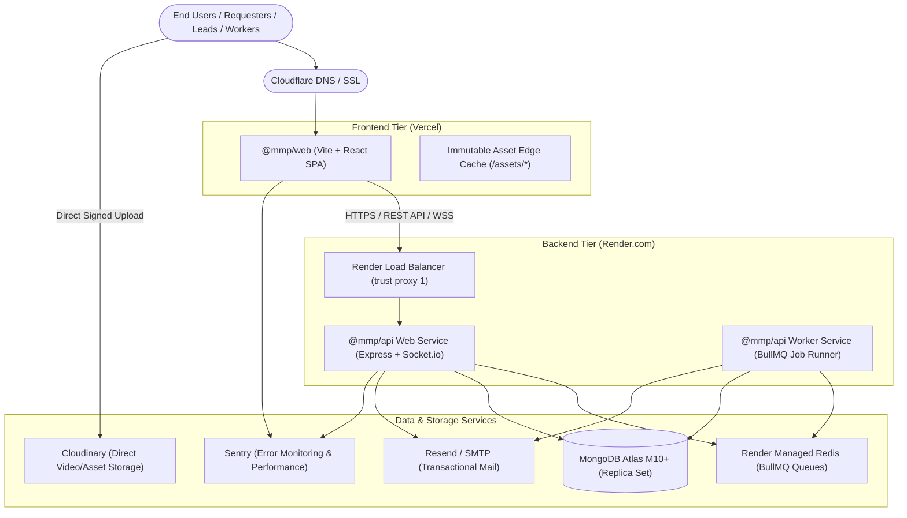

# Production Deployment & Operations Runbook

**System**: Internal Marketing Portal (MMP)  
**Version**: 1.0.0 Production Release  
**Last Updated**: October 2026  
**Target Environments**: Vercel (Frontend), Render (API Web Service, Worker, Redis), MongoDB Atlas (Database), Cloudinary (Media Storage)

---

## 1. System Architecture & Topology

The Marketing Portal is architected as a high-performance, decoupled monorepo consisting of a Single Page Application (SPA), a stateless Express.js REST/WebSocket API, a BullMQ background worker, an in-memory Redis message broker, and MongoDB Atlas as the primary persistence layer.



---

## 2. Environment Variables Specification

### 2.1 Backend Environment (`apps/api`)

| Variable | Required in Prod | Sensitivity | Description & Example |
| :--- | :---: | :---: | :--- |
| `NODE_ENV` | **Yes** | Low | Must be set to `production` (enforces secure cookies, strict CSP, rate limiters). |
| `PORT` | **Yes** | Low | Port assigned by hosting provider (Render sets `10000`). |
| `MONGODB_URI` | **Yes** | **Critical** | MongoDB Atlas connection string with replica set and SSL (`mongodb+srv://...`). |
| `REDIS_URL` | **Yes** | **High** | Redis connection URI for BullMQ queues (`redis://red-...@oregon-redis.render.com:6379`). |
| `JWT_SECRET` | **Yes** | **Critical** | Minimum 64-character hex string for signing short-lived access tokens. |
| `JWT_REFRESH_SECRET` | **Yes** | **Critical** | Minimum 64-character hex string for signing 7-day refresh tokens. |
| `JWT_EXPIRES_IN` | No | Low | Short-lived token lifespan. Default: `15m`. |
| `JWT_REFRESH_EXPIRES_IN`| No | Low | Refresh token lifespan. Default: `7d`. |
| `FRONTEND_URL` | **Yes** | Low | Canonical production web URL for CORS and redirects (e.g. `https://portal.yourdomain.com`). |
| `COOKIE_DOMAIN` | Optional | Low | Set to root domain for cross-subdomain cookie sharing (e.g. `.yourdomain.com`). Leave empty if single domain. |
| `EMAIL_PROVIDER` | **Yes** | Low | Provider selection (`resend` or `smtp`). In development: `console`. |
| `RESEND_API_KEY` | Optional | **High** | API key if `EMAIL_PROVIDER=resend` (e.g. `re_123456789`). |
| `MAIL_FROM` | **Yes** | Low | Verified sender address (e.g. `"Marketing Portal <no-reply@yourdomain.com>"`). |
| `CLOUDINARY_CLOUD_NAME` | **Yes** | Low | Cloudinary account cloud identifier. |
| `CLOUDINARY_API_KEY` | **Yes** | **Medium** | Cloudinary API Key for backend upload signature generation. |
| `CLOUDINARY_API_SECRET` | **Yes** | **Critical** | Cloudinary API Secret used for HMAC-SHA256 signature signing. |
| `SENTRY_DSN` | Optional | Low | Sentry Node project DSN for unhandled exception capture. |
| `ADMIN_SEED_EMAIL` | Optional | Low | Initial administrator email for bootstrapping (`npm run seed:admin`). |
| `ADMIN_SEED_PASSWORD` | Optional | **High** | Strong temporary password for bootstrap administrator. |

### 2.2 Frontend Environment (`apps/web`)

| Variable | Required in Prod | Sensitivity | Description & Example |
| :--- | :---: | :---: | :--- |
| `VITE_API_BASE_URL` | **Yes** | Low | Backend API base URL (e.g. `https://api.portal.yourdomain.com/api`). |
| `VITE_SOCKET_URL` | **Yes** | Low | Backend WebSocket root (e.g. `https://api.portal.yourdomain.com`). |
| `VITE_CLOUDINARY_CLOUD_NAME` | **Yes** | Low | Cloudinary account identifier for direct client-side uploads. |
| `VITE_SENTRY_DSN` | Optional | Low | Sentry Browser project DSN for client React error boundary reporting. |

---

## 3. Step-by-Step Provisioning Guide

### Step 1: MongoDB Atlas Setup
1. Create a project in [MongoDB Atlas](https://www.mongodb.com/cloud/atlas).
2. Deploy a cluster running MongoDB **8.0+** (M10+ recommended for production).
3. Under **Database Access**, create a user `mmp_app_user` with `readWriteAnyDatabase` or scoped read/write permissions on `marketing_portal`.
4. Under **Network Access**, add the static outgoing IP addresses of your Render instances (or allow access from all IPs `0.0.0.0/0` strictly guarded by strong authentication credentials and TLS).
5. Copy the connection string:
   ```bash
   mongodb+srv://mmp_app_user:<PASSWORD>@mmp-cluster.mongodb.net/marketing_portal?retryWrites=true&w=majority&appName=MMP
   ```

### Step 2: Cloudinary Setup (Direct Uploads)
1. Sign in to [Cloudinary](https://cloudinary.com/) and navigate to **Settings > Access Keys**.
2. Note your **Cloud Name**, **API Key**, and **API Secret**.
3. Under **Settings > Upload**, configure an unsigned or signed upload preset:
   - Preset Name: `mmp_media_uploads`
   - Signing Mode: `Signed`
   - Allowed formats: `mp4, mov, avi, webm, jpg, png, pdf`
   - Max file size: `500 MB`
4. The client requests HMAC signed tokens from `POST /api/uploads/sign`, ensuring no API secrets ever exist in the browser.

### Step 3: Transactional Email Setup (Resend)
1. In [Resend](https://resend.com/), navigate to **Domains** and add your organizational domain (e.g. `marketingportal.com`).
2. Add the required SPF, DKIM, and DMARC DNS records to your domain provider.
3. Once verified, generate an API key with sending permissions and set `EMAIL_PROVIDER=resend` and `RESEND_API_KEY=re_...`.

---

## 4. Deploying Backend Services on Render.com

The repository includes a ready-to-use Render Blueprint file: [`render.yaml`](file:///c:/Users/ADMIN/OneDrive/Desktop/HACA/TECH/haca-forge/render.yaml).

### Method A: Automated Deployment via Blueprint (Recommended)
1. Connect your GitHub repository to Render.
2. In the Render Dashboard, click **New > Blueprint**.
3. Select your repository. Render will automatically parse [`render.yaml`](file:///c:/Users/ADMIN/OneDrive/Desktop/HACA/TECH/haca-forge/render.yaml) and discover:
   - `mmp-api`: Web service (Node.js runtime, port 10000).
   - `mmp-worker`: Background worker service.
   - `mmp-redis`: Managed Redis instance.
4. Fill in the non-synced secrets (`MONGODB_URI`, `FRONTEND_URL`, `CLOUDINARY_*`, `RESEND_API_KEY`).
5. Click **Apply**. Render will provision and launch all three services in Oregon region.

### Method B: Manual Service Configuration
If deploying services individually:
- **Build Command**: `npm install && npm run build -w packages/shared`
- **Start Command (API)**: `npm run start -w apps/api`
- **Start Command (Worker)**: `npm run worker -w apps/api`
- **Health Check Path**: `/api/health`

---

## 5. Deploying Frontend on Vercel

The repository includes [`vercel.json`](file:///c:/Users/ADMIN/OneDrive/Desktop/HACA/TECH/haca-forge/vercel.json) at root and [`apps/web/vercel.json`](file:///c:/Users/ADMIN/OneDrive/Desktop/HACA/TECH/haca-forge/apps/web/vercel.json).

1. In [Vercel](https://vercel.com/), click **Add New > Project** and import the GitHub repository.
2. Configure project settings:
   - **Framework Preset**: `Vite`
   - **Root Directory**: `./` (or `apps/web`)
   - **Build Command**: `npm run build -w packages/shared && npm run build -w apps/web`
   - **Output Directory**: `apps/web/dist`
3. Add Environment Variables:
   - `VITE_API_BASE_URL`: `https://mmp-api.onrender.com/api` (or custom domain)
   - `VITE_SOCKET_URL`: `https://mmp-api.onrender.com`
   - `VITE_CLOUDINARY_CLOUD_NAME`: `your_cloud_name`
   - `VITE_SENTRY_DSN`: `your_sentry_browser_dsn`
4. Click **Deploy**. Vercel will build the 63 kB code-split bundle with immutable asset caching.

---

## 6. Post-Deployment Verification & Smoke Testing

Run the following checks immediately after a fresh deployment:

### 1. Health & Readiness Probes
```bash
# Verify API liveness
curl -i https://your-api.onrender.com/api/health
# HTTP/1.1 200 OK
# {"status":"ok","uptime":42.5,"timestamp":"2026-10-15T18:00:00.000Z"}

# Verify MongoDB readiness
curl -i https://your-api.onrender.com/api/ready
# HTTP/1.1 200 OK
# {"status":"ready","database":"connected"}
```

### 2. Initial Admin Seeding
On Render, open the Shell tab on `mmp-api` service and execute:
```bash
npm run seed:admin -w apps/api
```
Verify that the initial administrator account is created and log in via the web client.

### 3. Real-Time WebSocket Verification
Open browser developer tools (Network > WS), visit the portal, and confirm that the socket connection upgrades to `101 Switching Protocols` at `/socket.io/?EIO=4&transport=websocket`.

---

## 7. Disaster Recovery & Incident Response Runbook

### 7.1 Database Backup & Restore Procedures
- **Automated Snapshots**: MongoDB Atlas provides continuous point-in-time recovery (PITR) up to 7 days and daily cluster snapshots retained for 30 days.
- **Manual Cold Backup**:
  ```bash
  mongodump --uri="mongodb+srv://mmp_app_user:<PASSWORD>@mmp-cluster.mongodb.net/marketing_portal" --out=./backup-$(date +%F)
  ```
- **Disaster Restore**:
  ```bash
  mongorestore --uri="mongodb+srv://mmp_app_user:<PASSWORD>@mmp-cluster.mongodb.net/marketing_portal" --drop ./backup-2026-10-15/marketing_portal
  ```

### 7.2 Zero-Downtime Rollback Procedure
1. **Frontend Rollback**:
   - In Vercel Dashboard, go to **Deployments**.
   - Locate the previous successful deployment and click **Instant Rollback**. Traffic redirects within 5 seconds.
2. **Backend Rollback**:
   - In Render Dashboard, select `mmp-api` > **Deploys**.
   - Click the commit SHA of the previous healthy release and select **Rollback to this deploy**.

### 7.3 Emergency Administrative Credential Reset
If administrative access is lost:
1. Connect via Render Shell:
   ```bash
   node -e "
     import('./src/config/db.js').then(async ({ connectDB }) => {
       await connectDB();
       const { User } = await import('./src/modules/users/model.js');
       const bcrypt = (await import('bcryptjs')).default;
       const salt = await bcrypt.genSalt(10);
       const passwordHash = await bcrypt.hash('TemporaryEmergencyPass2026!', salt);
       await User.findOneAndUpdate(
         { role: 'admin' },
         { passwordHash, status: 'active', mustSetPassword: false }
       );
       console.log('Admin password reset successfully');
       process.exit(0);
     });
   "
   ```
2. Log in immediately and change the password via User Profile Settings.
