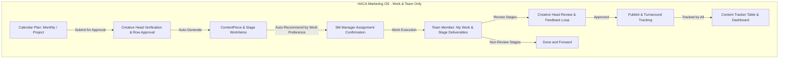
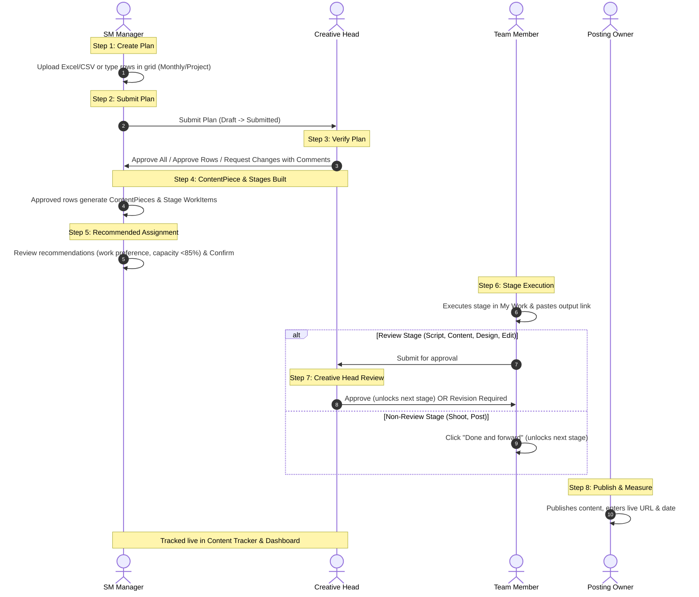

# HACA Marketing OS: Scope Reset Specification (V1 Source of Truth)

**Date:** 24 October 2026  
**Status:** Approved Master Scope & Architectural Reset  
**Target:** HACA Marketing OS (Internal Team Workspace)  
**System Boundary:** Work and Team management only, for the HACA brand only.

---

## 1. Executive Summary & Core Decision

The HACA Marketing OS portal is formally refocused into a dedicated, high-efficiency **Work and Team Management System** for **HACA**. 

All commercial lead tracking, external CRM synchronization, revenue targeting, and top-of-funnel marketing analytics are retired from the core codebase. This eliminates unnecessary complexity, removes external CRM schema dependencies, and places 100% of the team's operational focus on creative planning, content production pipelines, structured review approvals, and workload balancing.



---

## 2. Complete Removal Inventory

The following domains, models, routes, jobs, UI pages, and configuration are **permanently removed** from the portal:

| Area | Elements Removed Completely |
|---|---|
| **Leads & CRM** | LSQ adapter (`lsqAdapter.js`), inbound polling & sync jobs, `Lead` Mongoose model, `SyncRun` model, `DataIssue` model, Lead Funnel screen (`/leads`), Data Center screen (`/data-center`), and the WhatsApp inbound auto-task creation rule. |
| **Campaigns & OKRs** | `Campaign` Mongoose model, campaign routes (`/api/campaigns/*`), campaign UI pages (`/campaigns`, `/campaigns/:id`), campaign budget, spend tracking actuals, and `relatedOKR`. |
| **Monthly Targets** | `MonthlyTarget` Mongoose model, target routes (`/api/targets/*`), target UI forms, target KPIs, and revenue/lead target metrics. |
| **Reports** | **Lead Funnel & CPL Report** and **Campaign Deep-Dive Report** (4 core work reports remain). |
| **Automation** | `lsq_live_sync` background runner (6 core automation rules remain). |
| **Performance Dimensions** | **Business Impact** performance dimension (4 dimensions remain: Output, Efficiency, Quality, Collaboration). |
| **WorkItem Attributes** | Fields `campaignId`, `relatedOKR`, `relatedTarget`, `leadsGenerated`, and `qualifiedLeads` are removed/unset. Work items are now organized by `calendarPlanId` / `contentPieceId`. |
| **Permissions** | Retired keys: `target.*` (`target.view`, `target.manage`), `campaign.*` (`campaign.view`, `campaign.manage`), `lead.view`, and `datacenter.view`. |
| **Environment Variables** | All `LSQ_*` configuration variables (`LSQ_ACCESS_KEY`, `LSQ_SECRET_KEY`, `LSQ_HOST_URL`, etc.). |

---

## 3. Brand & Profile Scope

* **Single-Brand Mode (HACA Only):** The portal operates strictly for the single parent brand **HACA**.
* **Profile Selection Hidden:** All brand switchers, multi-brand dropdowns, profile filtering tabs, and profile selection pages are permanently hidden from the UI.
* **Internal Profile Integrity:** Documents retain an internal `profileId` pointing to the primary HACA organization record to preserve existing schema constraints without exposing multi-tenant complexity.

---

## 4. Roles & Permissions Architecture (Exact 5 Keys)

The system is governed by exactly **five role keys**: `admin`, `creative_head`, `executive`, `sm_manager`, and `team_member`.

```
admin ─── System & User Owner (Outside Creative Hierarchy)
  │
creative_head ─── Creative Authority (Approves Plans & Review Stages, Edits People Ops)
  │
sm_manager ─── Operational Planner (Builds Plans, Sets Deadlines, Assigns Stages, Resolves Blockers)
  │
team_member ─── Creative Contributor (Executes Stages, Submits for Review, Flags Blockers)

executive ─── Leadership Viewer (Company Management, Zero Mutation Privileges, Read-Only Across System)
```

### 4.1 Detailed Role Responsibilities & Boundaries

#### 1. `admin` (System Owner)
* **Identity:** IT System Administrator, outside the creative hierarchy.
* **Capabilities:** Every permission key in the system (derived dynamically from `PERMISSION_KEYS`).
* **Exclusive Powers:** ONLY `admin` can create users directly, approve/reject public access requests, assign or change user roles, grant elevated roles (`admin`, `creative_head`, `executive`), suspend or reactivate users, trigger password resets, and force session logout.
* **System Boundaries:** Admin needs no department, job role, or capacity hours; is strictly excluded from workload calculations and auto-assignment recommendation pools; and is omitted from team performance reports. Any work mutations performed by admin are logged in `ActivityEvent` with `actingAs: 'admin'`.
* **Landing Page:** `/dashboard`.

#### 2. `creative_head` (Creative Leadership — formerly `marketing_head`)
* **Identity:** Creative Director / Head of Creative Production.
* **Capabilities:**
  * **Calendar Plan Approvals:** Verifies and approves Social Media Calendar Plans submitted by the SM Manager. Can approve all rows at once, approve selected rows, or send back rows with line-item comments requesting changes.
  * **Stage Review Approvals:** Authoritative approver for all creative review stages (`Script`, `Content`, `Design`, `Edit`). Approves deliverable links or sends back with `Revision Required` and specific feedback.
  * **Revision Root Cause Classification:** Classifies root causes on revision flags (Brief unclear, Creative direction unclear, Skill gap, Feedback inconsistency, Excessive scope change, TL approval delay, Client/business requirement changed).
  * **Team Operations Management:** Manages operational assignments for `sm_manager` and `team_member` (`departmentId`, `jobRole`, `workPreferences[]`, `reportsToIds[]`, `weeklyCapacityHours`).
  * **System Oversight:** Sees all work, all team members, and overall team workload. Runs and controls report definitions and automation rules. Can reassign work owners.
* **Strict Boundaries:** Cannot create or suspend user accounts; cannot change user roles; cannot grant elevated roles; cannot upload or type calendar plans; cannot modify `admin`, `executive`, or other `creative_head` accounts.
* **Landing Page:** `/dashboard`.

#### 3. `sm_manager` (Social Media Manager / Operational Planner — formerly `team_lead`)
* **Identity:** Main operational planning and orchestration lead.
* **Capabilities:**
  * **Plan Creation & Upload:** Builds and creates Social Media Calendar Plans (Monthly or Project). Uploads plans via structured Excel/CSV templates with client-side validation preview, or enters rows directly in an interactive grid.
  * **Plan Submission:** Submits draft plans to the Creative Head for verification.
  * **Stage Assignment & Scheduling:** Once plan rows are approved, sets stage deadlines, auto-assigns or manually assigns stage owners based on `workPreferences[]` and capacity, and confirms all assignments in one click.
  * **Workflow Orchestration:** Tracks every stage across all content pieces in the Content Tracker, reassigns stage owners when bottlenecks arise, shifts deadlines, resolves blockers, and monitors live team workload.
  * **Visibility:** Full visibility into all work items, all people, and all calendar entries.
* **Strict Boundaries:** **Cannot approve calendar plans and cannot approve review stages.** Does not classify revision root causes. Cannot manage user accounts or elevate permissions.
* **Landing Page:** `/dashboard`.

#### 4. `executive` (Company Leadership Viewer)
* **Identity:** CEO, Business Head, Board Directors.
* **Capabilities:** Universal read-only visibility into the complete portal (Dashboard, Calendar, Content Tracker, Work Detail, Feedback history, Workload, Reports).
* **Strict Boundaries:** **Strictly zero mutation/write privileges (HTTP 403 Forbidden on all POST, PUT, PATCH, DELETE endpoints).** In the People directory, contact information (email and phone) is omitted/masked. Excluded from auto-assignment candidate pools, capacity calculations, and team performance digests. My Work is hidden from navigation.
* **Landing Page:** `/dashboard`.

#### 5. `team_member` (Creative Contributor / Worker)
* **Identity:** Writers, Graphic Designers, Video Editors, Animators, Specialists.
* **Capabilities:**
  * **Personal Portal:** Access restricted to own personal dashboard (`/my-work`), personal Todo, personal Calendar entries, Work Detail (`/work/:id`), Notifications, and My Account.
  * **Stage Execution:** Starts own assigned stages, updates status (`In Progress`, `Pending`, `Blocked`), pastes output URLs (Zoho Writer, Google Docs, Figma, Drive, YouTube links).
  * **Handoffs:** Submits review stages (`Script`, `Content`, `Design`, `Edit`) to the Creative Head for approval; marks non-review stages (`Shoot`, `Post`) as **Done and forward** to unlock the next stage.
  * **Collaboration:** Replies to revision feedback threads, flags blockers with mandatory dependency owner attribution, and submits work requests to the SM Manager.
* **Strict Boundaries:** Sees only own work items and own calendar items. Cannot see other members' work unless assigned. Cannot create calendar plans, cannot assign work, cannot approve deliverables, and cannot access team-wide reports or workload analytics.
* **Landing Page:** `/my-work`.

#### 4.2 Department & Approver Simplification Rule
* **No Other Department or Team Lead Roles:** All legacy department lead distinctions (Design Lead, SEO Lead, etc.) and departmental silos are retired.
* **Direct Creative Head Approval:** The legacy rule requiring a separate "Creative Manager (TL) job-role approver" is completely replaced by the dedicated `creative_head` role.

---

## 5. End-to-End Content & Work Lifecycle (The 8-Step Flow)



### Detailed Lifecycle Steps:

1. **Plan Creation:**
   * The SM Manager creates a **Calendar Plan** (kind: `Monthly` or `Project`, with title and time period).
   * Plan data can be entered in two ways:
     * **Excel / CSV Upload:** Downloadable standardized template, client-side validation preview highlighting row syntax errors, followed by single-click commit.
     * **Interactive Grid:** Fast inline table entry.
   * Required fields per row: `postingDate` (or final date), `topic`, `contentType`, `needsScript` (boolean), `needsShoot` (boolean, Reel only), `contentLink` (optional draft doc), `remarks`.
2. **Plan Submission:**
   * SM Manager reviews the drafted plan and clicks **Submit Plan**.
   * Plan status transitions: `Draft` $\rightarrow$ `Submitted`. Individual row statuses mirror the plan state.
3. **Creative Head Verification:**
   * Creative Head inspects the plan in **Feedback & Revisions $\rightarrow$ Plan Approvals**.
   * Actions available to Creative Head:
     * **Approve All:** Approves all rows in the plan.
     * **Approve Selected:** Approves valid rows while flagging others.
     * **Request Changes:** Attaches specific line-item comments to individual rows and sends the plan back (`Changes Requested`).
   * SM Manager updates rejected rows based on comments and resubmits.
4. **ContentPiece & Stage Generation:**
   * Once rows are marked `Approved`, the system auto-generates a **ContentPiece** record for each approved row, linked to the plan.
   * Sequential stage **WorkItems** are instantly constructed using the pipeline rules from `CONTENT_FLOW.md`.
   * Stage due dates are calculated automatically by counting backward from the final posting date $F$:
     * *Design Postable:* Content ($F-6$), Design ($F-3$), Post ($F$).
     * *Design Non-Postable:* Content ($F-5$), Design ($F-2$, approved by $F$).
     * *Reel Variant A (Script + Shoot):* Script ($F-10$), Shoot ($F-7$), Edit ($F-4$), Post ($F$).
     * *Reel Variant B (No Script + Shoot):* Shoot ($F-7$), Edit ($F-4$), Post ($F$).
     * *Reel Variant C (No Script + No Shoot):* Edit ($F-4$), Post ($F$).
5. **Intelligent Stage Auto-Assignment:**
   * For each generated stage, the system identifies candidate owners using:
     1. `Person.workPreferences[]` matching the stage key (`Content`, `Script`, `Design`, `Shoot`, `Edit`, `Post`).
     2. Current workload percentage strictly **under 85%**.
     3. Availability and capacity fit before the stage deadline.
   * **No Silent Assignment:** All recommendations are presented in the **Assign Stages** view with clear rationales. The SM Manager can confirm all recommendations with one click or manually override any stage. Stages left open display as `"Needs owner"`.
6. **Work Execution & Submission:**
   * Creative workers see assigned stages in `/my-work` (categorized into Today, This Week, Later).
   * Worker clicks **Start Work** (`In Progress`), executes the work, and pastes the output deliverable URL.
   * **Review Stages (`Script`, `Content`, `Design`, `Edit`):** Worker clicks **Submit for Approval**, transitioning the item to `Feedback` status for the Creative Head.
   * **Non-Review Stages (`Shoot`, `Post`):** Worker clicks **Done and forward**, immediately marking the stage complete and unlocking the next stage in sequence.
7. **Creative Head Review & Revision Guardrails:**
   * Creative Head reviews the deliverable from the **Waiting for Approval** queue.
   * Decisions:
     * **Approved:** Marks stage approved and automatically unlocks the next stage (`unlockedAt` timestamp set).
     * **Revision Required:** Attaches clear feedback text. The stage returns to the worker (`In Progress`), incrementing the revision counter.
   * **Revision Guardrails:** If revisions reach 4, or exceed the worker's rolling 90-day average by $>1$, an automatic `RevisionFlag` is raised. The Creative Head classifies the root cause. If unclassified for 48 hours, it escalates.
8. **Publishing & Turnaround Tracking:**
   * The posting owner publishes the approved asset, transitions the Post stage to `Published`, and enters the live public URL and publication timestamp.
   * The system computes **Turnaround Days** ($\text{Published Date} - \text{First Stage Start Date}$).
   * All stages and pieces are audited live in the **Content Tracker** across all management roles (`admin`, `creative_head`, `sm_manager`, `executive`).

---

## 6. Screen Inventory & Structure

The user interface consists of exactly **12 screens and views** (4 legacy screens permanently removed):

```
Active Navigation:
├── Dashboard (/dashboard)
├── My Work (/my-work)
├── Calendar & Plans (/calendar)
│   ├── Month View
│   ├── Calendar Plans (Upload / Grid / Approvals)
│   └── Content Tracker (Social & Design Views)
├── Work Detail (/work/:id)
├── Feedback & Revisions (/feedback)
│   ├── Stage Approvals Queue
│   └── Plan Approvals Queue
├── Team Workload (/workload)
├── Todo & Priorities (/todo)
├── Issues & Blockers (/issues)
├── Reports & Automation (/reports)
└── Administration & Account
    ├── People Management (/people)
    ├── Access Requests (/admin/access-requests)
    ├── My Account (/account)
    └── Notifications (/notifications)

REMOVED SCREENS:
❌ Campaigns List (/campaigns)
❌ Campaign Detail (/campaigns/:id)
❌ Lead Funnel (/leads)
❌ Data Center (/data-center)
```

---

## 7. Dashboard Architecture (8 Core Sections)

The `/dashboard` screen is structured into 8 operational sections designed for real-time clarity:

1. **Month Plan Status:** Live status of current calendar plans (Draft, Submitted, Approved), planned pieces versus completed pieces, and publishing velocity.
2. **KPI Strip:** 7 core real-time metrics:
   * **Planned:** Total pieces planned for the active period.
   * **Completed:** Total pieces published / final approved.
   * **In Progress:** Stages actively being worked on.
   * **At Risk:** Open items due within 72 hours that are not yet in review.
   * **Blocked:** Items currently held up with an active blocker.
   * **Pending Approval:** Items awaiting Creative Head review.
   * **Overdue:** Items where deadline has passed without completion.
3. **Today's Priorities:** High-urgency deliverables due today or overdue.
4. **Production Stats & Trend:** Output velocity by content type (Reels, Static Posts, Carousels, Stories, Design assets) and weekly completion trends.
5. **Team Workload:** Live capacity breakdown showing healthy ($<65\%$), high ($65\%-85\%$), and overloaded ($>85\%$) team members.
6. **Issues & Blockers:** Unresolved blocker items with dependency owners, plus active revision flags requiring classification.
7. **Waiting for Approval:** Urgent deliverables submitted by team members awaiting Creative Head action.
8. **Recent Activity:** Audit feed of status transitions, approvals, handoffs, and assignments.

---

## 8. Report Definitions (4 Core Reports)

Four focused reports replace all previous marketing and lead reports:

| Report Name | Cadence | Scope & Contents |
|---|---|---|
| **Weekly Work Report** | Every Monday, 08:00 IST | Weekly summary of completed deliverables, on-time delivery rate, active bottlenecks, and upcoming week priorities. |
| **Monthly Performance Scorecard** | Last day of month, 23:59 IST | End-of-month operational throughput, turnaround days by content format, revision rates, and blocker resolution times (targets completely removed). |
| **Creative Production Report** | Every Friday, 18:00 IST | Deep dive into stage throughput: script output, design assets created, video edit hours, and stage approval turnaround. |
| **Team Performance Digest** | 1st of every month, 09:00 IST | Objective evaluation across 4 dimensions (Output, Efficiency, Quality, Collaboration) for each creative contributor. |

*(Removed: Lead Funnel & CPL Report, Campaign Deep-Dive Report).*

---

## 9. Automation Rules (6 Core Rules)

Six background automation jobs run via BullMQ:

1. **`month_end_report`:** Automatically compiles and archives the Monthly Performance Scorecard on the last day of the month at 23:59.
2. **`overdue_escalation`:** Pings the stage owner immediately when a deadline passes; escalates alert to the SM Manager if uncompleted after 4 hours.
3. **`todo_escalation`:** Flags open items that have had no status change or activity for $>3$ consecutive days.
4. **`blocker_dependency_alert`:** Instantly dispatches a notification to the named dependency owner when an item is marked Blocked.
5. **`revision_pattern_flag`:** Automatically raises a `RevisionFlag` when an item reaches 4 revisions or exceeds owner average by $>1$.
6. **`weekly_report`:** Compiles and dispatches the Weekly Work Report every Monday morning at 08:00.

*(Removed: `lsq_live_sync`).*

---

## 10. Performance Dimensions (4 Objective Dimensions)

Performance evaluation is strictly creative and operational, calculated across **four dimensions**:

1. **Output:** Deliverables completed against estimated effort hours and stage volume.
2. **Efficiency:** On-time completion percentage and average stage turnaround days versus deadline baselines.
3. **Quality:** First-pass approval rate and low average revision count ($\le 1.5$ rounds per piece).
4. **Collaboration:** Rapid blocker resolution time and constructive response time on revision feedback.

*(Permanently Removed: Business Impact dimension).*

---

## 11. Permissions Key Registry

### Deleted Permission Keys:
* `target.view`, `target.manage`
* `campaign.view`, `campaign.manage`
* `lead.view`
* `datacenter.view`

### Added Permission Keys:
* **`calendar.plan`:** Create, upload, edit, and submit calendar plans. Granted to: `sm_manager`, `admin`.
* **`calendar.approve`:** Approve or request changes on calendar plans and approve review stages. Granted to: `creative_head`, `admin`.

### Complete Canonical Permission Map:
```javascript
export const ROLE_PERMISSIONS = {
  admin: ['*'], // Derived dynamically from all PERMISSION_KEYS
  creative_head: [
    'portal.view',
    'people.view',
    'people.assign',
    'calendar.view',
    'calendar.approve',
    'work.view',
    'work.create',
    'work.assign',
    'feedback.give',
    'feedback.view',
    'blocker.resolve',
    'analytics.team',
    'report.view',
    'report.configure',
    'automation.manage'
  ],
  sm_manager: [
    'portal.view',
    'people.view',
    'calendar.view',
    'calendar.plan',
    'work.view',
    'work.create',
    'work.assign',
    'feedback.view',
    'blocker.resolve',
    'analytics.team',
    'report.view'
  ],
  executive: [
    'portal.view',
    'people.view', // Email & phone masked
    'calendar.view',
    'work.view',
    'feedback.view',
    'analytics.team',
    'report.view'
  ],
  team_member: [
    'portal.view',
    'calendar.view',
    'work.view.own',
    'work.update.own',
    'work.request',
    'feedback.view.own',
    'feedback.reply'
  ]
};
```

---

## 12. Database Transition & Data Cleanup Strategy

Before executing database modifications during Phase R1:
1. **Full Export Backup:** Completed via `mongodump` into `backup-before-scope-reset/`.
2. **Collection Purge:**
   * Export documents from `campaigns`, `monthlytargets`, `leads`, `dataissues`, and `syncruns` to JSON archive.
   * Drop/delete documents in these 5 retired collections.
3. **WorkItem Field Cleanup:**
   * Execute an atomic Mongoose update script to unset retired fields on all existing `WorkItem` documents:
     ```javascript
     await WorkItem.updateMany({}, {
       $unset: {
         campaignId: 1,
         relatedOKR: 1,
         relatedTarget: 1,
         leadsGenerated: 1,
         qualifiedLeads: 1
       }
     });
     ```
   * All historical work items and stage records are preserved intact.
