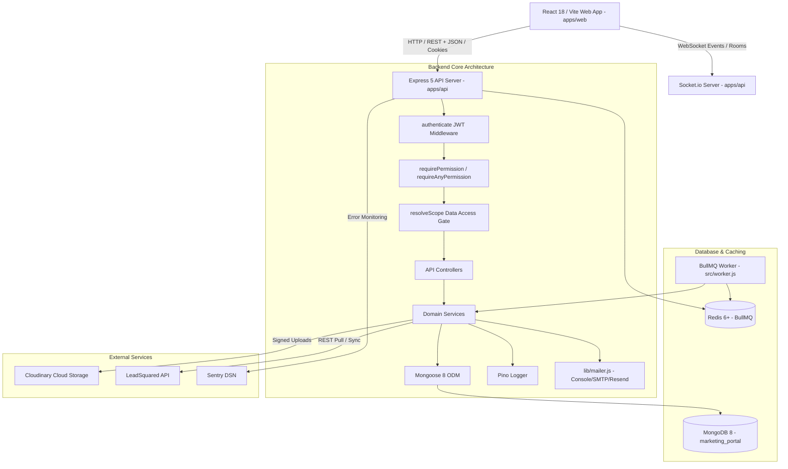
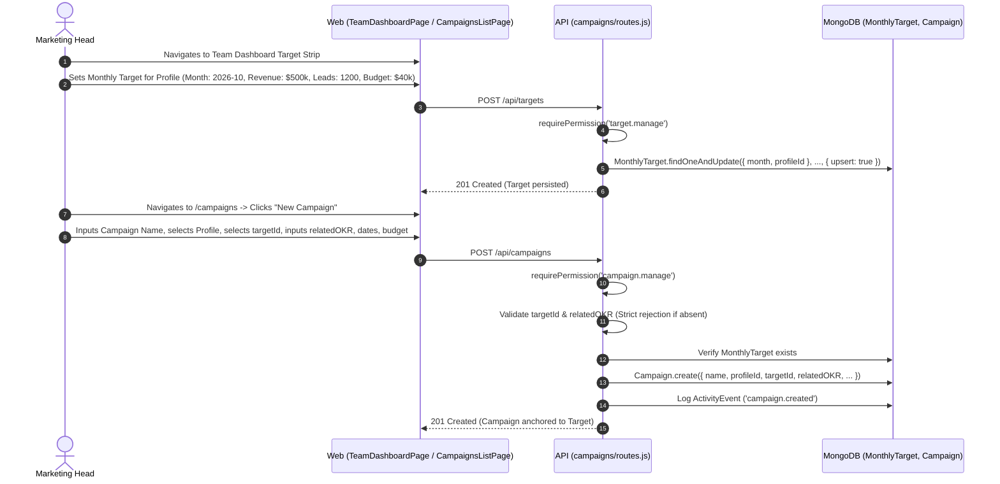
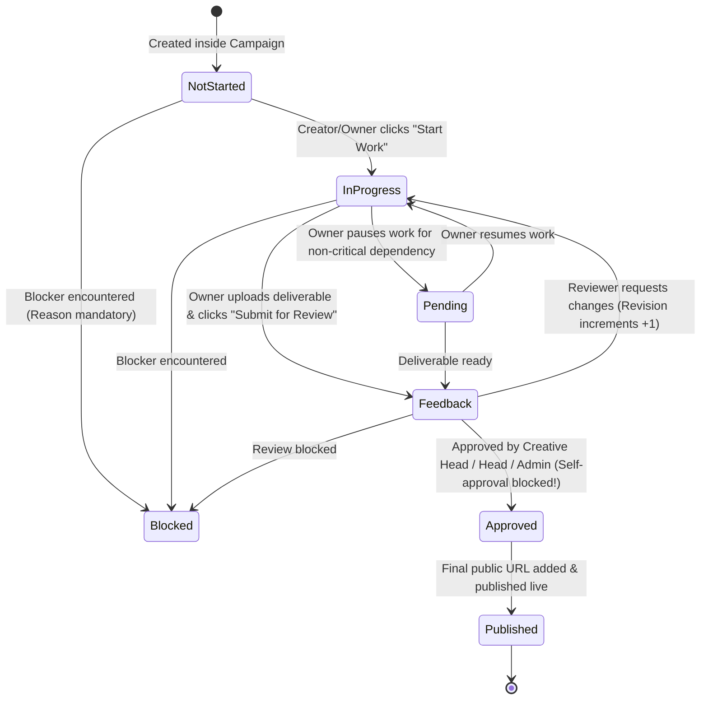
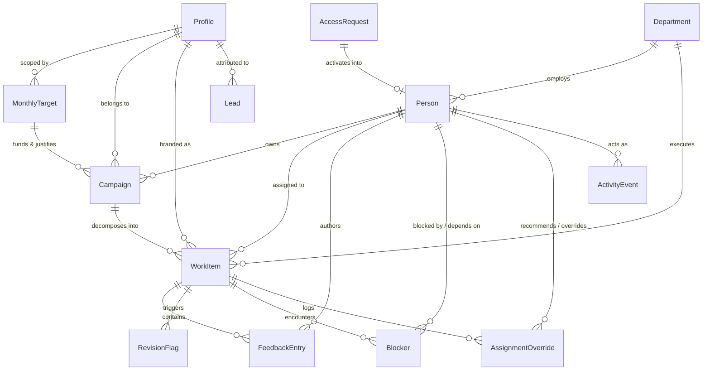

# HACA Marketing OS: Complete System & Architecture Documentation

> **Document Type:** Master Project Architecture & Implementation Reference  
> **Target Audience:** Engineering Team, Technical Reviewers, AI Coding Agents  
> **Codebase Path:** `c:\Users\ADMIN\OneDrive\Desktop\HACA\TECH\haca-forge`  
> **Source Documents:** [HACA-Marketing-OS-Build-Spec.pdf](file:///c:/Users/ADMIN/OneDrive/Desktop/HACA/TECH/haca-forge/docs/HACA-Marketing-OS-Build-Spec.pdf), [PROJECT_REPORT.md](file:///c:/Users/ADMIN/OneDrive/Desktop/HACA/TECH/haca-forge/docs/PROJECT_REPORT.md), [BUILD_PLAN.md](file:///c:/Users/ADMIN/OneDrive/Desktop/HACA/TECH/haca-forge/docs/BUILD_PLAN.md), [CONTENT_FLOW.md](file:///c:/Users/ADMIN/OneDrive/Desktop/HACA/TECH/haca-forge/docs/CONTENT_FLOW.md), and [PROGRESS.md](file:///c:/Users/ADMIN/OneDrive/Desktop/HACA/TECH/haca-forge/docs/PROGRESS.md)  
> **Monorepo Version:** `1.0.0`  
> **Verification Status:** **100% Verified** against active codebase (211/211 backend tests passing; clean TypeScript/Vite frontend build).

---

## Table of Contents
1. [Project Overview](#1-project-overview)
2. [Project Structure](#2-project-structure)
3. [Technology Stack](#3-technology-stack)
4. [User Roles and Permissions](#4-user-roles-and-permissions)
5. [Complete Feature Inventory](#5-complete-feature-inventory)
6. [Detailed User Workflows](#6-detailed-user-workflows)
7. [Authentication and Authorization](#7-authentication-and-authorization)
8. [Database Design](#8-database-design)
9. [API Documentation](#9-api-documentation)
10. [Frontend Architecture](#10-frontend-architecture)
11. [Business Logic and Rules](#11-business-logic-and-rules)
12. [External Integrations](#12-external-integrations)
13. [Validation and Error Handling](#13-validation-and-error-handling)
14. [Security Review](#14-security-review)
15. [Environment Configuration](#15-environment-configuration)
16. [Testing and Quality Assurance](#16-testing-and-quality-assurance)
17. [Deployment and Infrastructure](#17-deployment-and-infrastructure)
18. [Current Project Status](#18-current-project-status)
19. [End-to-End Feature Matrix](#19-end-to-end-feature-matrix)
20. [Important User Journeys](#20-important-user-journeys)
21. [Unanswered Questions and Assumptions](#21-unanswered-questions-and-assumptions)
22. [Recommended Completion Roadmap](#22-recommended-completion-roadmap)
23. [Project Completion Checklist](#23-project-completion-checklist)

---

# 1. Project Overview

### 1.1 Project Name & Purpose
* **Project Name:** HACA Marketing OS (formerly *HACA FORGE*).
* **Workspace Monorepo:** Private NPM workspace (`apps/api`, `apps/web`, `packages/shared`).
* **Purpose:** An internal, unified marketing operations cockpit and deliverable execution system for the HACA educational network. It replaces fragmented Google Sheets, manual spreadsheets, and ad-hoc WhatsApp approvals with an authoritative, traceable, and audited workflow engine.

### 1.2 The Problem Solved
Prior to Marketing OS, HACA's 7 brand profiles operated across disconnected spreadsheets:
1. **Sheet A (SM CONTENT):** A multi-column social calendar with inconsistent date formats (`24/9/2026` vs `1 Oct, 2026`), impossible chronological paradoxes (published dates recorded earlier than posting dates), untracked rework cycles, and out-of-order stage completion.
2. **Sheet B (Design Sheets):** Brand-specific tabs tracking 14 creative requirement types with missing feedback attribution and no workload guardrails.
3. **Traceability Vacuum:** No link existed between high-level revenue targets, campaigns, daily creative deliverables, and downstream lead generation in LeadSquared (LSQ).
4. **Approval Delays & Overload:** Team leads were overwhelmed, team members were assigned tasks beyond their 40-hour capacity, and review revisions exceeded 5 cycles without root-cause accountability.

### 1.3 Target Users
* **Executive Leadership (`executive`):** CEO, Business Head, and Board Directors needing total cross-brand read-only visibility into marketing velocity, CAC, CPL, and deliverables without mutation powers.
* **Marketing Leadership (`marketing_head`):** Operational leader who sets monthly targets, approves campaigns, monitors workload balance, classifies revision root causes, and assigns team roles.
* **System Administration (`admin`):** Technical owner managing user creation, role elevations, access requests, and system configurations.
* **Creative & Department Leads (`team_lead`):** Social Media Manager (SM Manager), Creative Manager / Creative Head (approver), Performance Marketer, SEO Lead, Video Production Lead.
* **Creative Contributors (`team_member`):** Video Editors, Graphic Designers, Writers, Animators, WhatsApp Marketers, and Telecallers.

### 1.4 Main Business Objectives
1. **Strict 4-Tier Traceability Chain:** `MonthlyTarget` $\rightarrow$ `Campaign` (with explicit OKR) $\rightarrow$ `WorkItem` $\rightarrow$ `LeadSquared (LSQ) Attributed Leads`. No deliverable can exist without campaign linkage.
2. **Intelligent Auto-Assignment & Capacity Guardrails:** Automatically recommend task assignees using capacity formulas ($<65\%$ healthy, $65\%-85\%$ high, $>85\%$ overloaded) and rolling 90-day revision averages. Never silently assign.
3. **Structured Review Feedback Loops:** Replace endless comment chats with a formal 2-entry round model (`Revision Required` vs `Approved`), mandatory blocker reasons, and automatic 48-hour escalation flags for $\ge 4$ revisions.
4. **Authoritative LSQ Data Center:** Unify 19 lead channels and a 12-stage funnel with zero manual lead editing permitted (HTTP 405 Method Not Allowed on lead mutations).
5. **5-Dimensional Performance Measurement:** Evaluate creative talent objectively across Output, Efficiency, Quality, Collaboration, and Business Impact.

### 1.5 Current Development Stage
The repository is in **Phase 10 completion stage** of the Master Conversion Roadmap:
* **Completed (Verified in Code):** Phase 0 (Retirement of legacy FORGE ticketing), Phase 1 (Profiles, People, 5 Roles, Access Requests), Phase 2 (Monthly Targets & Campaigns), Phase 3 (Work Items, My Work, Calendar, Todo), Phase 4 (Auto-Assignment Engine & Workload), Phase 5 (Feedback Loops, Revision Flags, Blockers), Phase 6 (Global Filter Bar, Team Dashboard), Phase 7 (Automation Rules, Reports & Notifications), Phase 8 (LeadSquared Integration & Data Center), Phase 9 (5 Performance Dimensions & Hardening), Phase 10 (Executive Role Addition).
* **Partially Implemented / Next Up:** **Phase 5b (Content Flow, ContentPiece, Sequential Pipelines & Content Tracker)** as specified in [CONTENT_FLOW.md](file:///c:/Users/ADMIN/OneDrive/Desktop/HACA/TECH/haca-forge/docs/CONTENT_FLOW.md). Stage fields exist on `WorkItem` (`contentPieceId`, `stageKey`, `stageOrder`, `reviewRequired`, `unlockedAt`), but the grouping `ContentPiece` entity and table tracker on `/calendar` are not yet built.

### 1.6 High-Level System Architecture



---

# 2. Project Structure

The project is structured as an NPM monorepo containing two applications and one shared library.

```
c:\Users\ADMIN\OneDrive\Desktop\HACA\TECH\haca-forge\
├── package.json                    # Monorepo root scripts, workspaces declaration
├── render.yaml                     # Render.com Blueprint (Web API, Worker, Redis)
├── vercel.json                     # Vercel deployment configuration for apps/web
├── scripts/                        # Monorepo orchestration & seeding scripts
│   ├── demo-users.json             # Seed cohort definition for 10 demo users
│   ├── seed-demo-users.js          # Standalone seed runner for demo accounts
│   ├── migrate-legacy-roles.js     # Legacy FORGE to Marketing OS role migrator
│   └── reset-data-marketing-os.js  # Production-guarded database clean and reseed
├── docs/                           # Authoritative project specifications & documentation
│   ├── HACA-Marketing-OS-Build-Spec.pdf # Original architecture and business requirements
│   ├── PROJECT_REPORT.md           # Master technical conversion specification
│   ├── BUILD_PLAN.md               # 11-phase step-by-step master build roadmap
│   ├── CONTENT_FLOW.md             # SM Content flow and pipeline design spec
│   ├── USERS_AND_PASSWORDS.md      # Credentials directory for local & demo users
│   └── PROGRESS.md                 # Granular phase-by-phase completion log
├── packages/
│   └── shared/                     # @mmp/shared - Canonical shared library (tsup)
│       ├── package.json
│       ├── tsconfig.json
│       └── src/
│           └── index.ts            # Enums, roles, permission matrix, Zod schemas
└── apps/
    ├── api/                        # @mmp/api - Express 5 Backend
    │   ├── package.json
    │   ├── vitest.config.js
    │   ├── .env.example
    │   ├── scripts/                # Database seeders and maintenance
    │   │   ├── seed.js             # Baseline seed (admin + 7 departments)
    │   │   ├── seed-admin.js       # Dedicated first-admin bootstrap
    │   │   ├── seed-demo.js        # Historical demo seeder wrapper
    │   │   ├── clean-database.js   # Non-destructive test reset script
    │   │   └── migrate-user-to-person.js # FORGE User to Person migrator
    │   ├── test/                   # 15 Vitest automated test suites (211 tests)
    │   └── src/
    │       ├── server.js           # Server bootstrap, Express setup, routes mount
    │       ├── worker.js           # Background queue runner entrypoint
    │       ├── config/             # Environment, DB, and Sentry configuration
    │       │   ├── env.js          # Zod-validated environment parser
    │       │   ├── db.js           # Mongoose connection logic
    │       │   └── sentry.js       # Sentry initialization and error handler
    │       ├── middleware/         # Security & request lifecycle middleware
    │       │   ├── auth.js         # JWT cookie/header authentication
    │       │   ├── requirePermission.js # CASL permission verification
    │       │   ├── validate.js     # Zod schema validation middleware
    │       │   ├── sanitize.js     # Express-mongo-sanitize NoSQL guard
    │       │   ├── requestId.js    # Correlation ID generator (x-request-id)
    │       │   └── errorHandler.js # Standardized error formatter
    │       ├── lib/                # Shared internal utilities
    │       │   ├── logger.js       # Pino logger with redaction
    │       │   ├── mailer.js       # Email sender (Console, SMTP, Resend)
    │       │   ├── queue.js        # BullMQ queue producer interface
    │       │   ├── socket.js       # Socket.io notification dispatcher
    │       │   ├── scope.js        # resolveScope query-level scoping gate
    │       │   ├── permissions.js  # CASL Ability builder for roles
    │       │   └── storage.js      # Cloudinary signed upload provider
    │       └── modules/            # Domain Modules
    │           ├── access/         # Public request access & admin approval
    │           ├── activity/       # Immutable ActivityEvent audit ledger
    │           ├── assignment/     # Auto-assignment recommendation & override
    │           ├── auth/           # Login, refresh tokens, set-password
    │           ├── automation/     # 7 Automation Rules & execution runner
    │           ├── blockers/       # Blocker tracking & dependency alerting
    │           ├── calendar/       # Legacy calendar endpoints & work items
    │           ├── campaigns/      # Marketing Campaigns & OKR linkage
    │           ├── common/         # Cross-module transition helper
    │           ├── departments/    # 7 fixed operational departments
    │           ├── docs/           # OpenAPI 3.0 specification & Swagger UI
    │           ├── feedback/       # 2-entry review rounds & revision flags
    │           ├── jobs/           # BullMQ job processor registrations
    │           ├── leads/          # LSQ sync, 12-stage funnel & Data Center
    │           ├── notifications/  # Notification center & socket emit
    │           ├── people/         # Person schema, capacity, 5 dimensions
    │           ├── referenceData/  # 7 brand profiles & taxonomies
    │           ├── reports/        # 6 report definitions & dashboard aggregations
    │           ├── status/         # Health & readiness probes
    │           ├── targets/        # MonthlyTargets (revenue, leads, spend)
    │           ├── uploads/        # Cloudinary signature generation
    │           ├── users/          # Backward-compatible User endpoints
    │           └── workItems/      # Core deliverable unit & state machine
    └── web/                        # @mmp/web - React 18 / Vite Frontend
        ├── package.json
        ├── vite.config.ts
        ├── tsconfig.json
        ├── tailwind.config.js
        └── src/
            ├── main.tsx            # React root mount
            ├── App.tsx             # Route declarations & RootRedirect
            ├── index.css           # Glassmorphic CSS tokens & utility styles
            ├── context/            # React Global State Providers
            │   ├── AuthContext.tsx # User session, login/logout, permissions
            │   └── GlobalFilterContext.tsx # URL-synced global filter state
            ├── hooks/              # Custom React hooks
            │   └── useSocket.ts    # Socket.io real-time connection hook
            ├── lib/                # Frontend clients & formatters
            │   ├── api.ts          # apiFetch client with credential cookies
            │   └── sentry.ts       # Frontend Sentry error tracking
            ├── components/         # Reusable Design System Components
            │   ├── Layout.tsx      # Main application shell, topbar, navigation
            │   ├── GlobalFilterBar.tsx # Profile/Dept/Owner/Month filter toolbar
            │   ├── ProtectedRoute.tsx # Route authentication & permission guards
            │   ├── ErrorBoundary.tsx  # React error boundary
            │   ├── EmptyState.tsx  # Standardized empty screen render
            │   ├── Skeleton.tsx    # Shimmer loading skeletons
            │   ├── NotificationCenter.tsx # Slide-out notification drawer
            │   ├── NotificationToast.tsx  # Real-time popup notifications
            │   ├── NotificationPreferencesModal.tsx # Alert toggles modal
            │   └── MyAccountModal.tsx # User profile & work preferences modal
            └── pages/              # Screen Implementations
                ├── LoginPage.tsx              # Screen 1: Sign in & request access
                ├── SetPasswordPage.tsx        # Password activation & reset
                ├── UnauthorizedPage.tsx       # HTTP 403 Forbidden page
                ├── NotificationsPage.tsx      # Full notifications history
                ├── MyAccountPage.tsx          # User settings & work preferences
                ├── PlaceholderPage.tsx        # Fallback glass shell
                ├── admin/
                │   ├── AccessRequestsPage.tsx # Review, approve, reject requests
                │   └── UsersPage.tsx          # People & user management
                ├── dashboard/
                │   └── TeamDashboardPage.tsx  # Screen 2: 9-section master dashboard
                ├── work/
                │   ├── MyWorkPage.tsx         # Screen 3: Member personal work queue
                │   ├── WorkListPage.tsx       # Universal drill-down work table
                │   └── WorkDetailPage.tsx     # Screen 7: Stepper, tabs & feedback
                ├── calendar/
                │   └── CalendarPage.tsx       # Screen 4: FullCalendar monthly view
                ├── campaigns/
                │   ├── CampaignsListPage.tsx  # Screen 5: Campaign portfolio & OKRs
                │   └── CampaignDetailPage.tsx # Screen 6: Traceability & budget burn
                ├── feedback/
                │   └── FeedbackPage.tsx       # Screen 8: 2-entry review hub
                ├── workload/
                │   └── TeamWorkloadPage.tsx   # Screen 9: Capacity & workload bands
                ├── todo/
                │   └── TodoPrioritiesPage.tsx # Screen 10: Role-scoped priorities
                ├── issues/
                │   └── IssuesBlockersPage.tsx # Screen 11: Blockers & root causes
                ├── leads/
                │   └── LeadFunnelPage.tsx     # Screen 12: 12-stage LSQ funnel
                ├── datacenter/
                │   └── DataCenterPage.tsx     # Screen 13: LSQ hygiene console
                └── reports/
                    └── ReportsPage.tsx        # Screen 14: Reports & automation rules
```

---

# 3. Technology Stack

| Technology | Purpose | Where It Is Used | Current Status |
| :--- | :--- | :--- | :--- |
| **Node.js (v22+)** | Server JavaScript runtime | Root, `apps/api`, `scripts/` | COMPLETE (Enforced via `.nvmrc` & `engines`) |
| **Express 5 (`v5.0.1`)** | REST API framework | `apps/api/src/server.js` | COMPLETE (Modern promise error handling) |
| **MongoDB 8 & Mongoose (`v8.10.1`)** | Document database & ODM | `apps/api/src/config/db.js`, `modules/*/model.js` | COMPLETE (Indexes, hooks, virtuals verified) |
| **React 18 (`v18.3.1`)** | Frontend UI framework | `apps/web/src/` | COMPLETE (Concurrent features, Strict Mode) |
| **Vite (`v6.1.0`)** | Frontend build tool & dev server | `apps/web/vite.config.ts` | COMPLETE (Builds in ~22s, chunks optimized) |
| **TypeScript (`v5.8.2`)** | Static typing & interface contracts | `packages/shared`, `apps/web` | COMPLETE (`tsc --noEmit` exits with 0 errors) |
| **tsup (`v8.5.1`)** | Dual ESM/CJS bundler & DTS emitter | `packages/shared/tsup.config.ts` | COMPLETE (Emits `.js`, `.cjs`, `.d.ts`) |
| **TailwindCSS (`v3.4.17`)** | Utility-first styling & glassmorphism | `apps/web/src/index.css`, components | COMPLETE (Frosted glass & gradient tokens) |
| **TanStack React Query (`v5.66.0`)** | Async server-state management | `apps/web/src/App.tsx`, pages | COMPLETE (30s stale time, query invalidation) |
| **TanStack React Table (`v8.21.2`)** | Headless table sorting & pagination | `apps/web/src/pages/work/WorkListPage.tsx` | COMPLETE (Custom table renders) |
| **Zod (`v3.24.2`)** | Runtime schema validation | `packages/shared`, backend middleware | COMPLETE (Validates bodies, queries, params) |
| **CASL Ability (`v6.7.3`)** | Role-based declarative authorization | `apps/api/src/lib/permissions.js` | COMPLETE (Can/cannot rule enforcement) |
| **JSONWebToken (`v9.0.2`)** | Stateless auth & refresh tokens | `apps/api/src/modules/auth/service.js` | COMPLETE (15m access / 7d refresh) |
| **bcryptjs (`v2.4.3`)** | Cryptographic password hashing | `apps/api/src/modules/auth/service.js` | COMPLETE (10 salt rounds) |
| **BullMQ (`v6.3.15`) & Redis** | Background job queue & cron execution | `apps/api/src/lib/queue.js`, `src/worker.js` | COMPLETE (Queue setup ready, Redis mapped) |
| **Socket.io (`v4.8.1`)** | Real-time bidirectional notification push | `apps/api/src/lib/socket.js`, `useSocket.ts` | COMPLETE (Personal & role room broadcasts) |
| **Pino (`v9.6.0`)** | High-performance structured logging | `apps/api/src/lib/logger.js` | COMPLETE (Redacts passwords, tokens, cookies) |
| **Helmet (`v8.0.0`) & HPP** | HTTP security headers & parameter pollution | `apps/api/src/server.js` | COMPLETE (CSP, frameguard, XSS protection) |
| **express-mongo-sanitize** | NoSQL query injection prevention | `apps/api/src/middleware/sanitize.js` | COMPLETE (Strips `$` and `.` operators) |
| **express-rate-limit (`v7.5.0`)**| Brute force & DDoS protection | `apps/api/src/server.js`, `auth/routes.js` | COMPLETE (10 logins/15m; 5 requests/hr) |
| **Cloudinary SDK (`v2.11.0`)** | Asset storage & signed direct uploads | `apps/api/src/lib/storage.js` | COMPLETE (Signed direct browser upload flow) |
| **Nodemailer (`v6.10.0`)** | Multi-transport transactional email | `apps/api/src/lib/mailer.js` | COMPLETE (Console, SMTP, Resend adapters) |
| **LeadSquared REST API** | Read-authoritative CRM & lead source | `apps/api/src/modules/leads/lsqAdapter.js` | PARTIAL (Live adapter coded; mock fallback active) |
| **Vitest (`v3.0.5`)** | Unit, integration & E2E test runner | `apps/api`, `apps/web` | COMPLETE (15 API suites, 211 tests passing) |
| **Lucide React (`v0.475.0`)** | Visual iconography | `apps/web/src/components/`, pages | COMPLETE (Consistent modern icon set) |
| **Recharts (`v3.10.1`)** | SVG charting & performance visualization | `apps/web/src/pages/dashboard/` | COMPLETE (Rendered across dashboard & funnel) |
| **Sentry SDK** | Crash reporting & error tracing | `apps/api/src/config/sentry.js`, web | COMPLETE (Optional, graceful fallback when no DSN) |

---

# 4. User Roles and Permissions

HACA Marketing OS enforces a **strict 5-Role Model** defined canonically in `@mmp/shared`.

### 4.1 Canonical Role Definitions
1. **System Administrator (`admin`):**
   * **Purpose:** System Owner and IT administrator operating outside the creative hierarchy.
   * **Privileges:** Automatically granted all 22 permission keys (`ROLE_PERMISSIONS.admin = [...PERMISSION_KEYS]`). Holds exclusive rights to grant `admin`, `marketing_head`, or `executive` roles, suspend accounts, force logouts, and manage core system settings.
2. **Marketing Head (`marketing_head`):**
   * **Purpose:** The executive operational leader of marketing.
   * **Privileges:** Full visibility and management across all 7 brand profiles (`personScope: 'all'`). Sets monthly revenue/leads targets, approves campaigns, assigns stage tasks, classifies revision root causes, and edits operational assignments of team leads and members (`people.assign`).
   * **Restrictions:** Cannot create users, cannot approve access requests, cannot suspend users, and cannot modify `admin` or `executive` accounts (HTTP 403 `CANNOT_MODIFY_PROTECTED_ROLE`).
3. **Company Executive (`executive`):**
   * **Purpose:** Company Leadership (CEO, Business Head, Board of Directors).
   * **Privileges:** Universal read-only visibility into all 14 portal screens and all 7 brand profiles (`personScope: 'all'`, `portal.view`, `people.view`, `target.view`, `lead.view`, `datacenter.view`, `analytics.team`, `report.view`).
   * **Restrictions:** Strictly zero mutation rights (HTTP 403 on all POST, PATCH, PUT, DELETE). Excluded from auto-assignment candidate pools, team workload counts, and performance digests. Contact details (email and phone) are omitted when executives view the People directory. Cannot access `/my-work`.
4. **Team Lead (`team_lead`):**
   * **Purpose:** Departmental managers (SM Manager, Creative Manager / Head, Performance Lead, etc.).
   * **Privileges:** Can create and manage campaigns, work items, and blockers. Can override auto-assignment recommendations. Approver rule: Team leads holding job role `Creative Manager (TL)` (Creative Head) hold exclusive lead approval authority over review stages.
   * **Restrictions:** Scoped to their assigned profiles and their direct reports + department members.
5. **Team Member (`team_member`):**
   * **Purpose:** Individual creative creators (Designers, Video Editors, Writers).
   * **Privileges:** Can view assigned items in My Work (`/my-work`), transition statuses (`In Progress`, `Pending`, `Blocked`), paste deliverable links, and submit responses in feedback threads.
   * **Restrictions:** Strictly scoped to self (`allowedPersonIds = [userId]`). Cannot approve items, cannot create campaigns or targets, and cannot view other members' private queues.

### 4.2 Role-Permission Matrix

| Action / Permission Key | `admin` | `marketing_head` | `executive` | `team_lead` | `team_member` | Backend Enforcement Route / Middleware |
| :--- | :---: | :---: | :---: | :---: | :---: | :--- |
| **Universal Read (`portal.view`)** | ✅ | ✅ | ✅ | ❌ | ❌ | `requireAnyPermission('portal.view', ...)` |
| **Masked People Read (`people.view`)** | ✅ | ✅ | ✅ | ❌ | ❌ | `GET /api/people` (sanitizes email/phone) |
| **Create Work Item (`work.create`)** | ✅ | ✅ | ❌ | ✅ | ❌ | `POST /api/work` |
| **Request Work Item (`work.request`)** | ✅ | ✅ | ❌ | ✅ | ✅ | `POST /api/work` |
| **Update Own Task (`work.update.own`)** | ✅ | ✅ | ❌ | ✅ | ✅ | `PATCH /api/work/:id`, `POST /:id/transition` |
| **Override Auto-Assign (`assignment.override`)**| ✅ | ✅ | ❌ | ✅ | ❌ | `POST /api/assignment/override` |
| **Give Review Feedback (`feedback.give`)** | ✅ | ✅ | ❌ | ✅* | ❌ | `POST /api/feedback/work-item/:id` (*Creative Head only) |
| **Respond to Feedback (`feedback.respond`)** | ✅ | ✅ | ❌ | ✅ | ✅ | `POST /api/feedback/work-item/:id` (isResponse=true) |
| **Classify Root Cause (`revision.classify`)**| ✅ | ✅ | ❌ | ✅ | ❌ | `POST /api/revisions/flags/:id/classify` |
| **Manage Campaigns (`campaign.manage`)** | ✅ | ✅ | ❌ | ✅ | ❌ | `POST /api/campaigns`, `PATCH /api/campaigns/:id` |
| **Manage Targets (`target.manage`)** | ✅ | ✅ | ❌ | ❌ | ❌ | `POST /api/targets`, `PATCH /api/targets/:id` |
| **View Targets (`target.view`)** | ✅ | ✅ | ✅ | ✅ | ❌ | `GET /api/targets` |
| **View Leads (`lead.view`)** | ✅ | ✅ | ✅ | ✅ | ❌ | `GET /api/leads/funnel` |
| **View Data Center (`datacenter.view`)** | ✅ | ✅ | ✅ | ✅ | ❌ | `GET /api/datacenter` |
| **Team Analytics (`analytics.team`)** | ✅ | ✅ | ✅ | ✅ | ❌ | `GET /api/dashboard`, `/api/workload` |
| **Manage Users (`user.manage`)** | ✅ | ❌ | ❌ | ❌ | ❌ | `POST /api/people`, `/api/admin/users/*` |
| **Approve Access (`user.approve`)** | ✅ | ❌ | ❌ | ❌ | ❌ | `PATCH /api/admin/access-requests/:id/approve` |
| **Manage Settings (`settings.manage`)** | ✅ | ❌ | ❌ | ❌ | ❌ | `POST /api/departments` |
| **Configure Reports (`report.configure`)** | ✅ | ✅ | ❌ | ❌ | ❌ | `POST /api/reports/:key/generate` |
| **View Reports (`report.view`)** | ✅ | ✅ | ✅ | ✅ | ❌ | `GET /api/reports/definitions` |
| **Manage Automation (`automation.manage`)**| ✅ | ✅ | ❌ | ❌ | ❌ | `PATCH /api/automation/rules/:id/toggle` |
| **Operational Assignment (`people.assign`)**| ✅ | ✅ | ❌ | ❌ | ❌ | `PATCH /api/people/:id` (non-admin/non-exec only) |

---

# 5. Complete Feature Inventory

| Module / Feature | Purpose | Intended User | Frontend Page & Component | Backend Route & Controller | Database Models | Implementation Status | Known Problems & Missing Pieces |
| :--- | :--- | :--- | :--- | :--- | :--- | :---: | :--- |
| **Public Access Request** | Self-service registration flow | Prospective Staff | `LoginPage.tsx` (Request modal) | `POST /api/auth/request-access` | `AccessRequest` | **COMPLETE** | None. Rate limited to 5/hr; sends admin email. |
| **Admin Request Triage** | Approve, reject, or question requests | `admin` | `AccessRequestsPage.tsx` | `PATCH /api/admin/access-requests/:id/*` | `AccessRequest`, `Person` | **COMPLETE** | Approving generates a 48h activation token. |
| **Password Activation** | Set initial password via invite link | New Staff | `SetPasswordPage.tsx` | `POST /api/auth/set-password` | `User`, `AccessRequest` | **COMPLETE** | Validates 8+ chars; destroys invite token. |
| **Authentication & Tokens** | Sign in with email/pass, JWT refresh | All | `LoginPage.tsx`, `AuthContext.tsx` | `POST /api/auth/login`, `POST /refresh` | `Person` | **COMPLETE** | Frontend `apiFetch` lacks automatic 401 interceptor. |
| **Global Filter Context** | Synchronize 6 filters via URL query | All | `GlobalFilterBar.tsx`, Context | Scoped queries in `resolveScope()` | `Profile`, `Department` | **COMPLETE** | Profile, Department, Owner, Campaign, Month, Status. |
| **Team Dashboard** | 9-section master performance cockpit | `admin`, `marketing_head`, `executive`, `team_lead` | `TeamDashboardPage.tsx` | `GET /api/dashboard/overview` | `WorkItem`, `MonthlyTarget`, `Campaign`, `Lead` | **COMPLETE** | Deep aggregation with lean projections. |
| **Monthly Targets** | Monthly revenue, leads, and spend goals | `admin`, `marketing_head` | `TeamDashboardPage.tsx` | `POST /api/targets`, `PATCH /api/targets/:id` | `MonthlyTarget` | **COMPLETE** | Unique compound index on `{ month, profileId }`. |
| **Campaigns Portfolio** | Sprint tracking with OKR & budget pace | `admin`, `marketing_head`, `team_lead` | `CampaignsListPage.tsx`, `CampaignDetailPage.tsx` | `modules/campaigns/routes.js` | `Campaign` | **COMPLETE** | Requires `targetId` and `relatedOKR`. |
| **Deliverables & Work Items** | Core unit of work execution | All | `WorkListPage.tsx`, `WorkDetailPage.tsx` | `modules/workItems/routes.js` | `WorkItem` | **COMPLETE** | Validates against 15 design types + Reel. |
| **Dynamic Overdue Engine**| Non-persisted computed overdue flag | All | `WorkItem.virtual('isOverdue')` | `WorkItem.js:208` | `WorkItem` | **COMPLETE** | Evaluates `deadline < now` dynamically. |
| **My Work Queue** | Personal work queue (Today, Week, Later)| `team_member`, `team_lead` | `MyWorkPage.tsx` | `GET /api/work/my-work` | `WorkItem` | **COMPLETE** | Hidden for `executive`. Direct actions available. |
| **Marketing Calendar** | Monthly work item deadline visualization| All | `CalendarPage.tsx` (FullCalendar) | `GET /api/work/calendar` | `WorkItem` | **COMPLETE** | Color-coded by brand profile and status. |
| **Todo & Priorities** | Urgency-sorted task lists | All | `TodoPrioritiesPage.tsx` | `GET /api/work/todo` | `WorkItem` | **COMPLETE** | Empty state reads as "Operational Clarity". |
| **Auto-Assignment Engine** | Recommend assignee based on bandwidth | Leads / Head | Creation modals, `TeamWorkloadPage.tsx`| `POST /api/assignment/recommend` | `Person`, `WorkItem` | **COMPLETE** | Ranks $<85\%$ workload, rolling avg revisions. |
| **Assignment Overrides** | Audit log when lead alters recommendation| Leads / Head | Assignment modals | `POST /api/assignment/override` | `AssignmentOverride` | **COMPLETE** | Mandatory reason logging. |
| **Team Workload Cockpit** | Capacity bars and overload warnings | Leads / Head | `TeamWorkloadPage.tsx` | `GET /api/workload` | `Person`, `WorkItem` | **COMPLETE** | Computes allocated vs weekly capacity hours. |
| **Review Feedback Rounds**| Formal 2-entry reviewer/owner threads | Leads, Owners | `FeedbackPage.tsx`, `WorkDetailPage.tsx` | `POST /api/feedback/work-item/:id` | `FeedbackEntry` | **COMPLETE** | Enforces Creative Head approver rule. |
| **Excessive Revision Flag**| Auto-flag on 4th round with root causes | Leads / Head | `IssuesBlockersPage.tsx`, `FeedbackPage.tsx` | `POST /api/revisions/flags/:id/classify` | `RevisionFlag` | **COMPLETE** | 7 canonical root causes; 48h escalation alert. |
| **Issues & Blockers** | Blocker tracking with dependency owner | All | `IssuesBlockersPage.tsx` | `POST /api/blockers`, `PATCH /:id/resolve` | `Blocker` | **COMPLETE** | 9 blocker reasons; instant Socket ping. |
| **Lead Funnel (LSQ)** | 12-stage funnel, CPL, and source mix | Leads / Head | `LeadFunnelPage.tsx` | `GET /api/leads/funnel` | `Lead` | **COMPLETE** | Read-only; rejects PUT/POST/DELETE with 405. |
| **Data Center (LSQ)** | Lead hygiene & sync discrepancy triage | Leads / Head | `DataCenterPage.tsx` | `GET /api/datacenter`, `POST /sync` | `Lead` | **COMPLETE** | Resolves unmapped brands & sources. |
| **Reports Engine** | 6 scheduled report definitions & exports | Leads / Head | `ReportsPage.tsx` | `POST /api/reports/:key/generate` | `ReportDefinition` | **COMPLETE** | In-app live render + HTML email dispatch. |
| **Automation Rules** | 7 cron & event automation runners | `marketing_head`, `admin` | `ReportsPage.tsx` (Automation tab) | `modules/automation/runner.js` | `AutomationRule` | **COMPLETE** | BullMQ & cron expression runners. |
| **5 Performance Dimensions**| Output, Efficiency, Quality, Collab, Impact | Leads / Head | `UsersPage.tsx` (Performance drawer) | `GET /api/people/:id/performance` | `WorkItem`, `FeedbackEntry`, `Lead` | **COMPLETE** | Evaluates composite performance index. |
| **ContentPiece Pipelines (5b)**| Group sequential stages (Design, Reel) | SM Manager, Head | Planned for `/calendar` | Planned in `modules/contentPieces/` | `ContentPiece` | **NOT IMPLEMENTED** | `contentPieceId` exists on `WorkItem`, but model & UI tracker are unbuilt. |
| **Direct Cloudinary Upload** | Direct signed browser file upload | All creators | `WorkDetailPage.tsx` | `POST /api/uploads/sign` | None (Signed URL) | **COMPLETE** | Preserves Cloudinary URLs safely. |
| **My Account & Preferences**| Profile modal & work preference badges | All | `MyAccountModal.tsx`, `MyAccountPage.tsx`| `GET /api/auth/me` | `Person` | **COMPLETE** | Displays stage competencies. |

---

# 6. Detailed User Workflows

### 6.1 Workflow 1: Public Access Request & Admin Invite Flow

```mermaid
sequenceDiagram
    autonumber
    actor Candidate as Inbound Staff
    participant Web as Web (LoginPage.tsx)
    participant API as API (access/routes.js)
    participant DB as MongoDB (AccessRequest)
    participant Mail as Mailer (lib/mailer.js)
    actor Admin as System Administrator

    Candidate->>Web: Submits Request Access Form (Name, Email, Dept, Role)
    Web->>API: POST /api/auth/request-access (Rate limited 5/hr)
    API->>API: Validate with requestAccessSchema
    API->>DB: Create AccessRequest (status: 'pending')
    API->>Mail: Dispatch notification email to ADMIN_SEED_EMAIL
    API-->>Web: 201 Created ("Request submitted successfully")
    
    Admin->>Web: Navigates to /admin/access-requests
    Web->>API: GET /api/admin/access-requests
    API->>DB: Query AccessRequest.find({ status: 'pending' })
    API-->>Web: Render pending request cards
    
    Admin->>Web: Clicks "Approve" (Assigns Profile, Dept, JobRole)
    Web->>API: PATCH /api/admin/access-requests/:id/approve
    API->>API: requirePermission('user.approve')
    API->>DB: Generate crypto 32-byte invite token hash (48h expiry)
    API->>DB: Create Person record in 'users' collection (status: 'invited', mustSetPassword: true)
    API->>Mail: Send Welcome Email with activation link (/set-password?token=...)
    API-->>Web: 200 OK (Request status: 'approved')
    
    Candidate->>Web: Clicks email link to /set-password?token=...
    Candidate->>Web: Inputs new password (min 8 chars)
    Web->>API: POST /api/auth/set-password
    API->>DB: Verify inviteTokenHash & expiry > now
    API->>DB: Hash password with bcrypt (10 rounds); set mustSetPassword: false
    API->>DB: Clear inviteTokenHash on AccessRequest
    API-->>Web: 200 OK ("Password set successfully. Please sign in.")
```

### 6.2 Workflow 2: Target & Campaign Linkage Traceability Flow



### 6.3 Workflow 3: WorkItem Lifecycle, State Machine & Approver Guard



#### Detailed Execution Steps:
1. **Creation:** Team Lead or Marketing Head opens `WorkListPage.tsx` or `TeamDashboardPage.tsx` and creates a deliverable. Campaign linkage is strictly enforced.
2. **Auto-Assignment:** Backend auto-assignment ranks candidates by capacity $<85\%$ and lowest rolling revisions, returning explainable rationale.
3. **Execution:** The assigned owner transitions the item to `In Progress` in `MyWorkPage.tsx`.
4. **Submission:** When finished, owner pastes `deliverableUrl` or Zoho/Google Doc `contentLink` and transitions status to `Feedback`.
5. **Approver Gating:**
   * If `reviewRequired` is true, **only** a Team Lead with job role `Creative Manager (TL)` (Creative Head), the `marketing_head`, or `admin` can transition to `Approved`.
   * **Self-Approval Guard:** If `reviewRequired` is true and the reviewer is the assigned owner, the transition is rejected with HTTP 403 `FORBIDDEN_SELF_APPROVAL`.
6. **Revision Increment:** If changes are needed, reviewer submits feedback (`roundStatus: 'Revision Required'`). When the owner starts rework (`Feedback` $\rightarrow$ `In Progress`), `workItem.revisions` is automatically incremented by 1.
7. **Publication:** Once `Approved`, owner or lead marks `Published` with the live URL.

### 6.4 Workflow 4: Excessive Revision Flag & Root-Cause Classification
1. **Trigger:** When `workItem.revisions` reaches 4 or exceeds the owner's rolling average by $>1$, an automatic `RevisionFlag` record is generated in `modules/feedback/service.js`.
2. **Escalation Alert:** A high-priority Socket notification and email are dispatched to the Marketing Head.
3. **Classification Modal:** The Team Lead or Marketing Head opens `/issues` or `/feedback`, clicks "Classify Root Cause", selects 1 of the 7 canonical causes (e.g., `Brief unclear`, `Scope changed`), adds context notes, and saves.
4. **48-Hour SLA:** If an item remains unclassified for $>48$ hours, the virtual `isOver48HoursUnclassified` triggers an escalated red pulse on the dashboard.

### 6.5 Workflow 5: Blocker Alert & Cross-Functional Dependency Resolution
1. **Encountering Blocker:** A creator working on a deliverable gets stuck (e.g., waiting on video footage from another team).
2. **Marking Blocked:** In `WorkDetailPage.tsx` or `MyWorkPage.tsx`, the creator selects "Mark Blocked", chooses 1 of 9 reasons (e.g., `Dependency on Other Department`), and selects the `dependencyOwnerId`.
3. **Instant Notification:** Backend creates a `Blocker` record and dispatches an instant personal notification to the `dependencyOwnerId` stating they are blocking deliverable $X$.
4. **Resolution:** When the dependency is fulfilled, the dependency owner or creator clicks "Resolve Blocker". The work item automatically reverts to `In Progress` and clears the blocker flag.

---

# 7. Authentication and Authorization

### 7.1 Registration & Activation
* There is **no unauthenticated public self-signup** in Marketing OS.
* Prospective team members submit an **Access Request** via `/api/auth/request-access`.
* The Administrator reviews and approves the request via `/api/admin/access-requests/:id/approve`.
* Approval generates a cryptographically secure 32-byte random hex token (`crypto.randomBytes(32).toString('hex')`), stores its SHA-256 hash in `AccessRequest.inviteTokenHash` with a 48-hour expiration date, creates an inactive `Person` document with `mustSetPassword: true`, and emails the activation link to the user.
* The user sets their password at `/set-password?token=...`, clearing `mustSetPassword` and activating the account.

### 7.2 Password Hashing & Cryptography
* Passwords are encrypted using **bcryptjs** with **10 salt rounds** (`bcrypt.genSalt(10)`).
* Plaintext passwords are never logged, stored, or transmitted in responses.
* Tokens (refresh tokens, reset tokens, invite tokens) are hashed using **SHA-256** prior to database persistence (`crypto.createHash('sha256').update(token).digest('hex')`).

### 7.3 Token Lifecycle & Cookie Configuration
* **Access Token:**
  * Lifetime: **15 minutes** (`env.JWT_EXPIRES_IN = '15m'`).
  * Payload: `{ userId, role, email }`. Signed with `env.JWT_SECRET`.
  * Transport: Set as an `httpOnly`, `secure` (in production), `sameSite: 'none'` (prod) / `'lax'` (dev) cookie named `accessToken`. Also returned in JSON response as fallback.
* **Refresh Token:**
  * Lifetime: **7 days** (`env.JWT_REFRESH_EXPIRES_IN = '7d'`).
  * Transport: Set as an `httpOnly`, `secure`, `sameSite` cookie named `refreshToken`.
  * **Database Hash & Rotation:** When `/api/auth/refresh` is called, the provided refresh token's SHA-256 hash is compared against `User.refreshTokenHash`. Upon successful match, a new access token AND a new refresh token are issued, and `User.refreshTokenHash` is updated (automatic token rotation). If a revoked or rotated token is reused, the request is immediately rejected.
* **Logout:**
  * Calls `POST /api/auth/logout`.
  * Unsets `refreshTokenHash` from the database and clears both `accessToken` and `refreshToken` cookies with explicit matching `domain` and `path: '/'`.

### 7.4 Authorization & Scoping Engine (`resolveScope`)
Every request passing `authenticate` is assigned `req.user` and `req.ability` (CASL Ability).
All database queries must route through `resolveScope(user, filters)` in `apps/api/src/lib/scope.js`:
* **`admin`:** Full access across all profiles and all team members.
* **`marketing_head`:** Full access across all profiles and all team members (`personScope: 'all'`).
* **`executive`:** Full access across all 7 profiles in read-only mode (`personScope: 'all'`).
* **`team_lead`:** Scoped to assigned profiles (`user.profileAccess`) and own team members (`allowedPersonIds = [direct reports + same department + self]`).
* **`team_member`:** Scoped to assigned profiles and strictly self (`allowedPersonIds = [userId]`).

---

# 8. Database Design

### 8.1 Entity Relationship Diagram (ERD)



### 8.2 Database Models & Schemas

#### 1. `Person` (Collection: `users`)
* **Purpose:** Represents all internal human operators, credentials, assignments, and roles.
* **Fields:**
  * `name`: String (Required, trimmed).
  * `email`: String (Required, unique, lowercase, indexed).
  * `passwordHash`: String (Select: false).
  * `role`: String (Enum: `['admin', 'marketing_head', 'executive', 'team_lead', 'team_member']`, default: `'team_member'`).
  * `jobRole`: String (Enum of 13 creative roles, optional for admin/executive).
  * `departmentId`: ObjectId $\rightarrow$ `Department` (Indexed).
  * `profileAccess`: Array of ObjectIds $\rightarrow$ `Profile` (Indexed).
  * `reportsToIds`: Array of ObjectIds $\rightarrow$ `Person` (Indexed, hierarchy).
  * `weeklyCapacityHours`: Number (Default: 40, range: 0–168).
  * `workPreferences`: Array of Strings (Enum: `['Content', 'Script', 'Design', 'Shoot', 'Edit', 'Post']`).
  * `lastProfileId`: ObjectId $\rightarrow$ `Profile`.
  * `status`: String (Enum: `['invited', 'active', 'suspended']`, default: `'active'`).
  * `mustSetPassword`: Boolean (Default: false).
  * `refreshTokenHash`: String (Select: false, SHA-256).
  * `resetPasswordTokenHash`: String (Select: false, SHA-256).
  * `resetPasswordExpiresAt`: Date.
  * `notificationPreferences`: Embedded object (email and inApp alert toggles).
* **Indexes:** Unique index on `email`. Indexes on `role`, `departmentId`, `profileAccess`, `status`.

#### 2. `Profile` (Collection: `profiles`)
* **Purpose:** The 7 fixed HACA brand entities.
* **Fields:** `name` (String, unique), `code` (String, unique, lowercase, indexed), `active` (Boolean, default: true), `description` (String).
* **Fixed Roster:** `haca` (Main Brand), `creative` (Creative School), `tech` (Tech School), `digital` (Digital School), `kids` (Kids School), `aviation` (Aviation Academy), `corporate` (HACA Mideast).

#### 3. `Department` (Collection: `departments`)
* **Purpose:** The 7 operational creative departments.
* **Fields:** `name` (String, unique), `code` (String, unique, sparse, lowercase), `type` (String), `lead` (ObjectId $\rightarrow$ `Person`), `isActive` (Boolean).
* **Fixed Roster:** `video_production`, `design`, `seo_content`, `social_media`, `performance_marketing`, `whatsapp`, `offline_ops`.

#### 4. `MonthlyTarget` (Collection: `monthlytargets`)
* **Purpose:** High-level monthly business targets.
* **Fields:** `month` (String, format `YYYY-MM`, indexed), `profileId` (ObjectId $\rightarrow$ `Profile`, nullable for org-wide), `revenueTarget` (Number), `leadsTarget` (Number), `qualifiedLeadsTarget` (Number), `budget` (Number), `createdBy` (ObjectId $\rightarrow$ `Person`).
* **Indexes:** Unique compound index on `{ month: 1, profileId: 1 }`.

#### 5. `Campaign` (Collection: `campaigns`)
* **Purpose:** Time-bound marketing campaign initiatives justifying work items.
* **Fields:** `name` (String, required, indexed), `profileId` (ObjectId $\rightarrow$ `Profile`, required), `targetId` (ObjectId $\rightarrow$ `MonthlyTarget`, strictly required), `relatedOKR` (String, strictly required), `startDate` (Date), `endDate` (Date), `status` (Enum: `['In Progress', 'Completed', 'At Risk']`), `goalType` (Enum: `['Leads', 'Revenue', 'Brand Awareness', 'Engagement', 'Retention']`), `goalValue` (Number), `expectedOutcome` (Enum: `['Lead Generation', 'Enrollment', 'Event Attendance', 'Content Reach', 'Placement Milestone']`), `budget` (Number), `spend` (Number), `leadsActual` (Number), `qualifiedLeadsActual` (Number), `ownerId` (ObjectId $\rightarrow$ `Person`, required).
* **Virtuals:** `budgetAllocated` $\leftrightarrow$ `budget`, `spendActual` $\leftrightarrow$ `spend`.
* **Indexes:** `{ profileId: 1, status: 1 }`, `{ departmentId: 1, status: 1 }`, `{ ownerId: 1, status: 1 }`, `{ startDate: 1, endDate: 1 }`.

#### 6. `WorkItem` (Collection: `workitems`)
* **Purpose:** The fundamental atomic unit of creative production.
* **Fields:** `campaignId` (ObjectId $\rightarrow$ `Campaign`, required), `profileId` (ObjectId $\rightarrow$ `Profile`, required), `relatedOKR` (String, required), `relatedTarget` (ObjectId $\rightarrow$ `MonthlyTarget`), `title` (String, required, max 300), `workType` (Enum: 15 design types + Reel), `departmentId` (ObjectId $\rightarrow$ `Department`, required), `ownerId` (ObjectId $\rightarrow$ `Person`, required), `deadline` (Date, required), `estimatedEffortHrs` (Number, default: 4), `status` (Enum: `['Not Started', 'In Progress', 'Feedback', 'Pending', 'Blocked', 'Approved', 'Published']`), `priority` (Enum: `['High', 'Medium', 'Low']`), `blockerReason` (Enum of 9 blocker reasons), `blockerNote` (String), `deliverableUrl` (String), `publishedUrl` (String), `revisions` (Number, default: 0), `contentLink` (Zoho Writer / Google Doc), `assetsLink` (Creative assets URL), `contentPieceId` (ObjectId $\rightarrow$ `ContentPiece`, nullable), `stageKey` (String), `stageOrder` (Number), `reviewRequired` (Boolean), `unlockedAt` (Date), `isSkipped` (Boolean).
* **Virtuals:** `isOverdue` (Dynamically checks `deadline < now` when status is not `Approved` or `Published`).
* **Indexes:** Compound indexes on `{ profileId: 1, status: 1 }`, `{ ownerId: 1, status: 1 }`, `{ deadline: 1, status: 1 }`, `{ isBlocked: 1 }`, `{ contentPieceId: 1, stageOrder: 1 }`.

#### 7. `FeedbackEntry` (Collection: `feedbackentries`)
* **Purpose:** Round-based 2-entry feedback threads.
* **Fields:** `workItemId` (ObjectId $\rightarrow$ `WorkItem`), `round` (Number, min 1), `fromPersonId` (ObjectId $\rightarrow$ `Person`), `roundStatus` (Enum: `['Revision Required', 'Approved']`), `text` (String, required), `isResponse` (Boolean, default: false), `attachments` (Array of `{ name, url, fileType, size }`).
* **Indexes:** `{ workItemId: 1, round: 1, isResponse: 1 }`, `{ workItemId: 1, createdAt: -1 }`.

#### 8. `RevisionFlag` (Collection: `revisionflags`)
* **Purpose:** Excessive revision detection and root-cause taxonomy tracker.
* **Fields:** `workItemId` (ObjectId $\rightarrow$ `WorkItem`, unique), `ownerId` (ObjectId $\rightarrow$ `Person`), `revisionsCount` (Number), `baselineAvg` (Number, default: 1.0), `isFlagged` (Boolean, default: true), `flaggedAt` (Date), `rootCause` (Enum: 7 canonical causes, nullable), `rootCauseNotes` (String), `classifiedBy` (ObjectId $\rightarrow$ `Person`), `classifiedAt` (Date), `isEscalated` (Boolean), `escalatedAt` (Date).
* **Virtuals:** `isOver48HoursUnclassified` (Returns true if unclassified after 48h).

#### 9. `Blocker` (Collection: `blockers`)
* **Purpose:** Workflow impediment logger with dependency alerting.
* **Fields:** `workItemId` (ObjectId $\rightarrow$ `WorkItem`), `blockedById` (ObjectId $\rightarrow$ `Person`), `reason` (Enum of 9 blocker reasons), `notes` (String), `dependencyOwnerId` (ObjectId $\rightarrow$ `Person`, nullable), `status` (Enum: `['Active', 'Resolved']`), `blockedAt` (Date), `resolvedAt` (Date), `resolvedById` (ObjectId $\rightarrow$ `Person`), `resolutionNotes` (String), `lastNotifiedAt` (Date).

#### 10. `Lead` (Collection: `leads`)
* **Purpose:** Read-authoritative representation of LeadSquared CRM leads.
* **Fields:** `lsqLeadId` (String, unique, required), `profileId` (ObjectId $\rightarrow$ `Profile`), `leadSource` (Enum of 19 sources), `stage` (Enum of 12 funnel stages), `score` (Number), `ownerEmail` (String), `ownerName` (String), `contactName` (String), `contactEmail` (String), `contactPhone` (String), `syncStatus` (Enum: `['synced', 'discrepancy', 'unassigned']`), `discrepancyReason` (String), `resolvedAt` (Date), `resolvedById` (ObjectId $\rightarrow$ `Person`), `rawData` (Mixed).

#### 11. `ActivityEvent` (Collection: `activityevents`)
* **Purpose:** System-wide immutable audit trail.
* **Fields:** `entityType` (String), `entityId` (Mixed), `profileId` (ObjectId $\rightarrow$ `Profile`), `actorId` (ObjectId $\rightarrow$ `Person`), `actingAs` (String, e.g. `'admin'`), `action` (String), `fromStatus` (String), `toStatus` (String), `metadata` (Mixed), `timestamp` (Date, default: Date.now).

#### 12. `AutomationRule` (Collection: `automationrules`)
* **Purpose:** Execution state and triggers for the 7 core automation jobs.
* **Fields:** `ruleKey` (Enum of 7 rule keys, unique), `name` (String), `description` (String), `trigger` (Enum: `['cron', 'event', 'scheduled']`), `schedule` (String), `cronExpression` (String), `action` (String), `active` (Boolean), `lastRunAt` (Date), `lastRunStatus` (Enum: `['idle', 'success', 'failed', 'running']`), `lastRunSummary` (String), `lastRunDetails` (Mixed).

#### 13. `ReportDefinition` (Collection: `reportdefinitions`)
* **Purpose:** Saved configurations for the 6 standardized executive and operational reports.
* **Fields:** `reportKey` (Enum of 6 report keys, unique), `name` (String), `description` (String), `cadence` (Enum: `['Daily', 'Weekly', 'Monthly', 'On Demand']`), `scheduleCron` (String), `scheduleDisplay` (String), `recipients` (Array of role strings), `lastGeneratedAt` (Date), `lastGeneratedBy` (ObjectId $\rightarrow$ `User`), `lastGeneratedSummary` (Mixed).

---

# 9. API Documentation

The following table documents every active REST endpoint across the backend application.

| Method | Full Route Path | Purpose | Auth? | Required Permission | Request Data | Success Response | Status |
| :--- | :--- | :--- | :---: | :--- | :--- | :--- | :---: |
| `GET` | `/api/status` | Backward-compatible health probe | No | None | None | `{ status: 'ok', uptime }` | COMPLETE |
| `GET` | `/api/health` | Container liveness check | No | None | None | `{ status: 'healthy', uptime }` | COMPLETE |
| `GET` | `/api/ready` | MongoDB connection readiness probe | No | None | None | `{ status: 'ready', checks }` | COMPLETE |
| `POST`| `/api/auth/login` | Authenticate user & set JWT cookies | No | None (Rate limit: 10/15m) | `{ email, password }` | `{ user, permissions, accessToken }` | COMPLETE |
| `POST`| `/api/auth/refresh` | Rotate access & refresh tokens | No | None (Cookie/Body) | `{ refreshToken? }` | `{ user, permissions, accessToken }` | COMPLETE |
| `POST`| `/api/auth/logout` | Revoke session & clear cookies | Yes | Authenticated | None | `{ success: true }` | COMPLETE |
| `GET` | `/api/auth/me` | Fetch active user profile & perms | Yes | Authenticated | None | `{ user, role, permissions }` | COMPLETE |
| `POST`| `/api/auth/request-access` | Public access request submission | No | None (Rate limit: 5/hr) | `requestAccessSchema` | `{ message: '...', requestId }` | COMPLETE |
| `POST`| `/api/auth/set-password` | Activate account / reset password | No | Valid token | `{ token, password }` | `{ success: true, email }` | COMPLETE |
| `POST`| `/api/auth/forgot-password` | Request password reset email | No | None | `{ email }` | `{ success: true, message }` | COMPLETE |
| `GET` | `/api/admin/access-requests` | List inbound access requests | Yes | `user.approve` | Query `{ status, page }` | `{ data: AccessRequest[] }` | COMPLETE |
| `PATCH`| `/api/admin/access-requests/:id/approve` | Approve request & send invite email | Yes | `user.approve` | `accessRequestReviewSchema`| `{ message, request, user }` | COMPLETE |
| `PATCH`| `/api/admin/access-requests/:id/reject` | Reject access request with reason | Yes | `user.approve` | `{ reason: string }` | `{ message, request }` | COMPLETE |
| `PATCH`| `/api/admin/access-requests/:id/info` | Request additional info from user | Yes | `user.approve` | `{ question: string }` | `{ message, request }` | COMPLETE |
| `GET` | `/api/people` | Directory of people (masked for exec) | Yes | `user.manage` \| `people.assign` \| `people.view` \| `portal.view` | Query `{ departmentId, role, ... }` | `{ data: Person[] }` | COMPLETE |
| `POST`| `/api/people` | Admin creates person account | Yes | `user.manage` | `personCreateSchema` | `{ success: true, data: Person }` | COMPLETE |
| `GET` | `/api/people/:id` | Get individual person profile | Yes | View / Assign permissions | Param `:id` | `{ data: Person }` | COMPLETE |
| `PATCH`| `/api/people/:id` | Update operational assignment | Yes | `user.manage` \| `people.assign` | `personOperationalUpdateSchema`| `{ data: Person }` | COMPLETE |
| `POST`| `/api/people/:id/suspend` | Suspend user account | Yes | `user.manage` | Param `:id` | `{ message, user }` | COMPLETE |
| `POST`| `/api/people/:id/reactivate`| Reactivate suspended user | Yes | `user.manage` | Param `:id` | `{ message, user }` | COMPLETE |
| `GET` | `/api/people/:id/performance` | Individual 5 performance dimensions | Yes | `analytics.team` \| `portal.view` | Query `{ month, profileId }` | `{ data: PerformanceReport }` | COMPLETE |
| `GET` | `/api/people/performance/team` | Aggregated team performance metrics | Yes | `analytics.team` \| `portal.view` | Query filters | `{ data: TeamPerformanceReport }`| COMPLETE |
| `GET` | `/api/reference-data/profiles` | List 7 fixed brand profiles | Yes | Authenticated | None | `{ data: Profile[] }` | COMPLETE |
| `GET` | `/api/reference-data/departments` | List 7 operational departments | Yes | Authenticated | None | `{ data: Department[] }` | COMPLETE |
| `GET` | `/api/targets` | List monthly targets by profile | Yes | `target.view` \| `portal.view` | Query `{ month, profileId }` | `{ data: MonthlyTarget[] }` | COMPLETE |
| `POST`| `/api/targets` | Create / Set monthly target | Yes | `target.manage` | `monthlyTargetSchema` | `{ data: MonthlyTarget }` | COMPLETE |
| `PATCH`| `/api/targets/:id` | Update monthly target | Yes | `target.manage` | `monthlyTargetUpdateSchema` | `{ data: MonthlyTarget }` | COMPLETE |
| `DELETE`| `/api/targets/:id` | Delete monthly target | Yes | `target.manage` | Param `:id` | `{ success: true }` | COMPLETE |
| `GET` | `/api/campaigns` | List campaigns with progress & OKRs | Yes | `campaign.manage` \| `portal.view` | Query filters | `{ data: Campaign[] }` | COMPLETE |
| `POST`| `/api/campaigns` | Create campaign linked to target | Yes | `campaign.manage` | `campaignSchema` | `{ data: Campaign }` | COMPLETE |
| `GET` | `/api/campaigns/:id` | Campaign detail with attached tasks | Yes | `campaign.manage` \| `portal.view` | Param `:id` | `{ data: Campaign, workItems }` | COMPLETE |
| `PATCH`| `/api/campaigns/:id` | Update campaign status / actuals | Yes | `campaign.manage` | `campaignUpdateSchema` | `{ data: Campaign }` | COMPLETE |
| `DELETE`| `/api/campaigns/:id` | Delete campaign | Yes | `campaign.manage` | Param `:id` | `{ success: true }` | COMPLETE |
| `GET` | `/api/work` | Universal filtered work items list | Yes | `work.request` \| `work.update.own` \| `portal.view` | Query filters | `{ data: WorkItem[] }` | COMPLETE |
| `POST`| `/api/work` | Create deliverable inside campaign | Yes | `work.request` \| `work.create` | `workItemCreateSchema` | `{ data: WorkItem }` | COMPLETE |
| `GET` | `/api/work/:id` | Work item detail, brief & links | Yes | View permissions | Param `:id` | `{ data: WorkItem }` | COMPLETE |
| `PATCH`| `/api/work/:id` | Update work item metadata/brief | Yes | `work.update.own` | `workItemUpdateSchema` | `{ data: WorkItem }` | COMPLETE |
| `POST`| `/api/work/:id/transition` | State machine transition engine | Yes | `work.update.own` | `workItemTransitionSchema` | `{ data: WorkItem }` | COMPLETE |
| `GET` | `/api/work/my-work` | Personal queue (Today/Week/Later) | Yes | `work.update.own` | Query `{ status, month }` | `{ data: { today, thisWeek, later } }`| COMPLETE |
| `GET` | `/api/work/calendar` | Work item deadlines for calendar | Yes | `work.request` \| `portal.view` | Query `{ from, to, profileId }` | `{ data: WorkItemCalendar[] }` | COMPLETE |
| `GET` | `/api/work/todo` | Urgency-sorted task lists | Yes | `work.request` \| `portal.view` | Query filters | `{ data: TodoGroups }` | COMPLETE |
| `POST`| `/api/assignment/recommend` | Auto-assignment recommendation | Yes | `work.create` \| `work.request` | `assignmentRecommendSchema` | `{ recommendedPerson, rationale }` | COMPLETE |
| `POST`| `/api/assignment/override` | Log manual assignment override | Yes | `assignment.override` | `assignmentOverrideSchema` | `{ success: true, override }` | COMPLETE |
| `GET` | `/api/workload` | Team capacity bars & overload bands | Yes | Authenticated (`analytics.team`) | Query `{ departmentId, profileId }`| `{ data: DepartmentWorkload[] }` | COMPLETE |
| `GET` | `/api/feedback/threads` | List open review feedback threads | Yes | `analytics.team` \| `portal.view` | Query filters | `{ data: FeedbackThreadItem[] }`| COMPLETE |
| `GET` | `/api/feedback/work-item/:id` | Full 2-entry thread for deliverable | Yes | `analytics.team` \| `portal.view` | Param `:id` | `{ data: { entries, rounds, flag } }` | COMPLETE |
| `POST`| `/api/feedback/work-item/:id` | Submit review round / owner response | Yes | `feedback.give` \| `feedback.respond` | `{ roundStatus, text, isResponse }` | `{ data: FeedbackEntry }` | COMPLETE |
| `GET` | `/api/revisions/flags` | List excessive revision flags | Yes | `analytics.team` \| `portal.view` | Query filters | `{ data: RevisionFlagItem[] }` | COMPLETE |
| `POST`| `/api/revisions/flags/:id/classify` | Classify root cause (1 of 7) | Yes | `revision.classify` | `{ rootCause, rootCauseNotes }` | `{ data: RevisionFlag }` | COMPLETE |
| `GET` | `/api/blockers` | List active blockers & dependencies | Yes | `work.request` \| `portal.view` | Query filters | `{ data: BlockerItem[] }` | COMPLETE |
| `POST`| `/api/blockers` | Mark deliverable blocked with reason | Yes | `work.update.own` | `{ workItemId, reason, dependencyOwnerId }` | `{ data: Blocker }` | COMPLETE |
| `PATCH`| `/api/blockers/:id/resolve` | Resolve blocker & unblock task | Yes | `work.update.own` | `{ resolutionNotes }` | `{ data: Blocker }` | COMPLETE |
| `POST`| `/api/blockers/:id/notify` | Ping dependency owner | Yes | `work.update.own` | Param `:id` | `{ success: true, message }` | COMPLETE |
| `GET` | `/api/dashboard/overview` | Dynamic 9-section master dashboard | Yes | `analytics.team` \| `portal.view` | Global filter query params | `{ targets, kpiStrip, priorities, ... }` | COMPLETE |
| `GET` | `/api/leads/funnel` | 12-stage funnel, CPL, CPQL metrics | Yes | `lead.view` \| `portal.view` | Query `{ profileId, month }` | `{ data: FunnelMetrics }` | COMPLETE |
| `POST`| `/api/leads` | Attempt manual lead creation | Yes | Any | Any | HTTP 405 Method Not Allowed | COMPLETE |
| `GET` | `/api/datacenter` | LSQ sync health & issue console | Yes | `datacenter.view` \| `portal.view` | Query filters | `{ data: { healthScore, issues } }` | COMPLETE |
| `POST`| `/api/datacenter/sync` | Trigger on-demand LSQ sync | Yes | `automation.manage` | None | `{ success, syncedCount, ... }` | COMPLETE |
| `PATCH`| `/api/datacenter/:id/resolve`| Resolve orphan lead discrepancy | Yes | `automation.manage` | `{ profileId?, leadSource? }` | `{ success: true, lead }` | COMPLETE |
| `GET` | `/api/reports/definitions` | List 6 standardized reports | Yes | `report.view` \| `portal.view` | None | `{ data: ReportDefinition[] }` | COMPLETE |
| `POST`| `/api/reports/:key/generate` | Generate report on-demand | Yes | `report.configure` \| `campaign.manage` | Param `:key` | `{ success: true, report }` | COMPLETE |
| `GET` | `/api/reports/view/:key` | Render live report in-app | Yes | `report.view` \| `portal.view` | Param `:key` | `{ data: ReportViewPayload }` | COMPLETE |
| `GET` | `/api/automation/rules` | List 7 core automation rules | Yes | `report.view` \| `portal.view` | None | `{ data: AutomationRule[] }` | COMPLETE |
| `PATCH`| `/api/automation/rules/:id/toggle`| Pause or activate automation rule | Yes | `automation.manage` | `{ active: boolean }` | `{ data: AutomationRule }` | COMPLETE |
| `POST`| `/api/automation/rules/:id/run` | Execute automation rule manually | Yes | `automation.manage` | Param `:id` | `{ success: true, result }` | COMPLETE |
| `POST`| `/api/uploads/sign` | Generate Cloudinary upload signature | Yes | `work.create` \| `work.update.own` | `{ folder, timestamp }` | `{ signature, timestamp, apiKey }` | COMPLETE |
| `GET` | `/api/notifications` | Get user notifications list | Yes | Authenticated | Query `{ unreadOnly, page }` | `{ notifications, totalUnread }` | COMPLETE |
| `PATCH`| `/api/notifications/:id/read` | Mark single notification as read | Yes | Authenticated | Param `:id` | `{ notification }` | COMPLETE |
| `PATCH`| `/api/notifications/read-all`| Mark all user notifications read | Yes | Authenticated | None | `{ success: true }` | COMPLETE |

---

# 10. Frontend Architecture

### 10.1 Routing Architecture & Navigation
* **Client Router:** React Router DOM v7 (`BrowserRouter`) with lazy page loading via `React.lazy` and `React.Suspense` wrapping [PageSkeleton.tsx](file:///c:/Users/ADMIN/OneDrive/Desktop/HACA/TECH/haca-forge/apps/web/src/components/Skeleton.tsx).
* **Root Redirection (`RootRedirect`):**
  * Evaluates session on `/`:
  * If unauthenticated: routes to `/login`.
  * If role is `team_member`: routes directly to personal cockpit `/my-work`.
  * If role is `admin`, `marketing_head`, `executive`, or `team_lead`: routes to master cockpit `/dashboard`.
* **Layout Shell (`Layout.tsx`):**
  * **Topbar Navigation:** Glassmorphic navigation header featuring Logo, Global Filter Bar trigger, Quick Launch Drawer, Notifications bell, and User Account menu.
  * **Categorized Navigation Dropdowns:**
    * *Production & Work:* Campaigns Hub (`/campaigns`), Monthly Calendar (`/calendar`), Deliverables Board (`/work`), My Work (`/my-work`), Todo & Priorities (`/todo`), Reviews Hub (`/feedback`), Issues & Blockers (`/issues`).
    * *Intelligence & Reports:* Team Dashboard (`/dashboard`), Team Workload (`/workload`), Lead Funnel (`/leads`), Data Center (`/data-center`), Reports & Automation (`/reports`).
    * *Organization:* People & Capacity (`/people`), Access Requests (`/admin/access-requests`).
  * **Executive Role Visibility Protection:** The navigation automatically hides `/my-work` for `executive` users and disables all creation/mutation modals.

### 10.2 State Management & Synchronization
* **Global Filter Context (`GlobalFilterContext.tsx`):** Reads and writes `profileId`, `departmentId`, `ownerId`, `campaignId`, `month`, and `status` directly to URL query parameters via `useSearchParams({ replace: true })`. This guarantees deep-linking: any filtered view can be shared via URL.
* **Server Cache (`@tanstack/react-query`):** Manages asynchronous server state with a 30-second stale time (`staleTime: 30000`) and window-focus refetching disabled to optimize performance.
* **Real-time Push (`useSocket.ts`):** Connects to the backend Socket.io instance using cookie authentication. Automatically joins `user:${userId}` and `role:${role}` rooms to display instant toast banners on blocker alerts, assignments, and review decisions.

---

# 11. Business Logic and Rules

### 11.1 The Traceability Axiom
* A `WorkItem` cannot be saved without an explicit `campaignId`.
* A `Campaign` cannot be saved without selecting a valid `targetId` and inputting a non-empty `relatedOKR`.
* Consequently, every deliverable in the organization is directly anchored to an executive monthly financial and lead target.

### 11.2 Approver Rule
* On review-required stages (`Script`, `Content`, `Design`, `Edit`), approval authority is granted **exclusively** to:
  1. A Team Lead whose job role is `Creative Manager (TL)` (Creative Head).
  2. The Marketing Head (`marketing_head`).
  3. The System Administrator (`admin`).
* The Social Media Manager (`team_lead`, `Social Media Manager`) assigns and orchestrates stages across departments, but **cannot approve review stages**.
* **Anti-Self-Approval Guard:** A creator can **never** approve their own stage, even if they hold an approver role.

### 11.3 Auto-Assignment Rationale Algorithm
1. **Candidate Pool Selection:**
   * For stage items: Candidates are filtered by matching `Person.workPreferences[]` and brand `profileAccess[]`.
   * For standalone items: Candidates are filtered by `departmentId` matching the work type mapping.
2. **Bandwidth Filtering:** Candidates with $>85\%$ workload are categorized as `Overloaded` and penalized in ranking.
3. **Multi-Factor Ranking:** Candidates are sorted by:
   $$\text{Rank Score} = (\text{Overloaded ? } 1 : 0) \rightarrow \text{Lowest Workload \%} \rightarrow \text{Lowest Rolling Avg Revisions} \rightarrow \text{Earliest Free Bandwidth}$$
4. **Explainable Rationale:** The system returns a mandatory human-readable string explaining why the candidate was selected.

### 11.4 Calculated Metric Formulas

$$\text{Workload \%} = \min\left(100, \text{round}\left(\frac{\sum \text{estimatedEffortHrs}}{\text{weeklyCapacityHours}} \times 100\right)\right)$$

$$\text{CPL} = \frac{\text{Spend}}{\text{Total Ad Leads}}, \quad \text{CPQL} = \frac{\text{Spend}}{\text{Qualified Leads}}, \quad \text{Qualified \%} = \frac{\text{Qualified Leads}}{\text{Total Leads}} \times 100$$

$$\text{Stage Turnaround (Days)} = \frac{\text{Date}_{\text{published}} - \text{Date}_{\text{first stage started}}}{86,400,000}$$

---

# 12. External Integrations

### 12.1 LeadSquared (LSQ) CRM
* **Purpose:** Authoritative source of truth for inbound marketing leads, funnel stages, and conversion tracking.
* **Implementation Location:** `apps/api/src/modules/leads/lsqAdapter.js` and `service.js`.
* **Sync Mechanism:** Idempotent upsert matching on `lsqLeadId`. Scheduled polling via BullMQ (`lsq_live_sync`, every 15 minutes) or manual trigger via `/api/datacenter/sync`.
* **Auto-Task Creation Rule:** Inbound leads with `leadSource === 'WhatsApp Inbound'` automatically trigger the generation of a high-priority 24-hour follow-up `WorkItem` assigned to the `WhatsApp Marketer`.
* **Current Status:** **PARTIAL / FALLBACK ACTIVE.** Live API caller is coded, but because `LSQ_*` environment variables are omitted from `env.js`, the system safely operates using deterministic mock fixtures.

### 12.2 Cloudinary Asset Storage
* **Purpose:** Direct client-to-cloud asset storage for creative deliverables, banners, images, and videos.
* **Implementation Location:** `apps/api/src/modules/uploads/` and `apps/api/src/lib/storage.js`.
* **Security Flow:** Client requests an upload signature via `POST /api/uploads/sign`. Server generates an HMAC-SHA1 signature using `CLOUDINARY_API_SECRET`. Client uploads directly to Cloudinary without streaming heavy files through the API server.

### 12.3 Multi-Transport Mailer
* **Purpose:** Transactional email delivery for access approvals, set-password invites, weekly digests, and escalation pings.
* **Implementation Location:** `apps/api/src/lib/mailer.js`.
* **Supported Adapters:**
  1. `console`: Formats emails as formatted log boxes in terminal output (default in dev/test).
  2. `smtp`: Connects via Nodemailer to custom SMTP host (port 587/465).
  3. `resend`: Dispatches via Resend transactional email API using `RESEND_API_KEY`.

### 12.4 BullMQ & Redis Worker
* **Purpose:** Asynchronous job processing and distributed cron execution.
* **Implementation Location:** `apps/api/src/lib/queue.js`, `src/worker.js`, and `src/modules/jobs/processors.js`.
* **Registered Workers:** `email_delivery` (transactional email sending), `lsq_live_sync` (15m lead fetch), `report_generator` (automated weekly/monthly report generation).

---

# 13. Validation and Error Handling

### 13.1 Schema Validation Architecture
* **Single Source of Truth:** All Zod schemas are defined in `@mmp/shared` and imported by both frontend forms and backend routes.
* **Backend Validation Middleware (`validate.js`):**
  ```javascript
  export function validate(schema) {
    return async (req, res, next) => {
      try {
        const parsed = await schema.parseAsync({
          body: req.body,
          query: req.query,
          params: req.params,
        });
        req.validated = parsed;
        next();
      } catch (err) {
        return res.status(400).json({ error: { code: 'VALIDATION_ERROR', details: err.errors } });
      }
    };
  }
  ```

### 13.2 Standardized API Error Response Shape
Every API failure returns a consistent JSON envelope:
```json
{
  "error": {
    "code": "FORBIDDEN_SELF_APPROVAL",
    "message": "The owner can never approve their own stage",
    "details": null
  }
}
```

### 13.3 Global Error Handling
* Express 5 handles rejected promises automatically.
* Uncaught errors pass through `sentryErrorHandler` (dispatched to Sentry if configured) and terminate in `errorHandler.js`.
* Pino logs the correlation `requestId`, request path, method, and error stack while strictly redacting sensitive fields.

---

# 14. Security Review

| Finding ID | Severity | File & Location | Vulnerability Description & Code Evidence | Potential Impact | Recommended Fix |
| :--- | :---: | :--- | :--- | :--- | :--- |
| **SEC-01** | **MEDIUM** | `apps/web/src/lib/api.ts:30-55` | **Missing Automatic 401 Token Refresh Interceptor:** The client `apiFetch` does not intercept HTTP 401 responses to call `/api/auth/refresh` using the refresh cookie. | Users experience abrupt session termination after 15 minutes when their access token expires, requiring a full page refresh. | Implement an in-flight refresh queue in `api.ts` that catches 401s, calls `/api/auth/refresh`, and retries the original request. |
| **SEC-02** | **LOW** | `apps/api/src/server.js:145` | **Unauthenticated Socket Connection Permitted:** If handshake cookie/token parsing fails, `server.js` calls `next()` instead of rejecting the socket connection. | Unauthenticated clients can open WebSocket connections, consuming memory. | Call `next(new Error('Unauthorized socket connection'))` when token verification fails. |
| **SEC-03** | **LOW** | `apps/api/src/modules/docs/routes.js:9-17` | **OpenAPI Swagger UI Public in Development:** `/api/docs` is open without authentication when `NODE_ENV !== 'production'`. | Development internal API surface is visible to anyone with network access to port 8080. | Acceptable in local development; keep behind `settings.manage` guard in staging/production. |
| **SEC-04** | **INFORMATIONAL** | `apps/api/src/lib/logger.js:15` | **Sensitive Key Redaction Configured:** Logger explicitly redacts `password`, `passwordHash`, `refreshToken`, `token`, `cookie`, `authorization`. | Verified secure; credentials do not leak into Pino log files or terminal output. | Maintain current redaction paths. |

---

# 15. Environment Configuration

| Variable | Purpose | Required? | Referenced In | Configuration Status |
| :--- | :--- | :---: | :--- | :--- |
| `PORT` | API server listening port | No (Default: 8080) | `apps/api/src/config/env.js` | Verified (Configured in `.env.example`) |
| `NODE_ENV` | Runtime mode (`development`, `production`, `test`) | Yes | `env.js`, `server.js` | Verified |
| `MONGODB_URI` | MongoDB connection connection string | Yes | `env.js`, `config/db.js` | Verified (`mongodb://127.0.0.1:27017/marketing_portal`) |
| `REDIS_URL` | Redis connection URL for BullMQ | No (Default: `redis://localhost:6379`) | `env.js`, `lib/queue.js` | Verified |
| `JWT_SECRET` | Secret key for 15m access tokens (min 32 chars) | Yes | `env.js`, `modules/auth/service.js` | Verified |
| `JWT_REFRESH_SECRET` | Secret key for 7d refresh tokens (min 32 chars) | Yes | `env.js`, `modules/auth/service.js` | Verified |
| `JWT_EXPIRES_IN` | Access token lifespan (e.g. `15m`) | No (Default: `15m`) | `env.js` | Verified |
| `JWT_REFRESH_EXPIRES_IN`| Refresh token lifespan (e.g. `7d`) | No (Default: `7d`) | `env.js` | Verified |
| `FRONTEND_URL` | Allowed CORS origin and email link base URL | Yes | `env.js`, `server.js` | Verified (`http://localhost:5173`) |
| `COOKIE_DOMAIN` | Domain attribute for auth cookies | No | `env.js`, `auth/controller.js` | Verified |
| `EMAIL_PROVIDER` | Transactional email provider (`console`, `smtp`, `resend`)| No (Default: `console`) | `env.js`, `lib/mailer.js` | Verified |
| `MAIL_FROM` | Sender address header for outgoing emails | No | `env.js`, `lib/mailer.js` | Verified |
| `SMTP_HOST` | Hostname for SMTP email dispatch | Conditional | `env.js`, `lib/mailer.js` | Optional |
| `SMTP_PORT` | Port for SMTP email dispatch | No (Default: 587) | `env.js`, `lib/mailer.js` | Optional |
| `SMTP_USER` | Username for SMTP authentication | Conditional | `env.js`, `lib/mailer.js` | Optional |
| `SMTP_PASS` | Password for SMTP authentication | Conditional | `env.js`, `lib/mailer.js` | Optional |
| `RESEND_API_KEY` | API Key for Resend email provider | Conditional | `env.js`, `lib/mailer.js` | Optional |
| `ADMIN_SEED_EMAIL` | Email for bootstrap administrator account | No | `env.js`, `scripts/seed-admin.js` | Verified |
| `ADMIN_SEED_PASSWORD`| Password for bootstrap administrator account | No | `env.js`, `scripts/seed-admin.js` | Verified |
| `DEMO_SEED_PASSWORD` | Shared password for 10 demo users | No | `env.js`, `scripts/seed-demo-users.js` | Verified (`demoPassword123!`) |
| `CLOUDINARY_CLOUD_NAME`| Cloudinary cloud identifier | Conditional | `env.js`, `lib/storage.js` | Optional |
| `CLOUDINARY_API_KEY` | Cloudinary public API key | Conditional | `env.js`, `lib/storage.js` | Optional |
| `CLOUDINARY_API_SECRET`| Cloudinary private secret key | Conditional | `env.js`, `lib/storage.js` | Optional |
| `SENTRY_DSN` | Sentry observability connection string | No | `env.js`, `config/sentry.js` | Optional |
| `LSQ_ACCESS_KEY` | LeadSquared API access key | Conditional | `modules/leads/lsqAdapter.js` | **MISSING FROM `env.js` SCHEMA** |
| `LSQ_SECRET_KEY` | LeadSquared API secret key | Conditional | `modules/leads/lsqAdapter.js` | **MISSING FROM `env.js` SCHEMA** |
| `LSQ_API_HOST` | LeadSquared API host domain | Conditional | `modules/leads/lsqAdapter.js` | **MISSING FROM `env.js` SCHEMA** |

---

# 16. Testing and Quality Assurance

### 16.1 Automated Test Execution Results
All test suites were executed directly against the local test database:

| Test Suite File | Module Under Test | Tests | Status | Execution Details |
| :--- | :--- | :---: | :---: | :--- |
| `test/status.test.js` | Status & Health | 1 | **PASSED** | Asserts `/api/status`, `/api/health`, `/api/ready` |
| `test/permissions.test.js` | Permissions & CASL | 9 | **PASSED** | Asserts 5 roles, dynamic admin permissions, CASL abilities |
| `test/request_access_schema.test.js` | Access Request Zod | 7 | **PASSED** | Asserts role restrictions (`team_member`/`lead` only) |
| `test/access_service_and_api.test.js` | Access Request Triage | 9 | **PASSED** | Asserts submit, approve, reject, info, token generation |
| `test/phase1_scoping.test.js` | Scoping Engine | 14 | **PASSED** | Asserts `resolveScope` across 5 roles & brand boundaries |
| `test/targets_and_campaigns.test.js` | Targets & Campaigns | 17 | **PASSED** | Asserts target CRUD, mandatory OKR linkage |
| `test/work_items_and_transitions.test.js` | WorkItem State Machine | 28 | **PASSED** | Asserts transitions, dynamic overdue, approver guards |
| `test/assignment_and_workload.test.js` | Auto-Assignment Engine| 15 | **PASSED** | Asserts ranking algorithm, capacity $<85\%$, overrides |
| `test/feedback_and_blockers.test.js` | Feedback & Blockers | 18 | **PASSED** | Asserts 2-entry rounds, 4th round flag, blocker alerts |
| `test/dashboard_and_filters.test.js` | Team Dashboard Overview| 3 | **PASSED** | Asserts 9-section aggregation under URL filter params |
| `test/automation_and_reports.test.js` | Automation & Reports | 17 | **PASSED** | Asserts 7 automation rules, 6 report definitions |
| `test/leads_and_datacenter.test.js` | LeadSquared Integration| 9 | **PASSED** | Asserts 12-stage funnel, WhatsApp auto-task, HTTP 405 |
| `test/phase9_mos_e2e.test.js` | Full System E2E | 11 | **PASSED** | End-to-end: Target $\rightarrow$ Campaign $\rightarrow$ Work $\rightarrow$ Feedback $\rightarrow$ LSQ |
| `test/executive_role.test.js` | Executive Role Addition| 53 | **PASSED** | Asserts read-only lock (403 on mutations), data masking |
| `test/reset_and_demo_seed.test.js` | Database Clean & Seed | 9 | **PASSED** | Asserts clean seeder and 10 demo users verification |
| **Total API Test Suite** | **`apps/api npm test`** | **211** | **PASSED** | **211/211 tests pass in ~53s with 0 failures** |
| **Web Smoke Test Suite** | **`apps/web npm test`** | **1** | **PASSED** | Asserts full React application renders without crashing |

---

# 17. Deployment and Infrastructure

### 17.1 Infrastructure Topology
* **Backend Hosting:** Render.com Web Service (`mmp-api`) running Node.js 22 on starter plan.
* **Background Queue Worker:** Render.com Background Worker (`mmp-worker`) running `npm run worker -w apps/api`.
* **Cache / Message Broker:** Render.com Managed Redis (`mmp-redis`) with internal VPC networking.
* **Frontend Hosting:** Vercel static SPA deployment configured via `vercel.json` with cache headers.
* **Database Hosting:** MongoDB Atlas (or self-hosted replica set) referenced via `MONGODB_URI`.
* **Health Check & Readiness:** Render performs liveness checks against `GET /api/health` and readiness via `GET /api/ready` (verifies MongoDB driver state `readyState === 1`).

---

# 18. Current Project Status

### 18.1 Master Defect & Gap Matrix

| ID | Module | Issue / Missing Feature | Evidence | Impact | Priority | Dependencies |
| :--- | :--- | :--- | :--- | :--- | :---: | :--- |
| **GAP-01** | **Content Flow (5b)** | **`ContentPiece` Entity & Sequential Pipeline Engine Unbuilt:** `docs/CONTENT_FLOW.md` specifies grouping stages under `ContentPiece` with Design & Reel variants (A, B, C) and sequential unlocking. | `ContentPiece` model does not exist in `apps/api/src/modules/`; only nullable `contentPieceId` field exists on `WorkItem`. | Social Media Manager cannot group deliverables into sequential pipelines or view Content Tracker. | **P1** | WorkItem stage fields, `workPreferences` |
| **GAP-02** | **Calendar (5b)** | **Content Tracker View Missing on `/calendar`:** Social view and Design view tables replacing legacy Google Sheets are not built. | `CalendarPage.tsx` only renders month/week/list views; lacks Social/Design table views. | Team must continue consulting external sheets for high-level content tracking. | **P1** | GAP-01 (`ContentPiece` API) |
| **GAP-03** | **Auth Client** | **Frontend Token Refresh Interceptor Omitted:** `apiFetch` in `apps/web/src/lib/api.ts` does not automatically handle 401s to refresh tokens. | `api.ts:47-56` throws `ApiError` directly on non-OK status. | User sessions break after 15 minutes of inactivity requiring full re-login. | **P1** | Auth API `/api/auth/refresh` |
| **GAP-04** | **Leads / WhatsApp** | **WhatsApp Lead Auto-Task Fails if No Active Campaign Exists:** Fallback campaign creation in `createWhatsAppInboundTask` omits `targetId`. | `modules/leads/service.js:156-167` creates Campaign without `targetId`, violating schema. | Inbound WhatsApp lead sync throws validation error if profile has no active campaign. | **P1** | MonthlyTarget seed |
| **GAP-05** | **Environment** | **`LSQ_*` Keys Missing from `env.js`:** Live LeadSquared credentials cannot be parsed by backend. | `lsqAdapter.js:13` references `env.LSQ_ACCESS_KEY` which is undeclared in `envSchema`. | System permanently operates on mock fixtures; cannot connect to live LSQ API. | **P2** | `config/env.js` |
| **GAP-06** | **Orphan API** | **Legacy `/api/calendar` Endpoints Disconnected:** `apps/api/src/modules/calendar/` serves legacy FORGE `CalendarEntry` model, which the frontend ignores. | `CalendarPage.tsx:172` fetches `/api/work/calendar`; `/api/calendar` is never called. | Technical debt: dead routes and unused database model in production server. | **P3** | None (can be retired) |

---

# 19. End-to-End Feature Matrix

| Feature | Frontend View | API Route | Service Logic | Database Model | Authorization | Validation | Automated Tests | Overall Status |
| :--- | :---: | :---: | :---: | :---: | :---: | :---: | :---: | :---: |
| **User Sign In** | ✅ | ✅ | ✅ | ✅ | ✅ | ✅ | ✅ | **COMPLETE** |
| **Access Request Triage** | ✅ | ✅ | ✅ | ✅ | ✅ | ✅ | ✅ | **COMPLETE** |
| **People Management** | ✅ | ✅ | ✅ | ✅ | ✅ | ✅ | ✅ | **COMPLETE** |
| **Monthly Targets** | ✅ | ✅ | ✅ | ✅ | ✅ | ✅ | ✅ | **COMPLETE** |
| **Campaigns Portfolio** | ✅ | ✅ | ✅ | ✅ | ✅ | ✅ | ✅ | **COMPLETE** |
| **Work Items & Stepper** | ✅ | ✅ | ✅ | ✅ | ✅ | ✅ | ✅ | **COMPLETE** |
| **My Work Personal Queue** | ✅ | ✅ | ✅ | ✅ | ✅ | ✅ | ✅ | **COMPLETE** |
| **Monthly Calendar** | ✅ | ✅ | ✅ | ✅ | ✅ | ✅ | ✅ | **COMPLETE** |
| **Auto-Assignment** | ✅ | ✅ | ✅ | ✅ | ✅ | ✅ | ✅ | **COMPLETE** |
| **Team Workload Cockpit** | ✅ | ✅ | ✅ | ✅ | ✅ | ✅ | ✅ | **COMPLETE** |
| **2-Entry Review Rounds** | ✅ | ✅ | ✅ | ✅ | ✅ | ✅ | ✅ | **COMPLETE** |
| **Revision Root Causes** | ✅ | ✅ | ✅ | ✅ | ✅ | ✅ | ✅ | **COMPLETE** |
| **Blockers & Pings** | ✅ | ✅ | ✅ | ✅ | ✅ | ✅ | ✅ | **COMPLETE** |
| **Lead Funnel (12-Stage)** | ✅ | ✅ | ✅ | ✅ | ✅ | ✅ | ✅ | **COMPLETE** |
| **Data Center Console** | ✅ | ✅ | ✅ | ✅ | ✅ | ✅ | ✅ | **COMPLETE** |
| **Reports Engine** | ✅ | ✅ | ✅ | ✅ | ✅ | ✅ | ✅ | **COMPLETE** |
| **Automation Rules** | ✅ | ✅ | ✅ | ✅ | ✅ | ✅ | ✅ | **COMPLETE** |
| **Executive Read-Only Lock**| ✅ | ✅ | ✅ | ✅ | ✅ | ✅ | ✅ | **COMPLETE** |
| **ContentPiece Pipelines** | ❌ | ❌ | ❌ | ❌ | ❌ | ❌ | ❌ | **NOT IMPLEMENTED** |
| **Content Tracker View** | ❌ | ❌ | ❌ | ❌ | ❌ | ❌ | ❌ | **NOT IMPLEMENTED** |

---

# 20. Important User Journeys

### 20.1 Journey 1: New Creative Staff Onboarding
* **Flow:** Candidate submits request at `/login` $\rightarrow$ Admin approves request at `/admin/access-requests` $\rightarrow$ Candidate receives welcome email with 48h activation token $\rightarrow$ Sets password at `/set-password` $\rightarrow$ Signs in $\rightarrow$ Automatically lands on `/my-work` with personal tasks.
* **Status:** **FULLY IMPLEMENTED & TESTED.**

### 20.2 Journey 2: Monthly Campaign & Work Item Creation
* **Flow:** Marketing Head sets monthly targets on `/dashboard` $\rightarrow$ Team Lead creates Campaign linked to target at `/campaigns` $\rightarrow$ Team Lead adds deliverable at `/work` $\rightarrow$ Auto-assignment engine analyzes member bandwidth and recommends lowest-workload creator $\rightarrow$ Lead accepts or overrides $\rightarrow$ Creator receives real-time notification.
* **Status:** **FULLY IMPLEMENTED & TESTED.**

### 20.3 Journey 3: Creative Review & Approval Cycle
* **Flow:** Creator uploads deliverable URL and submits for approval $\rightarrow$ Deliverable moves to `Feedback` status $\rightarrow$ Creative Head reviews in `/feedback` $\rightarrow$ If revision required, round 1 note submitted $\rightarrow$ Creator fixes and resubmits $\rightarrow$ If revisions reach 4, excessive revision flag triggers and escalates to Head $\rightarrow$ Creative Head approves $\rightarrow$ Creator posts deliverable and marks `Published`.
* **Status:** **FULLY IMPLEMENTED & TESTED.**

### 20.4 Journey 4: Social Media Content Flow (Phase 5b)
* **Flow:** SM Manager adds row in Content Tracker on `/calendar` (Topic, Type: Reel/Poster, Posting Date) $\rightarrow$ System auto-generates sequential stages (Script, Shoot, Edit, Post) with backward date offsets ($F-10, F-7, F-4, F$) $\rightarrow$ Stages unlock sequentially upon approval $\rightarrow$ Creative Head approves review stages $\rightarrow$ Published.
* **Status:** **NOT IMPLEMENTED.** Requires Phase 5b implementation.

---

# 21. Unanswered Questions and Assumptions

1. **Live LeadSquared Credentials:**
   * *Question:* When will live LSQ API credentials (`LSQ_ACCESS_KEY`, `LSQ_SECRET_KEY`, `LSQ_API_HOST`) and webhook triggers be provisioned?
   * *Impact:* System currently relies on deterministic mock fixtures for lead ingestion and Data Center testing.
2. **Phase 5b Content Tracker Table Layout:**
   * *Question:* Should the Content Tracker on `/calendar` completely replace the FullCalendar monthly grid, or exist as a secondary tab toggle ("Calendar View" vs "Content Tracker")?
   * *Recommendation:* Tab toggle on `/calendar` preserving the existing visual calendar while introducing Social and Design table views.
3. **Automated Ad Spend Synchronization:**
   * *Question:* Are Meta and Google Ad spend actuals planned to sync automatically via API in V1.1, or remain manual inputs by Campaign owners?
   * *Current Assumption:* Manual entry in Campaign Detail (`spendActual`) as defined in Open Questions §3.1.

---

# 22. Recommended Completion Roadmap

### Priority 1: Critical Operational & Architecture Blockers
* **Task 1.1: Frontend Token Refresh Interceptor (`apps/web/src/lib/api.ts`)**
  * *Description:* Update `apiFetch` to catch 401 errors, invoke `POST /api/auth/refresh`, and transparently replay the original request.
  * *Acceptance Criteria:* Users remain logged in seamlessly without 15-minute token expiry disruptions.
* **Task 1.2: WhatsApp Inbound Lead Task Fix (`apps/api/src/modules/leads/service.js`)**
  * *Description:* Ensure fallback campaign creation in `createWhatsAppInboundTask` queries and anchors to an active `MonthlyTarget`.
  * *Acceptance Criteria:* WhatsApp lead sync succeeds without Mongoose validation errors even if no campaigns exist.

### Priority 2: Phase 5b Content Flow & Content Tracker
* **Task 2.1: `ContentPiece` Model & Service (`apps/api/src/modules/contentPieces/`)**
  * *Description:* Implement `ContentPiece` schema, routes, and auto-generation service for Design and Reel pipelines (A, B, C variants) with computed due dates offset from final date $F$.
  * *Acceptance Criteria:* Creating a ContentPiece generates linked stage `WorkItem` records with sequential unlocking (`unlockedAt`).
* **Task 2.2: Content Tracker View on `/calendar` (`apps/web/src/pages/calendar/`)**
  * *Description:* Build Social View and Design View tables with brand filter, quick-add row, and stage color chips.
  * *Acceptance Criteria:* SM Manager can manage content pieces like a sheet directly within the portal.

### Priority 3: Integrations & Hygiene
* **Task 3.1: LeadSquared Environment Schema (`apps/api/src/config/env.js`)**
  * *Description:* Add `LSQ_ACCESS_KEY`, `LSQ_SECRET_KEY`, and `LSQ_API_HOST` to `envSchema`.
* **Task 3.2: Retire Orphaned `/api/calendar` Routes**
  * *Description:* Clean up legacy `CalendarEntry` model and unused routes in `apps/api/src/modules/calendar/`.

---

# 23. Project Completion Checklist

- [x] **5-Role Model & CASL Permissions:** `admin`, `marketing_head`, `executive`, `team_lead`, `team_member` verified (**COMPLETE**).
- [x] **Row-Level & Query-Level Scoping:** `resolveScope()` enforced across all list, aggregate, and export routes (**COMPLETE**).
- [x] **Target & Campaign Traceability:** Mandatory `targetId` and `relatedOKR` on every campaign (**COMPLETE**).
- [x] **Deliverable Execution & Dynamic Overdue:** Work items validate across 15 design types + Reel with dynamic overdue computation (**COMPLETE**).
- [x] **Auto-Assignment & Capacity Engine:** Multi-factor candidate ranking $<85\%$ capacity with logged overrides (**COMPLETE**).
- [x] **Review Feedback Loops & Approver Guards:** 2-entry rounds, anti-self-approval checks, and Creative Head rules enforced (**COMPLETE**).
- [x] **Blocker Tracking & Notifications:** 9 blocker reasons with real-time Socket.io and email alerts (**COMPLETE**).
- [x] **Lead Funnel & Data Center:** Read-authoritative LSQ sync, 12-stage funnel, and HTTP 405 mutation guards (**COMPLETE**).
- [x] **Automation & Scheduled Reports:** 7 automation rules and 6 report definitions operational (**COMPLETE**).
- [x] **5-Dimension Performance Analytics:** Individual and team metrics calculating Output, Efficiency, Quality, Collab, Impact (**COMPLETE**).
- [x] **Executive Role Read-Only Lock:** Universal read access with HTTP 403 on all mutation routes and data redaction (**COMPLETE**).
- [ ] **Phase 5b Sequential ContentPiece Pipelines:** Stage grouping entity and pipeline generator unbuilt (**INCOMPLETE**).
- [ ] **Phase 5b Content Tracker Table View:** Social & Design sheet replacement view on `/calendar` unbuilt (**INCOMPLETE**).
- [ ] **Frontend 401 Token Refresh Interceptor:** Client `apiFetch` lacks automatic token refreshing (**INCOMPLETE**).
- [x] **Backend Automated Test Coverage:** 15 test suites with 211 tests passing (**COMPLETE**).
- [x] **Production Bundle Build:** TypeScript typecheck and Vite build pass with 0 errors (**COMPLETE**).
