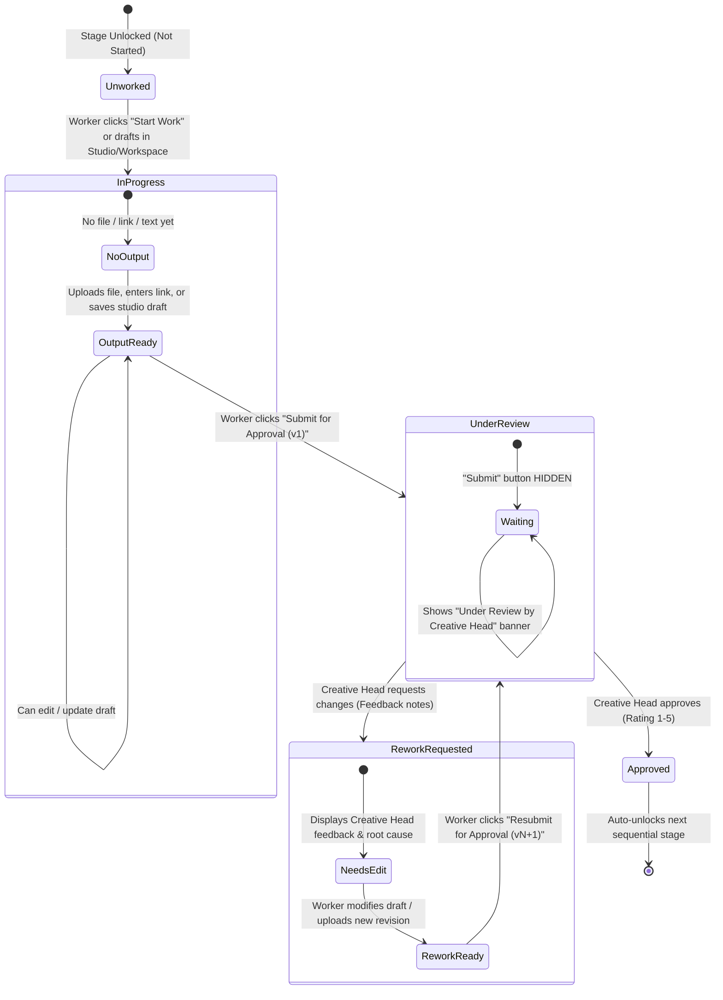
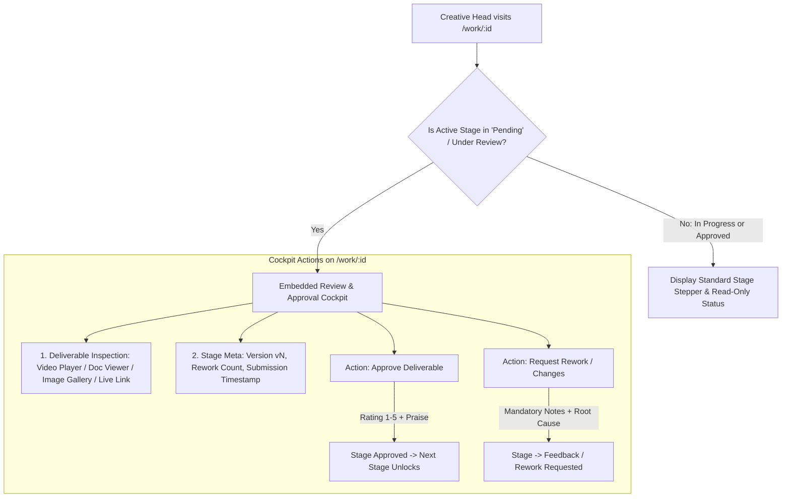

# Unified Work Submission & Centralized Approval Specification

**Authoritative Architecture & Fixed Implementation Prompts for HACA Marketing OS**  
*Resolves fragmented submission buttons, prevents premature submissions, eliminates confusing post-submission states, introduces per-stage rework counters, and centralizes all Creative Head approval actions onto the Work Details page (`/work/:id`).*

---

## 1. Problem Diagnosis & Architectural Reset

### 1.1 The Current Flaws (As Identified in UI Audits)
1. **Premature Submissions:** A worker could see and click "Submit for approval" on an untouched, empty stage before starting work or uploading any deliverables.
2. **Confusing Post-Submit State:** After submitting, the button remained visible in a disabled state with an amber badge *"Make a change first"*, making workers wonder if their submission went through or if it was blocked.
3. **Fragmented Approval Pages:** Creative Heads and Admins had approval actions scattered across `/feedback`, `/feedback/review-studio`, `/work/:id/review`, and `/work/:id`, causing disjointed decision-making.
4. **Missing Stage-Level Rework Counters:** While total piece revisions were tracked globally, individual stages lacked a clear, visible badge showing how many rework cycles that specific stage had undergone.

---

## 2. Redesigned Worker Submission Lifecycle



### 2.1 State Rules & Button Visibility Matrix

| Stage Status | Has Draft / Output? | What Worker Sees | Action Button | Notes / Banners |
| :--- | :--- | :--- | :--- | :--- |
| **`Not Started`** | No | Action Card: *"Start your stage deliverable"* | **`Start Work`** | "Submit" button is **HIDDEN**. |
| **`In Progress`** | No | Action Card: *"Draft or upload assets to submit"* | **`Open [Studio / Workspace]`** | "Submit" button is **HIDDEN** until output exists. |
| **`In Progress`** | Yes | Action Card: Deliverable draft ready | **`Submit for Approval`** | Active purple/indigo button. |
| **`Pending`** *(Under Review)* | Yes | Read-Only Submission Preview | **NONE** *(Submit button is **REMOVED**)* | Status Card: **`🕒 Under Review`** — *"Submitted v{version} on {date}. Waiting for Creative Head verification."* |
| **`Feedback`** *(Changes Requested)* | Previous draft exists | Rework Notice Card with Creative Head comments | **`Open Workspace to Revise`** &rarr; **`Resubmit for Approval (v{next})`** | Shows: **`⚠️ Rework Requested (Round {reworkCount})`** with reviewer feedback notes. |
| **`Approved`** | Yes | Final Approved Asset Summary | **NONE** | Green badge: **`✓ Stage Approved`** (Star rating displayed). |

---

## 3. Centralized Creative Head Approval Cockpit (On `/work/:id`)

All review and approval actions are **centralized directly onto the Work Details page (`/work/:id`)**:



### 3.1 Review & Approval UI Components on `/work/:id`
1. **Submission Preview Box:**
   - Script/Content: Embedded document reader with word count and hook preview.
   - Shoot: Video clip gallery / Google Drive footage link.
   - Edit: 9:16 Video player with duration indicator and aspect ratio check.
   - Design: Image lightbox / PDF viewer / Figma link opener.
2. **Stage Rework Counter:**
   - Prominently tagged: e.g., `Stage 1: Content · Round 1` (or `Rework Cycle: 2`).
3. **Approval Action Bar:**
   - **`Approve Deliverable`** (Green button):
     - Opens 1-click modal with 1–5 star rating, optional tags, and praise notes.
     - Sets stage status to `Approved` and triggers automatic downstream stage unlock.
   - **`Request Rework`** (Amber button):
     - Opens rework modal with required feedback comment and root cause category.
     - Sets stage status to `Feedback` (`Changes requested`), increments rework counter, and notifies worker.

---

## 4. Per-Stage Rework Counter Specification

Each `WorkItem` maintains its own explicit revision history:
* `workItem.revisions`: Total number of rework requests received on this stage (defaults to `0`).
* When Creative Head clicks **`Request Rework`**:
  $$\text{reworkCount} \leftarrow \text{reworkCount} + 1$$
* **UI Badge Formatting:**
  - `reworkCount == 0`: No badge (clean first attempt).
  - `reworkCount == 1`: Amber badge: **`1 Rework`** / **`Round 2`**.
  - `reworkCount >= 3`: Red warning badge: **`{reworkCount} Reworks`** (Alerts SM Manager of stagnant rework loops).

---

## 5. The Fixed Implementation Prompts

Use the following 4 structured prompts to execute this redesign cleanly across the frontend and backend:

---

### Prompt 1: Backend & Shared State Engine (Rework Counters & Transition Guards)

```text
PROMPT 1: BACKEND & SHARED RULES - STAGE REWORK COUNTERS & CLEAN TRANSITION GUARDS

Scope: packages/shared/src/index.ts, apps/api/src/modules/workItems/, apps/api/src/modules/submissions/

Requirements:
1. Stage Rework Counter:
   - Ensure WorkItem schema has `revisions: { type: Number, default: 0 }`.
   - In `apps/api/src/modules/submissions/service.js` under `requestRevision()`:
     - Increment `workItem.revisions = (workItem.revisions || 0) + 1`.
     - Record the rootCause, feedback comment, and timestamp.
     - Transition workItem.status to 'Feedback'.

2. Submission Validation Guard:
   - In `submitForApproval()`:
     - Ensure the deliverable is strictly non-empty (has text, files, or linkUrl). If empty, reject with 400 EMPTY_SUBMISSION.
     - Transition workItem.status to 'Pending' (meaning "Awaiting Creative Head Approval").
     - Compute next version: `nextVersion = (latestSubmission?.version || 0) + 1`.

3. Shared getAvailableActions Update:
   - In `packages/shared/src/index.ts`:
     - If status === 'Not Started': Worker gets ['start'].
     - If status === 'In Progress':
       - If hasOutput === false: Worker gets ['mark_blocked', 'request_help']. ('submit_for_approval' is NOT available).
       - If hasOutput === true: Worker gets ['submit_for_approval', 'mark_blocked', 'request_help'].
     - If status === 'Pending' (Under Review):
       - Worker gets NO submit actions (submit button is hidden).
       - Creative Head & Admin get ['approve', 'request_revision'].
     - If status === 'Feedback' (Rework Requested):
       - Worker gets ['resubmit_for_approval', 'mark_blocked', 'request_help'].
```

---

### Prompt 2: Worker Submission UI Redesign (`WorkDetailPage.tsx` & `MyWorkPage.tsx`)

```text
PROMPT 2: WORKER SUBMISSION UI REDESIGN - CONDITIONAL BUTTONS & UNDER REVIEW BANNER

Scope: apps/web/src/pages/work/WorkDetailPage.tsx, apps/web/src/pages/work/MyWorkPage.tsx

Requirements:
1. Remove Premature & Confusing Buttons:
   - Remove the disabled "Submit for approval" button with the amber "Make a change first" badge.
   - Do NOT render "Submit for approval" if the stage is untouched / has no draft or file uploaded yet.
   - Instead, render a clean card: "Start working or upload your deliverable to submit for approval" with a button to open the studio/workspace.

2. Hide Button When Under Review:
   - When `item.status === 'Pending'` (or currently submitted):
     - COMPLETELY REMOVE the "Submit for approval" button.
     - Display a reassuring status banner:
       "🕒 Under Review by Creative Head"
       "Deliverable v{item.currentSubmission?.version || 1} submitted on {formatDate(item.submittedAt)}. Creative Head review in progress."

3. Rework Requested State:
   - When `item.status === 'Feedback'`:
     - Display a prominent Rework Banner:
       "⚠️ Rework Requested (Round {item.revisions || 1})"
       Include Creative Head feedback comment, root cause tag, and timestamp.
     - Once the worker updates their draft or files, display an active button:
       "Resubmit for Approval (v{(item.currentSubmission?.version || 1) + 1})"

4. Display Stage Rework Badge:
   - In PipelineStepper and the Stage Detail card, display the stage's rework count:
     If `item.revisions > 0`, show badge: "{item.revisions} {item.revisions === 1 ? 'Rework' : 'Reworks'}".
```

---

### Prompt 3: Centralized Creative Head Approval Cockpit on Work Details Page

```text
PROMPT 3: CENTRALIZED CREATIVE HEAD & ADMIN APPROVAL COCKPIT ON /work/:id

Scope: apps/web/src/pages/work/WorkDetailPage.tsx, apps/web/src/pages/feedback/FeedbackPage.tsx

Requirements:
1. Embed Direct Approval Cockpit on WorkDetailPage:
   - On `/work/:id`, when user is `creative_head` or `admin` AND active stage status is 'Pending' (or awaiting approval):
     - Display an embedded "Review & Approval Cockpit" card directly above or inside the stage detail area.
     - Section A: Deliverable Preview
       - If Content/Script: Render document text snapshot with word count.
       - If Video (Edit/Shoot): Render HTML5 video player or Drive link.
       - If Design: Render image thumbnail with preview modal or Figma link.
     - Section B: Decision Actions Bar
       - Button 1: "Approve Deliverable" (Green button with checkmark icon)
         - Opens rating modal (Mandatory 1-5 star rating + optional notes).
         - On submit, calls POST `/api/submissions/:id/approve` or transitions to 'Approved'.
         - Triggers confetti / toast and auto-unlocks Stage N+1.
       - Button 2: "Request Rework" (Amber button with AlertTriangle icon)
         - Opens modal requiring:
           1. Feedback Comment (Textarea, required).
           2. Root Cause Category (Select: Brief Mismatch, Visual/Audio Defect, Tone/Copy, Typo, Pacing, Other).
         - On submit, calls POST `/api/submissions/:id/request-revision` or transitions to 'Feedback'.
         - Increments stage rework count and notifies worker.

2. Unify Links Across /feedback and Dashboard:
   - In `apps/web/src/pages/feedback/FeedbackPage.tsx`:
     - Remove disconnected inline approve/reject forms.
     - When clicking any pending review row or card, navigate directly to `/work/${item._id}` with hash `#review` to jump straight to the Approval Cockpit.
```

---

### Prompt 4: Studios & Workspaces Consistency Sync (`WritingStudio`, `Shoot`, `Edit`, `Design`)

```text
PROMPT 4: STUDIOS & MEDIA WORKSPACES SUBMISSION CLEANUP

Scope: apps/web/src/pages/work/writing-studio/WritingStudioPage.tsx, apps/web/src/pages/work/workspaces/

Requirements:
1. WritingStudioPage:
   - In header control bar, when `item.status === 'Pending'`:
     - Hide the "Submit for Approval" button.
     - Show badge: "Under Review by Creative Head".
   - If `item.status === 'Feedback'`:
     - Change button text to: "Resubmit for Approval (v{nextVersion})".
     - Require document modifications or comments before enabling submit.

2. Media Workspaces (Shoot, Edit, Design):
   - Only show "Submit for Approval" when:
     - Shoot: At least 1 video clip or link is attached.
     - Edit: 9:16 video cut is uploaded.
     - Design: Master image/PDF or Figma link is attached.
   - When submitted, replace button with: "Under Review (v{version})".
   - When rework requested, replace button with: "Resubmit Cut / Design (v{nextVersion})".
```
