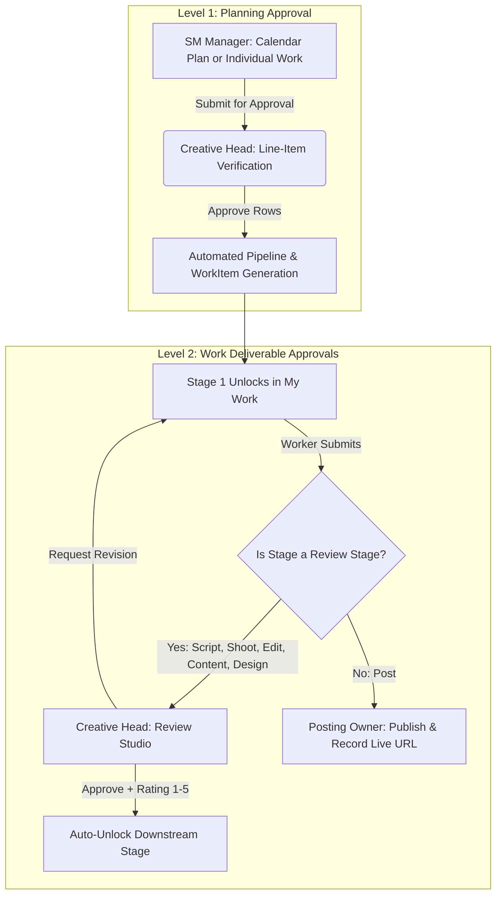
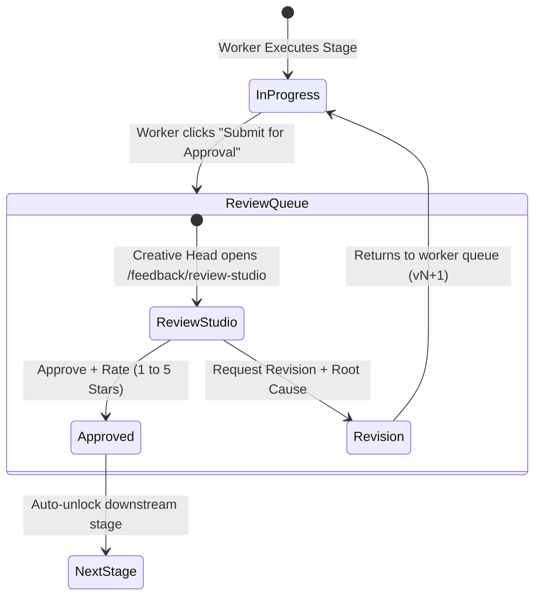

# Work Approval Request Workflow & UI Navigation Guide

**Authoritative Specification for HACA Marketing OS**  
*Documenting how to request approvals, who initiates each request, who approves, and every UI page and button where approval can be requested.*

---

## 1. Overview of the Approval Architecture

In **HACA Marketing OS**, approval requests happen at **two distinct levels**:

1. **Level 1 — Plan & Deliverable Inception (Calendar Plans & Individual Works):**
   - **Requester:** `sm_manager` (Social Media Manager) or `admin`.
   - **Approver:** `creative_head` (Creative Head).
   - **Purpose:** Approves the monthly calendar or ad-hoc individual work deliverable before any workers begin execution.
   - **Result of Approval:** Automatically instantiates the `ContentPiece` parent and creates the sequential stage `WorkItems`, instantly unlocking Stage 1.

2. **Level 2 — Stage Deliverable Execution (Review Stages):**
   - **Requester:** Assigned `team_member` (Writer, Designer, Videographer, Editor) or stage owner.
   - **Approver:** `creative_head` (Creative Head).
   - **Review Stages:** `Script`, `Shoot`, `Edit`, `Content`, and `Design`.
   - **Non-Review Stage:** `Post` (Final posting to social channels; completed by recording live URL & time).
   - **Result of Approval:** Triggers automatic unlock of the next sequential stage in the downstream worker's `/my-work` queue.

---

## 2. From Which Pages Can You Request Approvals?

Here is the comprehensive matrix of every page, workspace, role, and UI button available in the platform:

| Level | Page Name | URL Route | Target Stage / Entity | Eligible Roles | UI Button / Trigger |
| :--- | :--- | :--- | :--- | :--- | :--- |
| **Level 1** | **Monthly Calendar (Plans Tab)** | `/calendar` | Entire Monthly Plan or Individual Work rows | `sm_manager`, `admin` | **`Submit Plan for Approval`** / **`Resubmit for Approval`** |
| **Level 1** | **Individual Work Modal** | `/calendar` | Single Ad-Hoc Deliverable (`kind: 'individual'`) | `sm_manager`, `admin` | **`Create & Submit for Approval`** |
| **Level 2** | **My Work** | `/my-work` | Any assigned, unlocked review stage | `team_member`, `sm_manager` | **`Submit for approval`** (in active task card or quick drawer) |
| **Level 2** | **Work Detail Cockpit** | `/work/:id` | Active stage deliverable | Assigned Worker, `sm_manager`, `admin` | **`Submit for approval`** (in stage action bar) |
| **Level 2** | **Writing Studio** | `/work/:id/writing-studio` *(or `/work/:id/write`)* | `Script`, `Content` | Writer / Copywriter, `admin` | **`Submit for Approval`** (in top header control bar) |
| **Level 2** | **Design Workspace** | `/work/:id/workspace` *(or `/work/:id/design`)* | `Design` | Graphic Designer, `admin` | **`Submit for Approval`** (after uploading images/PDF) |
| **Level 2** | **Videographer (Shoot) Workspace** | `/work/:id/workspace` *(or `/work/:id/shoot`)* | `Shoot` (Footage verification) | Videographer, `admin` | **`Submit for approval`** (requires $\ge 1$ video clip or drive link) |
| **Level 2** | **Editor Workspace** | `/work/:id/workspace` *(or `/work/:id/edit`)* | `Edit` (Rough cut or final cut) | Video Editor, `admin` | **`Submit for Approval`** (after uploading 9:16 cut) |

---

## 3. Detailed Walkthrough by Page

### 3.1 Page 1: Monthly Calendar (`/calendar` &rarr; Plans Tab)

* **Primary Users:** `sm_manager` (Social Media Manager)
* **What is Submitted:**
  - Complete monthly calendar plan containing multiple scheduled rows (e.g., "Tech School November 2026").
  - Individual ad-hoc deliverable plans (`kind: 'individual'`).
* **Workflow Steps:**
  1. Navigate to `/calendar` and select the **Plans** tab.
  2. Select an active plan draft or click **"+ New Plan"** / **"+ Individual Work"**.
  3. Enter/edit deliverable rows: Type, Topic, For Team, Brief, Posting Date ($F$), and Stage Assignees.
  4. Real-time pre-flight validation verifies:
     - No blank required fields.
     - Dates are ordered sequentially (e.g. `Script < Shoot < Edit \le F`).
     - Reel toggles are satisfied (e.g. `needsShoot = false` requires `sourceVideoLink`).
  5. Click the primary button:
     - First submission: **`Submit Plan for Approval`**
     - After revisions: **`Resubmit for Approval`**
* **Under the Hood (API):**
  - Calls `POST /api/calendar-plans/:id/submit`
  - All valid rows transition from `draft` / `changes_requested` &rarr; `submitted`.
  - Notifications dispatch to `creative_head` (`plan.submitted`).

---

### 3.2 Page 2: My Work (`/my-work`)

* **Primary Users:** `team_member` (All creative contributors)
* **What is Submitted:** Any assigned stage item currently in `In Progress` status.
* **Workflow Steps:**
  1. Navigate to `/my-work` (default landing page for team members).
  2. Find the unlocked task in the **In Progress** column / list.
  3. Click the task card to open the **Submission Drawer** or preview pane.
  4. Fill in the required deliverable assets:
     - External deliverable link (Zoho Writer, Google Drive, Figma, or Dropbox).
     - Optional notes/remarks for the Creative Head.
     - Optional direct file uploads.
  5. Click the green/purple button: **`Submit for approval`**.
* **Direct Workspace Links:**
  - Tasks can also be opened in their specialized studios directly by clicking **"Open Writing Studio"** (for Script/Content) or **"Open Workspace"** (for Shoot/Edit/Design).
* **Under the Hood (API):**
  - Calls `POST /api/work/:id/submit`
  - WorkItem status transitions `in_progress` &rarr; `review` / `feedback`.
  - Creative Head receives real-time Socket.io alert and email notification.

---

### 3.3 Page 3: Work Detail Cockpit (`/work/:id`)

* **Primary Users:** Assigned Worker, `sm_manager`, `creative_head`, `admin`
* **What is Submitted:** Current active stage deliverable.
* **Workflow Steps:**
  1. Open any work item via direct URL or from `/work` or `/my-work`.
  2. Inspect the **Stage Stepper** across the top:
     - Completed stages are green checkmarks.
     - Active stage is highlighted in purple/blue.
     - Locked stages are greyed out with future target dates.
  3. In the **Stage Workspace / Action Card**:
     - Upload files or paste cloud asset links (Figma, Drive, Zoho).
     - Save draft auto-saves your progress.
  4. When ready, click **`Submit for approval`**.
  5. The UI enters read-only review mode with a banner: *"Submitted for review by Creative Head"*.

---

### 3.4 Page 4: Writing Studio (`/work/:id/writing-studio` or `/work/:id/write`)

* **Primary Users:** Writers (assigned to `Script` or `Content` stages)
* **Features:**
  - Scene-by-scene script table (Scene, Visual/Camera, Dialogue, Duration).
  - Copywriting editor with word count, target reading duration, and hook evaluation checklist.
  - External document fallback link.
* **How to Request Approval:**
  1. Complete the script/copy draft in the editor.
  2. Click **"Save Draft"** (or let auto-save capture changes).
  3. Click **`Submit for Approval`** in the top-right sticky control bar.
  4. A submission modal displays:
     - Version snapshot: `v1` (or `v2`, `v3` if re-submitting after revision).
     - Optional submission notes for the Creative Head.
  5. Confirming increments submission version and hands control to the Creative Head.

---

### 3.5 Page 5: Media Workspace — Graphic Design (`/work/:id/design` or `/work/:id/workspace`)

* **Primary Users:** Graphic Designers (assigned to `Design` stage)
* **Deliverable Formats:** PNG, JPG, WEBP, PDF, or Figma live links.
* **How to Request Approval:**
  1. Upload master visual artwork files (or paste Figma file link).
  2. Review the built-in dimension pre-flight check (e.g. 1080x1080 for Static, 1080x1350 for Carousel, 1080x1920 for Stories).
  3. Click **`Submit for Approval`** (displays as **`Submitting Design...`** while uploading).
  4. Assets are version-stamped and queued in the Creative Head's Review Studio.

---

### 3.6 Page 6: Media Workspace — Videographer Footage (`/work/:id/shoot` or `/work/:id/workspace`)

* **Primary Users:** Videographers / Shoot Owners (assigned to `Shoot` stage)
* **How to Request Approval:**
  1. Review the approved script and shot list (read-only reference).
  2. Upload raw video clips (supports chunked upload up to 500 MB per clip) or provide a Google Drive / cloud footage folder link.
  3. Verify that at least **1 clip or link** is attached. (The button remains disabled with *"At least one clip is required to submit for approval"* if empty).
  4. Click **`Submit for approval`**.
  5. Creative Head reviews the raw footage quality before Video Editing begins.

---

### 3.7 Page 7: Media Workspace — Video Editor (`/work/:id/edit` or `/work/:id/workspace`)

* **Primary Users:** Video Editors (assigned to `Edit` stage)
* **How to Request Approval:**
  1. Review approved script and footage from preceding stages.
  2. Upload rough cut / fine cut video file (MP4/MOV).
  3. Automated checks verify:
     - 9:16 vertical ratio (Reels/Shorts).
     - Duration check ($\le 90$ seconds).
  4. Enter edit notes and optional caption suggestions.
  5. Click **`Submit for Approval`** (displays as **`Submitting Cut...`**).

---

## 4. The Approval & Feedback Loop (Creative Head Perspective)

Where does the Creative Head review and act on these approval requests?

1. **Plan Approvals:**
   - **Page:** `/calendar` (Plans Tab &rarr; Review Drawer)
   - **Actions:**
     - **`Approve All`**: 1-click approval of all submitted rows.
     - **`Approve Selected Rows`**: Approve valid deliverables immediately.
     - **`Request Changes`**: Add mandatory inline comments on specific rows.
     - **`Reject Whole Plan`**: Reject with overarching strategic concern.

2. **Work Deliverable Approvals:**
   - **Page:** `/feedback/review-studio` (or `/work/:id/review`)
   - **Review Tools:**
     - Side-by-side split screen: Submission vs. Original Creative Brief.
     - HTML5 Video player with timecode-pinned comments for video edits.
     - Inline document viewer for scripts and copy.
   - **Actions:**
     - **`Approve Deliverable`**:
       - **Mandatory:** 1–5 star rating.
       - **Optional:** Quality tags and praise notes.
       - **Result:** Automatically sets `unlockedAt: new Date()` on Stage $N+1$.
     - **`Request Revision`**:
       - **Mandatory:** Specific feedback comments.
       - **Root Cause Categorization:** Selects cause (Brief mismatch, Audio/visual defect, Tone, Typo, etc.).
       - **Result:** Increments revision counter. Work item returns to worker's `/my-work` in `In Progress` with previous draft pre-filled. If revisions reach **4**, a `RevisionFlag` alert is raised on the manager's dashboard.

---

## 5. Security & Permission Rules

1. **No Self-Approval:** A worker cannot approve their own submission, even if they hold administrative or managerial permissions.
2. **Deterministic Sequence:** A downstream worker cannot request approval for Stage 2 until Stage 1 has been approved by the Creative Head.
3. **Immutable History:** Every approval, rejection, and comment is permanently recorded in `ActivityEvent` and `FeedbackEntry` audit logs with timestamp, actor, and version tag.
