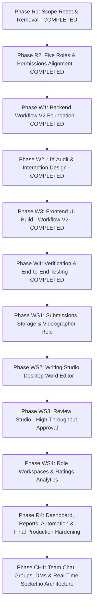

# HACA Marketing OS: Master Build Plan (Scope Reset & Workflow V2)

**Date:** 25 October 2026  
**Status:** Approved Master Scope Reset & Workflow V2  
**Target:** Conversion of HACA Marketing OS to Work and Team Only (HACA Only)  
**Source of Truth:** [docs/WORKFLOW.md](file:///c:/Users/ADMIN/OneDrive/Desktop/HACA/TECH/haca-forge/docs/WORKFLOW.md), [docs/SCOPE_RESET.md](file:///c:/Users/ADMIN/OneDrive/Desktop/HACA/TECH/haca-forge/docs/SCOPE_RESET.md) and [docs/CONTENT_FLOW.md](file:///c:/Users/ADMIN/OneDrive/Desktop/HACA/TECH/haca-forge/docs/CONTENT_FLOW.md)

---

## 1. Overview & Phased Roadmap Strategy

The transition restructures all system capabilities into sequential, self-contained milestones. Each phase delivers working functionality, passes all tests and linting, and establishes clear verification before advancing.

---

## 2. Phase-by-Phase Execution Specifications

### Phase R1: Scope Reset & Removal (COMPLETED)
* **Status:** Verified & Closed.
* **Scope:** Clean slate removal of all out-of-scope modules (`leads`, `campaigns`, `targets`), LSQ adapters, sync jobs, CRM pages, and CRM configuration. Established single-brand mode (HACA only).

---

### Phase R2: Five Roles & Permissions Alignment (COMPLETED)
* **Status:** Verified & Closed.
* **Scope:** Established exact 5 canonical role keys (`admin`, `creative_head`, `executive`, `sm_manager`, `team_member`). Aligned CASL permissions, resolveScope, executive read-only restrictions, and route guards.

---

### Phase W1: Backend Workflow V2 Foundation

* **Scope:** Implement core data structures, models, validation rules, auto-fill suggestion engine, post-approval pipeline generation, tracking calculations, and day-based notification rules for Workflow V2.
* **Backend Deliverables:**
  1. **CalendarPlan Schema Updates (`modules/calendarPlans/`):**
     * Restrict `kind` to exactly: `'monthly'` and `'individual'` (remove legacy `'project'`).
     * Plan title carries the school name and planning period (e.g., `'Tech School November 2026'`).
     * Add `rejectionConcern` field for overall plan rejection by Creative Head.
     * Plan statuses: `Draft`, `Submitted`, `Changes requested`, `Approved`, `Approved with pending rows`.
  2. **Row Schema & Validation Engine:**
     * Fields: `postingDate F`, `postingTime`, `topic`, `type` (15 types), `forTeam` (`Sales`, `Marketing`, `Academics`, `Other`), `programOrEvent`, `brief` (max 1,000 chars), `referenceLink` (input URL only; never reuse output fields), `priority` (`Normal`, `Urgent`, default `Normal`), `remarks`, `postingOwner`, `contentOwner`, `contentDeadline`, `scriptOwner`, `scriptDeadline`, `needsScript`, `needsShoot`, `shootOwner`, `shootDeadline`, `editOwner`, `editDeadline`, `designOwner`, `designDeadline`, `sourceVideoLink`.
     * Blocking errors: missing required fields, unknown type, past dates, stage deadline after $F$, out-of-order deadlines, Reel without shoot lacking source video link, postable type missing posting owner, owner not active `team_member` or lacking preference, duplicate row in plan, individual plan != 1 row.
     * Non-blocking warnings: last creation stage $>F-1$, owner workload $>85\%$, date outside plan month.
  3. **Auto-Fill Suggestion Engine (at Row Creation):**
     * Selecting type (and reel toggles) immediately suggests stage list, owners, and deadlines.
     * Suggested owners: active `team_member`, matching `workPreferences[]`, workload $<85\%$ (including draft plan stage hours: Content 2, Script 2, Design 4, Shoot 4, Edit 6, Post 1), ranked by lowest workload $\rightarrow$ fewest 90-day revisions $\rightarrow$ earliest availability. Rationale string attached. Fallback: `'No available person with this role'`. Excludes admin, creative_head, sm_manager, executive.
     * Suggested deadlines (calendar days from $F$; 2-day buffer):
       * Postable design: Content $F-5$, Design $F-2$, Post $F$.
       * Non-postable design: Content $F-5$, Design $F-2$, Handover $F$.
       * Reel Variant A: Script $F-8$, Shoot $F-5$, Edit $F-2$, Post $F$.
       * Reel Variant B: Shoot $F-5$, Edit $F-2$, Post $F$.
       * Reel Variant C: Edit $F-2$, Post $F$.
     * Manual edits marked `'set by SM Manager'`. If $F$ moves, only non-set values recalculate.
  4. **Creative Head Plan Actions:**
     * `POST /api/calendar-plans/:id/approve-all`: Approves all submitted rows.
     * `POST /api/calendar-plans/:id/approve-selected`: Approves selected rows.
     * `POST /api/calendar-plans/:id/request-changes`: Attaches mandatory row comment.
     * `POST /api/calendar-plans/:id/reject`: Rejects whole plan with overall concern; all submitted rows become `changes_requested`.
  5. **Post-Approval ContentPiece & Stage Generation:**
     * Approved rows generate `ContentPiece` and sequential `WorkItem` stages with row owners and deadlines.
     * Stage 1 is unlocked immediately (`unlockedAt: new Date()`); downstream stages are locked (`unlockedAt: null`).
     * Post-approval mutation service: SM Manager and Admin can change owner, deadline, reschedule $F$, or skip unstarted stage (logged in `ActivityEvent`: `who`, `when`, `old`, `new`; worker and Creative Head notified). Topic and type cannot change after approval.
  6. **Removal of Hour-Based Rules:**
     * Overdue checked once daily at end-of-day in `REPORT_TIMEZONE`.
     * Instant blocker notification with `'blocked since <date>'`. No 4-hour alert.
     * Approval queue shows `'waiting for X days'`.
     * Unclassified revision flags stay pinned on dashboard (no 48-hour alert).
  7. **Taxonomies & Import Parser:**
     * 9 Blocker reasons and 7 Revision root causes (with `Approval delay`).
     * 24-column template parser with email lookup and minimal 5-column upload support.
* **Acceptance Criteria:** All unit and API integration tests for W1 pass with 0 errors.

---

### Phase W2: UX Audit & Interaction Design

* **Scope:** Comprehensive UX design audit of the planning, verification, tracking, and execution journeys.
* **Deliverables:**
  1. **Calendar Plans UX:**
     * Authoring modal: Monthly vs Individual plan selection; school name in title.
     * 24-column upload preview modal with syntax validation and auto-fill tags.
     * Interactive grid editor: instant stage expansion upon type selection, inline reason chips, manual override badges ('set by SM Manager'), warning vs error indicators.
  2. **Plan Verification & Review UX:**
     * Creative Head review drawer in `/feedback`: approve all, select rows, row comment drawer, reject entire plan with strategic concern modal.
  3. **Content Tracker UX:**
     * Social View and Design View tables on `/calendar?tab=tracker`:
       * 'Who holds it now' chip (worker, Creative Head, SM Manager for needs owner, Blocked since date, Locked).
       * 'At Risk' badge (active stage due within 2 calendar days not in review).
       * Derived days: Late by days, owner lag days, approval wait days.
  4. **Worker & Execution UX:**
     * `/my-work` card design: greyed-out locked stages with scheduled due dates; clear separation of input reference link vs output deliverable link.
     * Blocker modal with 9 canonical reasons; Revision modal with 7 canonical causes.
* **Acceptance Criteria:** UX audit document and design specifications approved before UI build.

---

### Phase W3: Frontend UI Build (Workflow V2)

* **Scope:** Implement the audited user interfaces across the React web workspace.
* **Deliverables:**
  1. **Calendar Plans Tab (`/calendar?tab=plans`):**
     * Monthly and Individual plan creation with school in title.
     * 24-column Excel/CSV import modal with auto-fill preview and minimal upload support.
     * Interactive grid table with instant stage suggestion generation on type/toggle selection.
     * Manual override tagging ('set by SM Manager') and recalculation behavior on $F$ change.
  2. **Plan Approvals Queue (`/feedback?tab=plans`):**
     * Line-item approval interface for Creative Head: Approve All, Approve Selected, Request Changes with row comments, Reject Whole Plan with concern.
     * Plan status display (`Draft`, `Submitted`, `Changes requested`, `Approved`, `Approved with pending rows`).
  3. **Content Tracker Tab (`/calendar?tab=tracker`):**
     * Social view and Design view tabs.
     * Live operational columns: 'Who holds it now', 'Piece status' (On Track, At Risk [2 days], Late), Late by days, Owner lag days, Approval wait days.
  4. **Worker Portal & Stage Execution (`/my-work` & `/work/:id`):**
     * Visual stage stepper showing locked (greyed out with due date) vs unlocked states.
     * Display of input `referenceLink` and `brief` (up to 1,000 chars).
     * Non-postable items finish upon design approval with handover note on date $F$.
     * Blocker modal updated to 9 exact reasons; Revision modal updated to 7 exact root causes.
     * Post-approval change drawer for SM Manager and Admin with audit history.
* **Acceptance Criteria:** Clean TypeScript compilation, lint passing, responsive across breakpoints.

---

### Phase W4: Verification & End-to-End Testing

* **Scope:** Full test automation, regression testing, and verification of Workflow V2 across all 5 roles.
* **Deliverables:**
  1. **Automated Unit & Integration Test Suites:**
     * Plan authoring, 24-column import, minimal 5-column upload.
     * Auto-fill suggestion engine and workload calculation (including draft plan stage hours).
     * Deadline offsets ($F-5, F-2$, etc.) and recalculation logic preserving manual overrides.
     * Creative Head plan review actions (`approve_all`, `approve_selected`, `request_changes`, `reject`).
     * Sequential stage generation and unlocking upon row approval.
     * Day-based notifications (daily overdue check, instant blocker alert, 3-day inactivity).
  2. **End-to-End Role Journeys:**
     * Admin, Creative Head, SM Manager, Team Member, Executive complete all respective paths.
  3. **Zero Regression:**
     * Monorepo tests passing 100% green.
* **Acceptance Criteria:** Full test suite passes; production build succeeds without errors.

---

### Phase WS1: Data Model, Submissions, Storage & Videographer Role

* **Scope:** Establish the data models, backend endpoints, storage infrastructure, permission rules, and canonical job roles for typed submissions and creative quality ratings.
* **Backend Deliverables:**
  1. **Typed Submission Model (`Submission`):**
     * Links to `workItemId`, `contentPieceId`, `authorId`, `version` integer, `type` (`document`, `video_footage`, `video_cut`, `image_gallery`, `pdf_document`, `live_post`), `data` (JSON document, file references array, or live link metadata), `htmlSnapshot` (for document types), `changelogSummary`, `isLatest` flag.
     * Fallback URL field (`fallbackUrl`) for external document/drive links.
     * Submission endpoints: `POST /api/work-items/:id/submissions` (creates immutable `vN`), `GET /api/work-items/:id/submissions` (lists versions), `GET /api/work-items/:id/submissions/:version`.
  2. **Elevate Shoot to a Review Step:**
     * Update `apps/api/src/modules/workItems/transition.service.js` so that `Shoot` transitions from `In Progress` &rarr; `Feedback` (Submitted for review).
     * Downstream `Edit` stage unlocks **only after Creative Head approves the Shoot submission**.
  3. **Job Role 'Videographer':**
     * Add `Videographer` to canonical job roles in `packages/shared/src/index.ts`.
     * Assign default work preference `['Shoot']` and department `Video Production`.
     * Update Request Access schema, People management, and demo seeder.
  4. **Server-Side Asset Upload & Storage:**
     * File upload endpoints supporting chunked/resumable multipart uploads.
     * Enforce strict server-side limits: Video (MP4, MOV, WebM) $\le 500\text{ MB}$; Images (PNG, JPG, WebP) $\le 20\text{ MB}$; PDF $\le 50\text{ MB}$.
     * Unguessable storage paths (UUID-based), unindexed, served via signed URLs or reverse proxy.
     * Binary metadata extraction: size, duration (seconds), width, height, MIME type.
  5. **Quality Rating Schema (`QualityRating`):**
     * Fields: `workItemId`, `submissionId`, `contentPieceId`, `workerId`, `raterId`, `rating` (1 to 5 integer, required), `feedback` (optional string), `tags` (`Great hook`, `Clear message`, `Needs polish`, `Off brief`), `editHistory[]` (`editedBy`, `editedAt`, `oldRating`, `newRating`, `oldFeedback`, `newFeedback`, `reason`).
     * Worker notification upon rating and "Mark as seen" mutation (`seenAt`).
     * Profile metrics aggregator: computes 30d, 90d, all-time averages, monthly trend, distribution, per-step average (minimum 3 ratings required before returning averages).
  6. **Permissions & Scoping:**
     * Submissions visible to owner, reviewers (`creative_head`, `admin`), `sm_manager`, `executive` (read-only), and same-piece colleagues (read-only).
     * Comments strictly private between step owner and reviewers.
* **Acceptance Criteria:** Unit and API integration tests pass for all WS1 endpoints, storage size limits enforced, Shoot requires approval, Videographer role seedable.

---

### Phase WS2: Writing Studio (Writer Workspace)

* **Scope:** Desktop-first Word-style integrated document editor for `Content` and `Script` stages in `/work/:id`.
* **Deliverables:**
  1. **Tiptap Integration & Approved Dependencies:**
     * Install strictly approved packages: `@tiptap/react`, `@tiptap/pm`, `@tiptap/starter-kit`, official extensions (table, highlight, underline, text-align, text-style, color, image, link, task-list, task-item, subscript, superscript).
     * Exactly one DOCX export library, exactly one DOCX import library (`mammoth`), native browser print (`window.print()`). Zero other libraries.
  2. **Canvas & Ribbon UI:**
     * A4 page canvas ($210\text{mm} \times 297\text{mm}$) with margins, page breaks, and zoom controls ($50\%$ to $150\%$).
     * 6 Ribbon tabs: Home, Insert, Script, Review, View, File.
     * Docked collapsible sidebar with Brief, Script Tools, and Comments tabs.
  3. **Typography & Malayalam Support:**
     * Font family picker including **Manjari** / **Gayathri** for Malayalam Unicode rendering.
     * Paragraph styles: Title, Heading 1–3, Normal, Quote.
  4. **Collaboration & Autosave:**
     * Single-editor session heartbeating lock with read-only banner for secondary viewers.
     * Debounced autosave (3–5s) with `Saved ✓` indicator.
     * Offline local resilience buffer (`IndexedDB` / `localStorage`).
     * Version history browser with restore.
  5. **Scriptwriting Tools:**
     * One-click Script Templates: Reel script (Hook, Body, CTA), Explainer, Student voices, Event promo, Poster copy, Carousel, Story.
     * 2-column Scene Table (Visual, Audio, Time) with auto-numbering and cumulative duration.
     * Duration Estimator (WPM setting vs 15s/30s/60s/90s targets with warning).
     * Hook Check (first line length warning).
     * Captions & Hashtags section with platform limits feeding Post copy buttons.
     * Automatic Shot List extractor (read-only for Videographer).
     * Teleprompter mode.
     * Personal Snippets library.
  6. **Storage & Sanitization:**
     * Document stored as Tiptap JSON + sanitized HTML snapshot ($\le 1\text{ MB}$).
* **Acceptance Criteria:** Writing Studio creates, edits, autosaves, locks against collisions, renders Malayalam cleanly, imports/exports DOCX/TXT, and submits versioned snapshots.

---

### Phase WS3: Review Studio (Creative Head & Admin Workspace)

* **Scope:** High-throughput approval queue and multi-media review studio at `/feedback`.
* **Deliverables:**
  1. **Approval Queue ('Waiting for Approval'):**
     * Submissions sorted oldest first (FIFO) with days waiting badge.
     * Auto-advance to next submission upon decision.
     * Queue selector modal / breadcrumb.
  2. **Split-Screen Review Cockpit:**
     * Left pane: Rich media viewer (~70%).
     * Right pane: Context, brief, upstream outputs accordion, version switcher, anchored comments list (~30%).
  3. **Media Viewers:**
     * Document Viewer: A4 formatted read-only view with text comment anchoring and side-by-side / inline text compare diff.
     * Video Player: HTML5 player for MP4/WebM/MOV with speed controls ($0.5\times$ to $2\times$), fullscreen, and timecode-pinned comments.
     * Image Viewer: Pan, zoom, point-pinned coordinate comments, and carousel slide thumbnail gallery.
     * Link Opener: Isolated tab opener for fallback external links.
  4. **Decision Bar:**
     * Approve: Requires 1–5 quality rating, optional feedback, optional tags (`Great hook`, `Clear message`, `Needs polish`, `Off brief`).
     * Request Revision: Requires comment or note; Creative Head selects from 7 canonical root causes.
     * Prefills previous submission for worker in `In Progress`.
  5. **Keyboard Shortcuts:**
     * `Space` (Play/Pause), `J`/`L` (Seek 5s), `C` (Comment), `A` (Approve), `R` (Request Revision), `[`/`]` (Prev/Next).
* **Acceptance Criteria:** Creative Head reviews documents, videos, and images with anchored/timestamped comments, gives 1–5 ratings on approval, and auto-advances through the queue.

---

### Phase WS4: Workspaces for Other Roles & Ratings Analytics

* **Scope:** Role-specific workspaces for Videographer, Editor, Designer, and Poster, plus profile quality ratings analytics.
* **Deliverables:**
  1. **Videographer Workspace (`Shoot`):**
     * Read-only script and extracted shot list.
     * Chunked/resumable multi-video upload ($\le 500\text{ MB}$, pause, retry, phone support).
     * Shoot notes text area.
     * Submit for Creative Head review.
  2. **Editor Workspace (`Edit`):**
     * Read-only raw footage and script.
     * Video cut upload with non-blocking 9:16 vertical and $\le 90\text{s}$ duration warnings.
     * Version switcher and interactive revision comments checklist.
  3. **Designer Workspace (`Design`):**
     * Approved content docked side-by-side with section copy buttons (Headline, Subhead, Body, CTA).
     * Multi-file image upload ($\le 20\text{ MB}$) or PDF ($\le 50\text{ MB}$).
     * Dimension pre-flight warnings: Static Post ($1080\times 1080$), Carousel ($1080\times 1080$), Story ($1080\times 1920$), Thumbnail/Cover ($1280\times 720$).
     * Drag-and-drop carousel slide reordering.
  4. **Posting Owner Workspace (`Post`):**
     * Download approved master asset button.
     * Copy caption & hashtags buttons (pulled from Writing Studio metadata).
     * Platform pre-publish checklist.
     * Live link URL and publication timestamp entry; Mark as posted.
  5. **Quality Ratings Analytics & Profile Views:**
     * Task card rating display with "Mark as seen".
     * Rating edit modal with audit logging (`ActivityEvent`).
     * Profile metrics on My Account and People directory cards: 30d/90d/all-time average, monthly trend, distribution, step type average, recent feedback with content title.
     * Minimum 3 ratings threshold enforced (displays placeholder if $<3$).
     * Privacy guards: Worker sees strictly their own; leaders view all; zero public leaderboards or worker comparisons.
  6. **Comprehensive Automated Verification:**
     * End-to-end test suite covering WS1 to WS4 across all 5 roles.
* **Acceptance Criteria:** All role workspaces operational, file limits enforced, ratings captured and aggregated with strict privacy guards, monorepo tests 100% green.

---

### Phase R4: Dashboard, Reports, Automation & Comprehensive Tests

* **Scope:** Finalize the 8-section Team Dashboard, 4 core reports, day-based automation runners, and production deployment readiness.
* **Backend Changes:**
  * Dashboard aggregation service compiling all 8 sections with Workflow V2 metrics (At Risk = 2 days, 'who holds it now', late by days).
  * 4 Core Reports: Weekly Work Report, Monthly Performance Scorecard, Creative Production Report, Team Performance Digest.
  * 6 Background Automation Rules (day-based, no hour rules).
* **Frontend Changes:**
  * Dashboard layout with real-time counters and operational sections.
  * Reports viewer with on-demand generation for Creative Head and Admin.
* **Acceptance Criteria:** Dashboard live, reports accurate, all jobs running cleanly.

---

### Phase CH1: Team Chat, Groups, Direct Messages & Real-Time Socket.io Architecture

* **Source of Truth:** [docs/CHAT.md](file:///c:/Users/ADMIN/OneDrive/Desktop/HACA/TECH/haca-forge/docs/CHAT.md)
* **Scope:** Full-featured team communications platform with Team chat (system singleton), Groups, 1:1 Direct Messages, "Share to chat" approval flow with `ShareGrant`, and real-time Socket.io synchronization.
* **Deliverables:**
  1. **Shared Schemas & Permissions (`packages/shared`):**
     * Permissions: `chat.use`, `chat.group.create`, `chat.moderate`, `chat.read`.
     * Zod schemas: Channel creation, message validation (max 4,000 chars, stripped HTML), reaction toggle (6 emojis), attachment limits, share asset grant.
  2. **Backend Chat Engine (`apps/api/src/modules/chat/`):**
     * Data models: `Channel`, `ChannelMember`, `ChatMessage`, `ShareGrant`.
     * REST API: Channels CRUD, pagination (50 messages/page), pins, reactions, search, upload signing.
     * Upload engine: Multer disk storage in `uploads/chat/:channelId/:uuid/:safeFileName` enforcing caps (image $\le 20\text{ MB}$, doc $\le 25\text{ MB}$, video $\le 100\text{ MB}$).
     * Socket.io real-time layer: Authenticated JWT handshake, `channel:<id>` rooms with join/emit database verification, typing indicators, read receipts, optimistic retries.
     * Notifications: `chat` category in Settings (in-app default ON, email default OFF, mentionsOnly option) + per-channel mute.
     * Migration: `scripts/migrate-team-chat.js` (idempotent bootstrap of Team Chat channel and active user memberships).
  3. **Share to Chat & ShareGrant Architecture:**
     * "Share to chat" modal triggered on approved outputs in Review Studio, Workspaces, and clip cards.
     * Posts structured media card with thumbnail, approved badge, owner info, note, and view/download buttons.
     * `ShareGrant` verifies caller channel membership for asset access while keeping upstream pipeline and review comments isolated.
     * Optional `[ ] Also share to Team chat` checkbox upon Creative Head stage approval.
  4. **Frontend Chat UI (`apps/web/src/pages/chat/`):**
     * Top-bar chat button with real-time unread badge across all roles in `Layout.tsx`.
     * Route `/chat` with desktop 3-pane layout (Channels, Message Stream, Channel Details) and mobile 360px 2-screen flow.
     * Built-in Unicode emoji picker (zero dependencies), @mentions autocomplete, quoted replies, 24h edit window, deletion placeholders.
     * Channel & cross-channel search drawer, deep links `/chat/<channelId>?m=<messageId>`.
     * Role boundaries: Executive read-only viewer in Team chat/groups, cannot post/react/DM/share; Team Member full chat and DM with peers, cannot create groups or use `@everyone`; Admin moderate permissions. Zero surveillance leaderboards or message counts.
* **Acceptance Criteria:** Monorepo lint, typecheck, unit, integration, and e2e test suites 100% green; all 5 roles verified under strict permission and privacy rules.

---

## 3. Retained Historical Artifacts

All historical work items, deliverables, and activity events remain completely intact in MongoDB. Cloudinary assets stay fully accessible. The pre-workflow-v2 codebase and database state are preserved under git tag `pre-workflow-v2` and backup directory `../haca-backups/before-workflow-v2/`.
