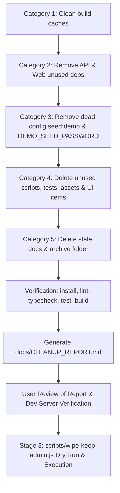

# Project Cleanup Plan: HACA Marketing OS
**Document Version:** 2.0 (Post-Review Update)  
**Date:** 2026-10-24  
**Target Repository:** `HACA/TECH/haca-forge`  
**Target Database:** `mongodb://127.0.0.1:27017/marketing_portal`  
**Status:** Approved with Modifications — Ready for Execution

---

## 1. Executive Summary & Approved Decisions

Following user review and approval of the initial cleanup audit, the cleanup plan has been updated with the following explicit decisions:

1. **Live Local Database (`.mongodb_data/`):** **DO NOT DELETE**. This is the active local database directory. It will be emptied selectively by the Stage 3 wipe script rather than deleted from disk.
2. **Video & Playbook Backups:**
   - `docs/ui/ui-ref.mp4` (11.79 MB) has been copied to `../haca-backups/ui-ref.mp4`, untracked via `git rm --cached`, and `*.mp4` added to `.gitignore`.
   - `docs/playbook/MOS_BUILD_PLAYBOOK.md` has been copied to `../haca-backups/MOS_BUILD_PLAYBOOK.md` and deleted from the repo along with `docs/playbook/PROJECT_REPORT.pdf`, removing the empty `playbook` directory.
   - Preserved design documentation: `docs/ui/ui-details.md` and `docs/ui/ui_design_specification.md`.
3. **Folder Case Standardization:**
   - Tracked documentation folder has been renamed from uppercase `Docs/` to lowercase `docs/` using git two-step (`git mv Docs docs_tmp && git mv docs_tmp docs`). All internal doc links updated.
4. **Category 4 Component & Code Inventory:**
   - Full audit conducted across `apps/web/src` and `apps/api/src`.
   - Identified 0 unused backend modules (all 28 controllers, services, and models are actively wired).
   - Identified candidate unused frontend files: `PlaceholderPage.tsx`, `EmptyState.tsx`, `MyAccountModal.tsx` (redundant with `MyAccountPage.tsx`), 6 unused logo image assets, and unused filter state properties. Full evidence documented in Section 4.
5. **Database Plan Adjustments:**
   - Audited reference collections: `holdreasons`, `contentformats`, `platforms`, `requesttypes`, and `pipelinetemplates` have **0 active usages** in application code outside legacy seeds $\rightarrow$ **DROP / EMPTY**.
   - `teams` and `settings` are actively used $\rightarrow$ **KEEP**.
   - `departments`: Prune from 13 documents to the agreed canonical 7 departments.
   - `priorities`: Prune from 4 documents (`Urgent`, `High`, `Medium`, `Low`) to the agreed 3: `High`, `Medium`, `Low`.
   - `reportdefinitions`: Delete 2 legacy definitions (`lead_funnel_cpl`, `campaign_deepdive`) so only the 4 canonical R4 reports remain (`weekly_marketing`, `monthly_scorecard`, `creative_production`, `team_performance`).
   - `profiles`: Ensure only HACA (`code: 'haca'`) is active; others inactive or removed.
   - `users`: Delete all users except `admin@hacaforge.com`.

---

## 2. Category 1: Build Artifacts & Caches

| Path / Target | Size | Action | Rationale |
| :--- | :--- | :--- | :--- |
| `.mongodb_data/` | ~339 MB | **`KEEP`** | **CRITICAL:** Live MongoDB data directory. Emptied programmatically in Stage 3. |
| `apps/web/dist/` | ~2.5 MB | **`SAFE-DELETE`** | Ephemeral Vite production build output. Rebuilt on `npm run build`. |
| `packages/shared/dist/` | ~45 KB | **`SAFE-DELETE`** | Ephemeral tsup build output. Rebuilt on `npm run build`. |
| `scratch/` (temporary analysis scripts) | ~10 KB | **`SAFE-DELETE`** | Temporary audit scripts created during inspection. |

**Verification Command:** `npm run build` after purge.

---

## 3. Category 2: Dependencies

### API (`apps/api/package.json`)

| Package | Dep Type | Size | Evidence / Action |
| :--- | :--- | :--- | :--- |
| `express-mongo-sanitize` | `dependencies` | 42 KB | 0 imports in `apps/api/src`. Express 5 / Mongoose handles sanitization. **REMOVE**. |
| `pino-http` | `dependencies` | 130 KB | 0 imports. Replaced by native pino middleware in `server.js`. **REMOVE**. |
| `@faker-js/faker` | `devDependencies` | ~15 MB | 0 imports in test suite or server. **REMOVE**. |

### Web (`apps/web/package.json`)

| Package | Dep Type | Size | Evidence / Action |
| :--- | :--- | :--- | :--- |
| `@tanstack/react-table` | `dependencies` | 1.8 MB | 0 imports across `apps/web/src`. Tables use native glassmorphic HTML markup. **REMOVE**. |
| `react-dropzone` | `dependencies` | 240 KB | 0 imports across `apps/web/src`. File uploads use direct input handlers. **REMOVE**. |
| `react-hook-form` | `dependencies` | 450 KB | 0 imports across `apps/web/src`. Modals and pages use React `useState`. **REMOVE**. |
| `clsx` | `dependencies` | 15 KB | 0 imports across `apps/web/src`. Classes use standard template literals. **REMOVE**. |
| `tailwind-merge` | `dependencies` | 110 KB | 0 imports across `apps/web/src`. **REMOVE**. |
| `zod` | `dependencies` | 220 KB | Remove **LAST**. Verified: `apps/web/src` has 0 direct imports of `zod`. `@mmp/shared` bundles its Zod schemas into `dist/index.js` and lists `zod` as a standard dependency (not peer dependency). Verify web build passes upon removal. **REMOVE**. |

### Rule Documentation Sync
Update `.agent/rules/01-engineering-rules.md` lines 6-7 and line 34:
- Remove references to `TanStack Table`, `React Hook Form`, `FullCalendar`, and `mongo sanitize`.

---

## 4. Category 3: Dead Configuration

| Item | File | Action |
| :--- | :--- | :--- |
| Script `seed:demo` | Root `package.json` & `apps/api/package.json` | Remove script definition. |
| Script `db:clean` | `apps/api/package.json` | Remove script definition (points to deleted `clean-database.js`). |
| Config `DEMO_SEED_PASSWORD` | `apps/api/src/config/env.js` | Remove from `envSchema` validation. |
| Config `DEMO_SEED_PASSWORD` | `apps/api/.env.example` and local `.env` | Remove environment variable entry. |

---

## 5. Category 4: Unused Files, Scripts & Frontend Inventory

### A. Scripts to Delete (with Accompanying Tests)

| Script Path | Purpose / Evidence | Action |
| :--- | :--- | :--- |
| `scripts/migration-overrides.json` | Legacy overrides file for pre-R1 migration. | **DELETE** |
| `scripts/scope-reset-r1.js` | Scope Reset R1 one-off migration script. Completed. | **DELETE** |
| `scripts/migrate-roles-r2.js` | Scope Reset R2 one-off role migration script. Completed. | **DELETE** |
| `scripts/migrate-legacy-roles.js` | Pre-reset legacy role migration script. Obsolete. | **DELETE** |
| `apps/api/scripts/clean-database.js` | Obsolete database cleaning script. Superseded by Stage 3 wipe. | **DELETE** |
| `apps/api/scripts/seed-demo.js` | Demo environment seeder. Multi-user demo accounts removed. | **DELETE** |
| `scripts/reset-data-marketing-os.js` | Intermediate reset script. Superseded by `scripts/wipe-keep-admin.js`. | **DELETE** |
| `scripts/seed-demo-users.js` | Demo user generator. Superseded by single admin seed. | **DELETE** |
| `scripts/demo-users.json` | Fixture containing demo user credentials. | **DELETE** |
| `apps/api/test/reset_and_demo_seed.test.js` | Tests targeting `reset-data-marketing-os.js` and `seed-demo-users.js`. | **DELETE** |
| Migration tests in `scope_reset_r1.test.js` & `scope_reset_r2.test.js` | Remove specific blocks testing deleted migration scripts (`runScopeResetR1` and `runRoleMigrationR2`). | **PRUNE** |

*Kept Scripts:* `scripts/seed.js` (reference taxonomy seeder) and `apps/api/scripts/seed-admin.js` (admin user bootstrap).

### B. Unused Components, Pages, Assets & Modals (Evidence & Recommendations)

| Item Path | Type | Size | Audit Evidence & Recommendation | Proposed Action |
| :--- | :--- | :--- | :--- | :--- |
| `apps/web/src/pages/PlaceholderPage.tsx` | Page Component | 4,543 B | **0 references** across the entire project. Was used during early milestone scaffolding before all 14 screens were implemented. | **DELETE** |
| `apps/web/src/components/EmptyState.tsx` | UI Component | 1,559 B | **0 references** across the entire project. All pages use domain-specific, contextual glassmorphic empty states. | **DELETE** |
| `apps/web/src/components/MyAccountModal.tsx` | Modal Component | 7,704 B | Duplicate of `apps/web/src/pages/MyAccountPage.tsx` (routed to `/account` and `/my-account`). In `Layout.tsx:603`, the user profile button currently opens this modal. Switching the button to `navigate('/account')` makes this modal 100% obsolete. | **DELETE** (after updating `Layout.tsx`) |
| `apps/web/src/assets/haca-forge-logo-white.png` | Image Asset | 11.1 KB | **0 references** in code. Only `haca-forge-logo.png` is used. | **DELETE** |
| `apps/web/src/assets/haca-icon-original.png` | Image Asset | 17.7 KB | **0 references** in code. | **DELETE** |
| `apps/web/src/assets/haca-icon.png` | Image Asset | 32.3 KB | **0 references** in code. | **DELETE** |
| `apps/web/src/assets/haca-logo-original.png` | Image Asset | 14.9 KB | **0 references** in code. | **DELETE** |
| `apps/web/src/assets/haca-logo-white.png` | Image Asset | 7.2 KB | **0 references** in code. | **DELETE** |
| `apps/web/src/assets/haca-logo.png` | Image Asset | 7.1 KB | **0 references** in code. | **DELETE** |
| `apps/web/src/context/GlobalFilterContext.tsx` | Filter State | — | `profileId` state and `ownerId` state are unused: single-brand HACA has no brand switcher, and `GlobalFilterBar.tsx` contains no owner filter. | **PRUNE** dead filter fields |

---

## 6. Category 5: Stale Documentation & Backups

### Actions Completed:
- Copied `docs/ui/ui-ref.mp4` to `../haca-backups/ui-ref.mp4`.
- Untracked `docs/ui/ui-ref.mp4` (`git rm --cached`) and added `*.mp4` to `.gitignore`.
- Copied `docs/playbook/MOS_BUILD_PLAYBOOK.md` to `../haca-backups/MOS_BUILD_PLAYBOOK.md`.
- Removed `docs/playbook/MOS_BUILD_PLAYBOOK.md` and `docs/playbook/PROJECT_REPORT.pdf` from git; removed empty `playbook` directory.
- Renamed `Docs/` directory to lowercase `docs/` in git index.
- Preserved `docs/ui/ui-details.md` and `docs/ui/ui_design_specification.md`.

### Stale Documentation to Delete from `docs/`:

| File | Size | Rationale |
| :--- | :--- | :--- |
| `docs/Role-Based Fix Plan HACA Marketing OS.md` | 20.3 KB | Duplicate byte-for-byte copy of `ROLE_FIX_PLAN.md`. |
| `docs/CURRENT_ROLES_REFERENCE.md` | 55.9 KB | Obsolete pre-R2 legacy role reference. |
| `docs/ROLE_FIX_VERIFICATION.md` | 55.9 KB | Pre-reset bug audit. Superseded by `PROGRESS.md`. |
| `docs/AUDIT.md` | 24.0 KB | Pre-reset audit of legacy ticketing platform. |
| `docs/SCOPE_RESET_IMPACT.md` | 20.3 KB | Pre-reset impact analysis. |
| `docs/DB_RESET_PLAN.md` | 6.6 KB | Obsolete reset plan. |
| `docs/USERS_AND_PASSWORDS.md` | 5.9 KB | Obsolete demo user credentials file. |
| `docs/archive/` (entire folder, 15 files) | 451.9 KB | Legacy FORGE documentation archive. |

### Preserved Documentation:
- `docs/PROGRESS.md`: Source of truth for all milestone progress, architecture decisions, and test logs.
- `docs/PROJECT_DOCUMENTATION.md`: System manual and operational reference.
- `docs/BUILD_PLAN.md`: System architecture and module specifications.
- `docs/CONTENT_FLOW.md`: Canonical calendar and content workflow specification.
- `docs/SCOPE_RESET.md`: Canonical Scope Reset specification.
- `docs/PROJECT_REPORT.md`: Consolidated project delivery report.
- `docs/README.md`: Workspace developer onboarding and commands.
- `docs/ROLE_FIX_PLAN.md`: Role architecture and CASL ability specifications.
- `docs/OPEN_QUESTIONS.md`: Tracked architecture decisions.
- `docs/HACA-Marketing-OS-Build-Spec.pdf`: Foundational design and feature specification PDF.
- `docs/ui/ui-details.md`: UI component design reference.
- `docs/ui/ui_design_specification.md`: Design tokens and Glassmorphism style specification.

---

## 7. Stage 3: Database Wipe & Reference Collections Verification

### A. Reference Collection Code Usage Audit

| Collection | Model / Code Match Count | Active Usages in Code | Stage 3 Verdict |
| :--- | :--- | :--- | :--- |
| `teams` | 33 matches | Active model (`Team`), used in WorkItem assignment, workload calculations, and user profile management. | **`KEEP`** |
| `settings` | 8 matches | Active model (`Setting`), stores system configuration and feature flags. | **`KEEP`** |
| `holdreasons` | 0 matches | Legacy reference collection. 0 models, routes, or services reference it. | **`EMPTY / DROP`** |
| `contentformats` | 0 matches | Content formats are defined directly in `@mmp/shared` enum taxonomy (`CONTENT_FORMATS`). | **`EMPTY / DROP`** |
| `platforms` | 0 matches | Platforms are defined directly in `@mmp/shared` enum taxonomy (`PLATFORMS`). | **`EMPTY / DROP`** |
| `requesttypes` | 0 matches | Legacy ticketing model. 0 references in active code. | **`EMPTY / DROP`** |
| `pipelinetemplates`| 0 matches | Pipeline templates are statically defined in `packages/shared/src/index.ts` (`DEFAULT_PIPELINE_TEMPLATES`). | **`EMPTY / DROP`** |

### B. Reference Collections Pruning & Re-seeding Rules

1. **`departments`:**
   - Current State: 13 documents.
   - Target State: Exactly the agreed canonical 7 departments:
     1. `brand_marketing` ("Brand & Marketing Strategy")
     2. `content_social` ("Content & Social Media")
     3. `design_creative` ("Design & Creative Production")
     4. `lead_generation` ("Performance & Lead Generation")
     5. `community_pr` ("Community & PR")
     6. `operations_strategy` ("Operations & Analytics")
     7. `technology_web` ("Technology & Digital Experience")
   - Action: Prune extra 6 documents or re-seed from canonical list.
2. **`priorities`:**
   - Current State: 4 documents (`Urgent`, `High`, `Medium`, `Low`).
   - Target State: Exactly the agreed 3 canonical priorities: `High`, `Medium`, `Low`.
   - Action: Delete `Urgent` priority document.
3. **`reportdefinitions`:**
   - Current State: 6 documents.
   - Target State: Exactly the 4 canonical R4 reports:
     1. `weekly_marketing` ("Weekly Marketing Operations Report")
     2. `monthly_scorecard` ("Monthly Performance Scorecard")
     3. `creative_production` ("Creative Production by Department")
     4. `team_performance` ("Team Performance Digest")
   - Action: Delete legacy `lead_funnel_cpl` and `campaign_deepdive` report definitions.
4. **`profiles`:**
   - Current State: 7 brand profiles (`haca`, `forge`, `nexus`, etc.).
   - Target State: Single-brand rule. Only `code: 'haca'` active; all 6 other profiles set to `isActive: false` or deleted.
5. **`users`:**
   - Target State: Keep **ONLY** the single admin user: `admin@hacaforge.com`. All other users deleted.
6. **Transactional & Runtime Collections to Empty:**
   - `activityevents`, `contentpieces`, `workitems`, `calendarplans`, `assignment_overrides`, `monthlytargets`, `notifications`, `counters`, `feedbackentries`, `campaigns`, `accessrequests`, `blockers`, `revisionflags`, and all 14 legacy empty collections.
   - Runtime reset: Reset `lastRunAt` and `lastRunStatus` in `automationrules`.
7. **Queues:**
   - `--clear-queues` flag obliterates BullMQ Redis keys (`email-queue`, `scheduled-jobs-queue`).

### C. Script Implementation Specification: `scripts/wipe-keep-admin.js`
- **Default:** Dry run only, prints intended actions and collection counts.
- **Safety Flags:** Requires `--confirm`, `--db-name=marketing_portal`, and `--keep-emails=admin@hacaforge.com`.
- **Pre-Wipe Backup:** Automatically creates mongodump in `../haca-backups/wipe-<timestamp>` before executing any deletion.
- **Test Suite:** `apps/api/test/wipe_keep_admin.test.js` validating dry-run invariance, argument requirements, and single-admin retention against a test database.

---

## 8. Execution Workflow Summary

