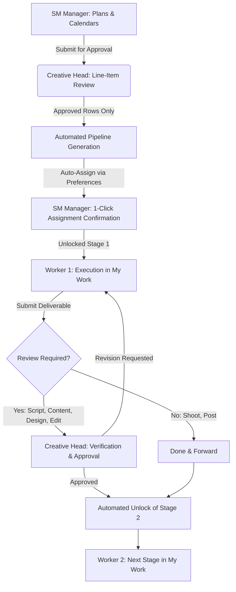
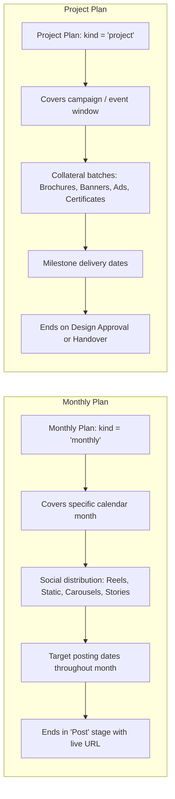
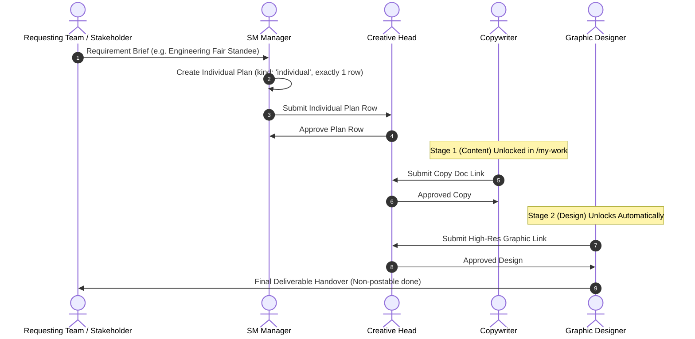
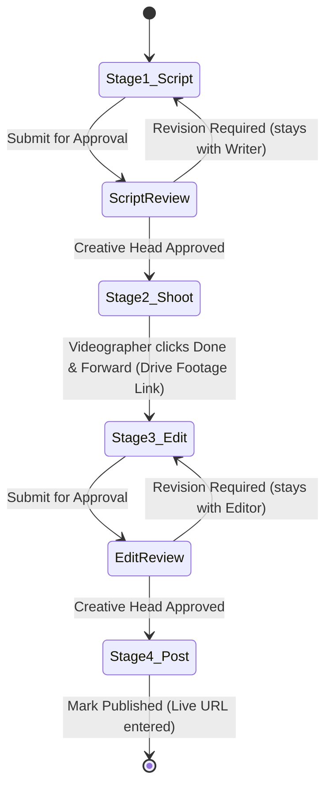

# Complete Marketing Operations Workflow Specification (HACA Marketing OS)

> [!WARNING]
> **SUPERSEDED / DEPRECATED:** This document has been replaced by [docs/WORKFLOW.md](file:///c:/Users/ADMIN/OneDrive/Desktop/HACA/TECH/haca-forge/docs/WORKFLOW.md), which is the authoritative single source of truth for Workflow V2.

*A definitive guide to Monthly Calendar Plans, Individual Works, Worker Execution, Inter-Worker Handoffs, and Creative Head Approvals.*

---

## 1. Executive Summary & Core Operating Architecture

**HACA Marketing OS** unifies all marketing operations into a verified digital workflow, replacing disconnected spreadsheets (Sheet A: SM Content and Sheet B: Design Requirements) and unstructured chat messages.

The system enforces three immutable principles:
1. **Single-Brand Focus:** Dedicated to **HACA** (eliminating multi-brand confusion).
2. **Deterministic Sequence:** Work items and pipeline stages cannot be executed out-of-order (editing cannot begin without approved script or footage; publishing cannot happen without final approval).
3. **Clear Separation of Powers:** Planners plan, workers execute, and only designated leads approve.



---

## 2. Role & Responsibility Matrix

Every user in the system operates under one of five strictly scoped roles:

| Role Key | Title | Planning & Entry | Approvals & Reviews | Worker Handoffs | Dashboard & Visibility |
| :--- | :--- | :--- | :--- | :--- | :--- |
| **`creative_head`** | **Creative Head** | Cannot upload plans or create initial raw items. | **Primary Approver:** Line-item verification of Calendar Plans (Approve All, Selected, or Changes Requested); approves review stages (`Script`, `Content`, `Design`, `Edit`); classifies revision causes. | Reviews submissions from workers; requests revisions with explicit notes. | Lands on `/dashboard` with pending approval counters, production stats, and team workload. |
| **`sm_manager`** | **SM Manager** *(Operational Lead)* | **Primary Planner:** Uploads CSV/Excel templates, enters rows in interactive grid, defines deadlines and formats. | **Zero approval authority:** Cannot approve calendar plans or review stages. | Recommends/confirms stage assignments; reassigns; shifts deadlines; resolves blocker dependencies. Executes assigned publishing tasks (e.g., `Post` stage) via **`/my-work`** with asset upload and live social reference links. | Lands on `/dashboard` with monthly plan progress, KPI strips, Content Tracker, and direct access to `/my-work` for personal posting assignments. |
| **`team_member`** | **Creative Contributor** *(Worker)* | Cannot submit plans or assign work to others. | Cannot approve work; cannot self-approve own stages. | **Executes assigned stages in `/my-work`:** starts work, pastes links (Zoho, Drive, Figma), submits for review or clicks Done and forward. | Redirected strictly to `/my-work` (sees only own assigned and unlocked items). |
| **`admin`** | **System Administrator** | Full operational override across all modules. | Holds emergency approval rights if needed. | Manages user directory, permissions, departments, and brand profiles. | Full access across all views. Excluded from capacity/workload calculations. |
| **`executive`** | **Executive Leadership** | Zero mutation / write access (HTTP 403 Forbidden). | Zero approval authority. | Zero assignment authority. Contact info masked. | Full read-only visibility into Dashboard, Calendar, Tracker, Workload, and Reports. |

---

## 3. Monthly Calendar vs. Project-Based Workflows

The platform supports two distinct planning models under the `CalendarPlan` engine:



### Comparative Breakdown

| Attribute | Monthly Calendar Plan (`kind: 'monthly'`) | Individual Work Plan (`kind: 'individual'`) |
| :--- | :--- | :--- |
| **Primary Scope** | Recurring social content distribution for a full calendar month. | Single standalone deliverable (exactly one row: event collateral, ad-hoc poster, brochure). |
| **Initiated By** | SM Manager (around the 25th of the prior month). | SM Manager (upon specific internal request or ad-hoc requirement). |
| **Time Horizon** | Fixed calendar month (`periodStart`: 1st, `periodEnd`: 30th/31st). | Delivery window for the single deliverable. |
| **Typical Deliverables** | Reels (A, B, C), Static Posts, Carousel Posts, Stories, Posters. | Single Brochure, Standee Poster, Certificate, or Announcement. |
| **Final Date ($F$) Meaning** | **Live Publication Date** on social channels. | **Target Handover / Print Date** or live date for the item. |
| **Pipeline Termination** | Includes a final `Post` stage for postable items. | Non-postable concludes on `Design` approval; postable includes `Post`. |
| **Evaluation Metrics** | Monthly Performance Scorecard: Planned vs. Done, on-time rate, revision rate. | Turnaround days, stage handoff latency, and approval wait times. |
| **Programs & Events** | Grouped within the plan using the row field `Program or event`. | Tagged with the row field `Program or event`. |

---

## 4. End-to-End Monthly Calendar Plan Lifecycle

### Step 1: Draft & Data Entry (SM Manager)
1. **Initiation:** The SM Manager navigates to `/calendar?tab=plans` and clicks **New Plan** (`kind: 'monthly'`, selects month/year).
2. **Entry Modes:**
   - **CSV / Excel Upload:** Downloadable standardized `.xlsx` / `.csv` template with client-side validation that flags missing topics or malformed dates prior to import.
   - **Interactive Grid:** Fast inline table editor where the SM Manager types row by row.
3. **Row Specification:**
   - `postingDate` (Target publication date $F$)
   - `topic` / Deliverable Title
   - `workType` (Reel, Carousel, Static Post, Story, Poster)
   - `needsScript` (Checkbox for Reels: determines Variant A vs B)
   - `needsShoot` (Checkbox for Reels: determines Variant A/B vs C)
   - `contentLink` (Zoho Writer draft or brief document)
   - `remarks` (Creative notes or instructions)

### Step 2: Submission to Creative Head
- The SM Manager verifies the monthly lineup and clicks **Submit for Approval**.
- **Plan Status Transition:** `Draft` $\rightarrow$ `Submitted`.
- Notification alert appears on the Creative Head's Dashboard under **Waiting for Approval (Plans)**.

### Step 3: Creative Head Verification & Line-Item Approval
The Creative Head opens the plan review interface (`/calendar?tab=plans` or `/feedback`):
- **Approve All:** Approves all rows in one click if the entire calendar aligns with strategy.
- **Approve Selected:** Approves validated rows while leaving questions on others.
- **Request Changes:** Attaches line-item comments to specific rows (e.g., *"Hook is too generic for Reel #4; replace with admission FAQ"*).
  - Row status becomes `changes_requested`.
  - Plan status becomes `Changes requested` (or `Approved with pending rows`).
  - SM Manager edits only the flagged rows and resubmits.

> [!IMPORTANT]
> **Stage work items are generated ONLY when a row achieves `approved` status.** A row in `draft`, `submitted`, or `changes_requested` never spawns premature worker tasks.

### Step 4: Automated Pipeline & Stage Generation
Upon row approval, the system creates a parent `ContentPiece` and constructs sequential `WorkItem` stage records counted backwards from posting date $F$:

```
Final Date F (e.g., Oct 25)
  ├── Reel Variant A: Script (F-10) ➔ Shoot (F-7) ➔ Edit (F-4) ➔ Post (F)
  ├── Reel Variant B: Shoot (F-7) ➔ Edit (F-4) ➔ Post (F)
  ├── Reel Variant C: Edit (F-4) ➔ Post (F)
  └── Postable Design: Content (F-6) ➔ Design (F-3) ➔ Post (F)
```

Only **Stage 1** has `unlockedAt = new Date()`. Subsequent stages are created with `unlockedAt = null` (locked state).

### Step 5: Intelligent Auto-Assignment & Confirmation
The automated recommendation engine inspects active team members:
1. **Preference Match:** Does `Person.workPreferences[]` include the required stage key (`Script`, `Shoot`, `Edit`, `Design`, `Content`, `Post`)?
2. **Capacity Guard:** Is current workload percentage strictly `< 85%`? Overloaded members ($\ge 85\%$) are excluded.
3. **Bandwidth Ranking:** Prioritizes lowest active workload $\rightarrow$ fewest 90-day revisions $\rightarrow$ earliest availability.
- **Confirmation:** The SM Manager reviews the recommended candidates in the **Content Tracker** (`/calendar?tab=tracker`) and clicks **Confirm Assignments (1-Click)** or manually selects overrides.

---

## 5. End-to-End Project-Based Workflow Lifecycle

Project-based workflows handle non-calendar campaigns, offline events, brochure printing, admissions drives, and ad collateral.



### Individual Work Workflow Rules:
1. **Strict One-Row Boundary:** An `individual` plan must contain exactly one deliverable row.
2. **Unified Approval & Form:** Uses the exact same plan builder, stage auto-fill, and approval flow as monthly plans.
3. **Programs and Events Tagging:** Programs and events are identified using the row field `Program or event`.
4. **Non-Postable Termination:** Items like `Poster`, `Brochure`, and `Certificate` conclude upon Creative Head `Design` approval.

---

## 6. In-Between Workers Handoff Protocols

The engine eliminates communication bottlenecks and lost assets through an automated, state-governed handoff mechanism.

### The Sequential Unlock Mechanism
- Each pipeline stage has an `unlockedAt` field.
- **Stage 1** is unlocked immediately upon assignment confirmation.
- **Stage $n+1$** remains locked (`unlockedAt: null`). It does **not** appear in Worker $n+1$'s active queue until Stage $n$ is complete and approved.

### Downstream Information Relay

```
[Row / ContentPiece Brief]
        │
        ▼ (Carried Forward)
[Stage 1: Script/Content] ──► Output: Zoho Doc / Script URL
        │
        ▼ (Auto-attached to Stage 2 Brief)
[Stage 2: Shoot/Design]   ──► Output: Google Drive Footage / Raw Assets
        │
        ▼ (Auto-attached to Stage 3 Brief)
[Stage 3: Edit/Polish]    ──► Output: Rendered Video / Final Design URL
        │
        ▼ (Auto-attached to Stage 4 Brief)
[Stage 4: Post/Publish]   ──► Output: Published Live URL & Time
```

Every stage inherits the parent `ContentPiece` metadata, the original brief, and the output links from all predecessor stages.

---

### Detailed Handoff Scenarios

#### Scenario A: Design Pipeline (3 Stages)
*Example: Admission Announcement Carousel*
1. **Stage 1 (Content - Writer):**
   - Writer opens `/my-work`, sees the item, clicks **Start Work** (`In Progress`).
   - Writes copy in Zoho Writer, pastes document link in `deliverableUrl`, clicks **Submit for Approval**.
   - Status becomes `Feedback` (or `Under Review`).
   - **Creative Head** reviews copy. When approved, Stage 1 becomes `Approved`.
2. **Automated Handoff:**
   - System immediately sets `unlockedAt = new Date()` on **Stage 2 (Design)**.
   - Designer receives an automated notification: *"New deliverable ready for design: Admission Announcement Carousel"*.
   - Copy document link is automatically displayed on the Designer's work card.
3. **Stage 2 (Design - Graphic Designer):**
   - Designer clicks **Start Work**, creates graphics in Illustrator/Photoshop/Figma.
   - Pastes Google Drive assets link into `deliverableUrl` and clicks **Submit for Approval**.
   - Creative Head reviews visual quality, typography, and brand adherence. When approved, Stage 2 becomes `Approved`.
4. **Stage 3 (Post - Social Media Specialist):**
   - Stage 3 unlocks.
   - Posting owner downloads the approved assets, schedules/posts to Instagram/LinkedIn.
   - Enters live URL (e.g., `https://instagram.com/p/...`) and clicks **Mark Published**.
   - Content piece marked complete.

---

#### Scenario B: Reel Pipeline Variant A (4 Stages)
*Example: Faculty Spotlight Reel with Script and Custom Footage*



1. **Stage 1: Script (Writer)**
   - Writes dialogue, hook, and shot breakdown.
   - Submits to Creative Head.
   - **Creative Head approves:** Stage 2 unlocks.
2. **Stage 2: Shoot (Videographer)**
   - Non-review stage. Videographer reads approved script link directly on the screen.
   - Conducts shoot, uploads raw footage to Google Drive.
   - Pastes Drive folder link and clicks **Done and forward**.
   - **No Creative Head signoff required for raw shoot:** Stage 3 unlocks instantly.
3. **Stage 3: Edit (Video Editor)**
   - Editor sees raw footage link + approved script link.
   - Cuts reel, adds captions, audio, and color grade.
   - Pastes review link (Frame.io, Drive, or Loom) and clicks **Submit for Approval**.
   - **Creative Head reviews:**
     - If audio needs leveling: clicks **Revision Required**. Item returns to Editor's queue (`In Progress`) with revision count incremented to 1.
     - When satisfied: clicks **Approve**. Stage 4 unlocks.
4. **Stage 4: Post (Posting Owner)**
   - Downloads final cut, posts with approved caption, enters live URL. Content completed.

---

## 7. Review vs. Non-Review Stages & Revision Guardrails

### Stage Classification

| Stage Name | Pipeline | Review Type | Approver | Action on Completion |
| :--- | :--- | :--- | :--- | :--- |
| **`Script`** | Reel Variant A | **Review Stage** | `creative_head` (or `admin`) | **Submit for approval** $\rightarrow$ Requires formal approval. |
| **`Content`** | Design Pipeline | **Review Stage** | `creative_head` (or `admin`) | **Submit for approval** $\rightarrow$ Requires formal approval. |
| **`Shoot`** | Reel Variant A & B | **Non-Review Stage** | None | **Done and forward** $\rightarrow$ Instantly unlocks next stage. |
| **`Design`** | Design Pipeline | **Review Stage** | `creative_head` (or `admin`) | **Submit for approval** $\rightarrow$ Requires formal approval. |
| **`Edit`** | Reel Variants A, B, C | **Review Stage** | `creative_head` (or `admin`) | **Submit for approval** $\rightarrow$ Requires formal approval. |
| **`Post`** | All postable items | **Non-Review Stage** | None | **Publish** $\rightarrow$ Requires live URL input. |

### The Revision Loopback Mechanism
When the Creative Head requests revisions on a review stage:
1. The stage does **NOT** advance to the next worker.
2. The item reverts to `In Progress` in the current worker's `/my-work` queue.
3. The system increments `workItem.revisions`.
4. The Creative Head's feedback appears as a prominent alert block on the worker's card.
5. If `revisions >= 4`, a **Revision Flag** is raised on the manager's dashboard and the Creative Head classifies the root cause (`brief_gap`, `creative_choice`, `technical_error`, `scope_change`).

---

## 8. Blockers & Dependency Notifications

If a worker is impeded during execution:
1. Worker clicks **Mark Blocked** in `/my-work`.
2. Selects standardized reason:
   - `waiting_approval` (Waiting on signoff)
   - `assets_missing` (Raw footage, logos, or brand assets not provided)
   - `brief_unclear` (Scope or requirements missing)
   - `technical_issue` (Software, hardware, or access failure)
   - `external_dependency` (Waiting on external vendor/faculty)
   - `scope_change` (Mid-flight direction change)
3. Enters an explanatory note.
4. **Automated Dependency Routing:**
   - If blocked by `assets_missing` or `waiting_approval`, system alerts the preceding stage owner and the SM Manager.
   - Status changes to `Blocked`. The item appears highlighted in red on `/issues` (Issues & Blockers).
   - If unresolved for $>4$ hours, an automated escalation notification triggers to the SM Manager.
5. **Resolution:** SM Manager or Creative Head resolves the blocker with a note; the item returns to `In Progress`.

---

## 9. Stage Due-Date Offset Rules (Cheat Sheet)

Due dates are calculated backwards from the final delivery/posting date $F$:

| Pipeline Type | Stage Sequence & Deadlines | Working Days Before $F$ |
| :--- | :--- | :--- |
| **Design (Postable)** | 1. Content $\rightarrow$ 2. Design $\rightarrow$ 3. Post | Content ($F-6$), Design ($F-3$), Post ($F$) |
| **Design (Non-Postable)** | 1. Content $\rightarrow$ 2. Design | Content ($F-5$), Design ($F-2$) |
| **Reel Variant A** *(Script + Shoot)* | 1. Script $\rightarrow$ 2. Shoot $\rightarrow$ 3. Edit $\rightarrow$ 4. Post | Script ($F-10$), Shoot ($F-7$), Edit ($F-4$), Post ($F$) |
| **Reel Variant B** *(No Script, Shoot)* | 1. Shoot $\rightarrow$ 2. Edit $\rightarrow$ 3. Post | Shoot ($F-7$), Edit ($F-4$), Post ($F$) |
| **Reel Variant C** *(Raw Footage Provided)*| 1. Edit $\rightarrow$ 2. Post | Edit ($F-4$), Post ($F$) |

*Approval Turnaround Expectation:* Creative Head review turnaround is standard 24 hours (1 working day) from submission.

---

## 10. Verification & Audit Trail

Every operational action generates an immutable `ActivityEvent` record logged with timestamp, actor, role, and metadata:
- `plan.created`, `plan.submitted`, `plan.approved`, `plan.changes_requested`
- `work_item.created`, `work_item.assigned`, `work_item.status_changed`, `work_item.unlocked`
- `feedback.requested`, `feedback.approved`, `blocker.raised`, `blocker.resolved`

These events drive the live **Team Workload Monitor** (`/workload`), the **Content Tracker** (`/calendar?tab=tracker`), the **Management Dashboard** (`/dashboard`), and the four executive reports:
1. **Weekly Work Report**
2. **Monthly Performance Scorecard**
3. **Creative Production Report**
4. **Team Performance Digest**
