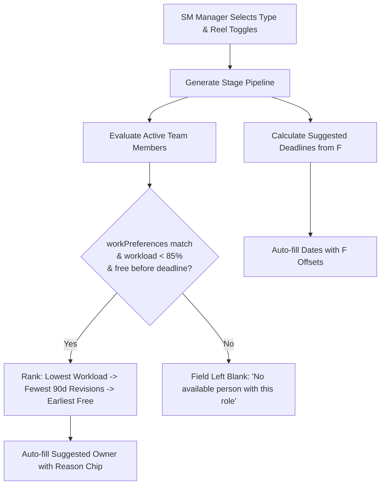
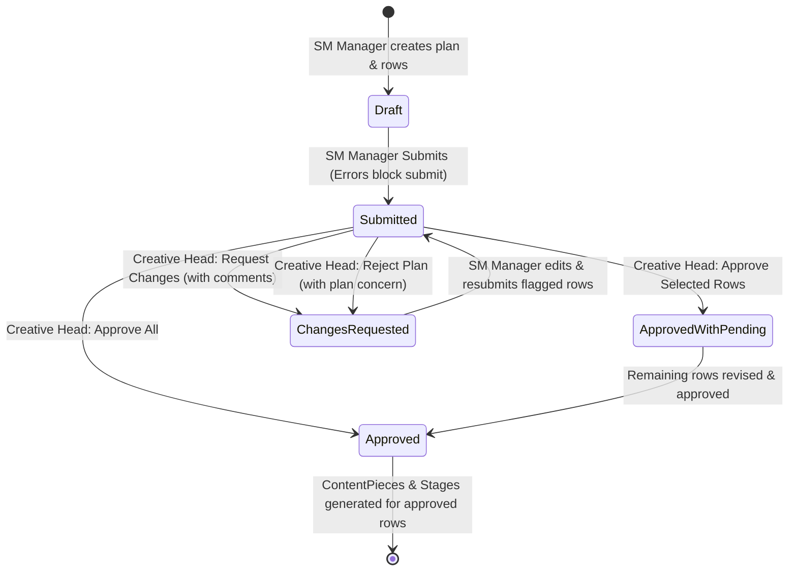
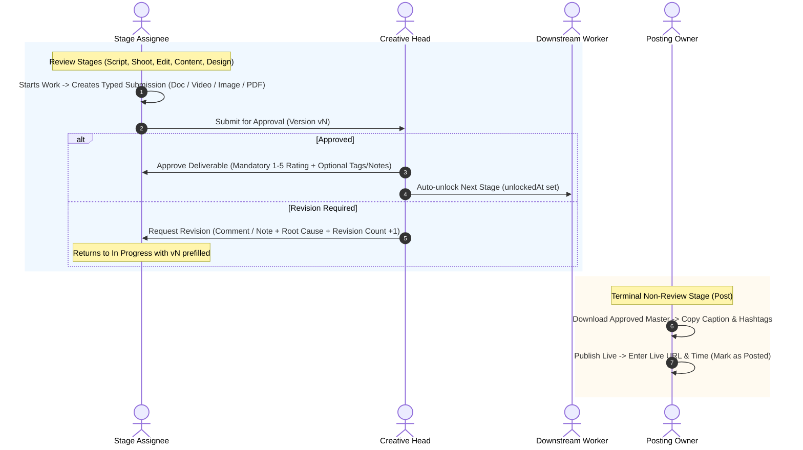

# Complete Marketing Operations Workflow Specification (Workflow V2)

**Single Source of Truth for HACA Marketing Operations**  
*Replaces all previous workflow documents and specifications (including `FLOW.md` / `flow.md`).*  
*Scope: WORK and TEAM only, for HACA only.*

---

## 1. Plan Types

The system supports exactly **two** plan types:

1. **`monthly` (Monthly Calendar):** Covers a complete calendar month of scheduled social marketing and departmental deliverables.
2. **`individual` (Individual Work):** A single-deliverable plan containing **exactly one row**. It uses the exact same form, fields, validation, and approval flow as a row in a monthly calendar.

> [!IMPORTANT]
> **Removal of Project Plans:** The legacy `project` kind is completely removed (there are no department leads or separate departmental planning silos).  
> **Campaign & Event Grouping:** Programs, offline campaigns, and events are grouped at the row level via the optional row field **`Program or event`**.  
> **School-Specific Naming:** The plan title carries the school name and planning period (e.g., `'Tech School November 2026'`). Single-brand mode is maintained (HACA only; no brand switcher or brand field).

---

## 2. Month-End Planning (Operating Practice)

* **Cadence:** Around the 25th of each month, the **SM Manager** builds the upcoming month's calendar plan.
* **Scope of Deliverables:** Collates programs, campaigns, and day-wise deliverables (reels, static posts, carousels, stories, brochures, etc.) needed across internal teams: **Sales**, **Marketing**, **Academics**, and **Other**.
* **Submission:** Once all rows for the month are compiled and verified, the SM Manager submits the complete calendar plan to the **Creative Head** for line-item review and verification.
* **Ad-Hoc & Mid-Month Requests:** After the monthly calendar is submitted or approved, the SM Manager can create **Individual Works** (`kind: 'individual'`) for single ad-hoc deliverables arising mid-month.

---

## 3. Row Fields (Data Entry Specification)

Every row represents one planned marketing deliverable. The SM Manager enters the following fields:

### 3.1 Core Row Fields (All Deliverables)
| Field | Requirement | Type / Constraints | Description |
|---|---|---|---|
| **Posting date ($F$)** | **Required** | Date (`YYYY-MM-DD`) | Target live publication date, or the needed-by delivery date for non-postable items. |
| **Posting time** | Optional | Time (`HH:mm`) | Scheduled time of publication on live channels. |
| **Topic** | **Required** | Text | Title or subject of the deliverable. |
| **Type** | **Required** | Enum (15 types) | `Reel` plus 14 design types (see below). |
| **For team** | **Required** | Enum | Requesting internal team: `Sales`, `Marketing`, `Academics`, `Other`. |
| **Program or event** | Optional | Text | Program or event grouping (e.g., "AI Integrated Graphic Design", "November Admissions Drive"). |
| **Brief** | **Required** | Text (max 1,000 chars) | Full creative brief, objectives, hook, and deliverables specifications. |
| **Reference link** | Optional | URL | Reference material, inspiration, or source documentation. **Input URL only:** never reuse `contentLink` or `assetsLink`, which are reserved strictly for worker outputs. |
| **Priority** | **Required** | Enum (`Normal`, `Urgent`) | Priority level (defaults to `Normal`). |
| **Remarks** | Optional | Text | Internal operational notes from the SM Manager. |
| **Posting owner** | Conditional | User Email / ID | **Required** when the deliverable type goes live (has a `Post` stage). Empty for non-postable items. |

### 3.2 Content Types & Final Handover
* **15 Supported Deliverable Types:**
  1. `Reel`
  2. `Static Post`
  3. `Carousel Post`
  4. `Story`
  5. `Cover Image`
  6. `Thumbnail`
  7. `Meta Ads Creative`
  8. `Class Announcement`
  9. `Orientation Creative`
  10. `Graduation Creative`
  11. `Brochure`
  12. `Certificate`
  13. `Offer Creative`
  14. `Placement Poster`
  15. `Custom Request`
* **Postable Types (Go Live with a `Post` Stage):**  
  `Reel`, `Static Post`, `Carousel Post`, `Story`.  
  *Execution ends with the posting owner publishing to social channels and recording the live URL and timestamp.*
* **Non-Postable Types (Collateral & Handover on $F$):**  
  `Cover Image`, `Thumbnail`, `Meta Ads Creative`, `Class Announcement`, `Orientation Creative`, `Graduation Creative`, `Brochure`, `Certificate`, `Offer Creative`, `Placement Poster`, `Custom Request`.  
  *Execution concludes upon Creative Head final approval; final assets are handed over on date $F$. No `Post` stage exists.*

### 3.3 Stage Owner & Deadline Fields by Type

#### Design Types (All 14 design types)
* **Content Writer:** `Content Owner` (the writer / copywriter) and `Content Deadline`. UI Label: **"Content writer"**.
* **Designer:** `Designer` (graphic designer / visual artist) and `Design Deadline`. UI Label: **"Designer"**.

#### Reel Deliverables
Configured dynamically via two boolean toggles:
* **Needs script?** (`yes` or `no`):
  * If `yes`: `Script Owner` and `Script Deadline` are active and required.
  * If `no`: Script stage is skipped.
* **Needs shoot?** (`yes` or `no`):
  * If `yes`: `Shoot Owner` and `Shoot Deadline` are active and required.
  * If `no`: Shoot stage is skipped, and **`Source video link`** is **required** (points to the existing program/event recording from which the reel is cut).
* **Video Editor:** `Editor` and `Edit Deadline` are **always required**.
* **Posting Owner:** `Posting Owner` and `Posting Date F` are **always required**.

---

## 4. Auto-Fill & Suggestion Engine

When the SM Manager selects a `Type` (and toggles for Reels), the system immediately generates the stage pipeline and automatically populates suggested stage owners and suggested deadlines directly in the row draft.

### 4.1 Owner Suggestion Algorithm
The engine evaluates candidates per stage:
1. **Role & Work Preference Filter:**
   - Must be an active user with role `team_member`.
   - Must hold the stage's key in `Person.workPreferences[]` (`Content`, `Script`, `Design`, `Shoot`, `Edit`, `Post`).
   - `admin`, `creative_head`, `sm_manager`, and `executive` are **strictly excluded** and never suggested.
2. **Workload Guard:**
   - Current workload must be strictly **$< 85\%$**.
   - Workload includes existing open assigned work **plus** the estimated hours of stages already drafted in the current plan.
   - **Default Stage Hours (Configuration constants, never displayed in forms):**
     - `Content`: 2 hours
     - `Script`: 2 hours
     - `Design`: 4 hours
     - `Shoot`: 4 hours
     - `Edit`: 6 hours
     - `Post`: 1 hour
3. **Availability:** Candidate must have bandwidth free prior to the stage deadline.
4. **Ranking Order:**
   1. Lowest total workload percentage (including current draft plan load).
   2. Fewest revisions over the past 90 days (`avgRevisions`).
   3. Earliest availability date.
5. **Transparency & Overrides:**
   - The recommendation rationale is displayed beside the candidate's name (e.g., *"Lowest workload (32%), 0.4 avg rev"*).
   - If no team member qualifies, the field remains empty with the prompt: **`'No available person with this role'`**.
   - The SM Manager can manually select or replace any suggestion.

### 4.2 Suggested Deadline Offsets (Calendar Days from $F$)
Deadlines are calculated backward from posting date $F$ using **calendar days** (Sundays and holidays are not skipped):

| Pipeline Category | Stage Deadlines (Offsets from $F$) | Final Stage / Handover | Buffer |
|---|---|---|---|
| **Postable Design** (`Static Post`, `Carousel`, `Story`) | Content: $F - 5$   Design: $F - 2$ | Post: $F$ | 2 days after Design (1 day review + 1 spare) |
| **Non-Postable Design** (11 collateral types) | Content: $F - 5$   Design: $F - 2$ | Handover: $F$ | 2 days after Design (1 day review + 1 spare) |
| **Reel Variant A** (Script: Yes, Shoot: Yes) | Script: $F - 8$   Shoot: $F - 5$   Edit: $F - 2$ | Post: $F$ | 2 days after Edit (1 day review + 1 spare) |
| **Reel Variant B** (Script: No, Shoot: Yes) | Shoot: $F - 5$   Edit: $F - 2$ | Post: $F$ | 2 days after Edit (1 day review + 1 spare) |
| **Reel Variant C** (Script: No, Shoot: No) | Edit: $F - 2$ | Post: $F$ | 2 days after Edit (1 day review + 1 spare) |

* **Buffer Rationale:** The 2-day gap between the final creation stage ($F - 2$) and delivery ($F$) provides 1 full working day for Creative Head approval and 1 contingency buffer day.

### 4.3 Manual Overrides & Recalculation Rules
* Any owner or deadline modified by the SM Manager is visually tagged: **`'set by SM Manager'`**.
* If the posting date $F$ is changed later, **only the deadlines that were not set by the SM Manager are automatically recalculated**. Overridden values remain locked.

---

## 5. Validation Rules

Validation runs in real time and enforces strict submission integrity:

### 5.1 Blocking Errors (Prevent Plan Submission)
A plan cannot be submitted while any row contains a blocking error:
1. **Missing Required Fields:** Blank `postingDate`, `topic`, `type`, `forTeam`, or `brief`.
2. **Unknown Type:** Type not in the 15 supported formats.
3. **Past Dates:** Posting date $F$ or any stage deadline is earlier than today's date.
4. **Deadline After $F$:** Any stage deadline is set later than posting date $F$.
5. **Out-of-Order Deadlines:**
   - Reels: `Script Deadline` must be earlier than `Shoot Deadline`, which must be earlier than `Edit Deadline`.
   - Design: `Content Deadline` must be earlier than `Design Deadline`.
6. **Missing Source Video:** `Needs shoot` is `no` on a Reel, but `Source video link` is blank.
7. **Missing Posting Owner:** Type is postable (`Reel`, `Static Post`, `Carousel Post`, `Story`), but `Posting owner` is not assigned.
8. **Invalid Stage Owner:** Assigned owner is not an active `team_member` or does not possess the stage's work preference.
9. **Duplicate Row:** Two or more rows share the exact same `Posting date F`, `Topic`, and `Type` within the plan.
10. **Individual Plan Row Violation:** Plan kind is `individual`, but contains more or fewer than exactly 1 row.

### 5.2 Non-Blocking Warnings (Displayed to Creative Head in Review)
Warnings do not block submission, but are highlighted for the Creative Head:
1. **Tight Creation Buffer:** The last creation stage deadline is scheduled later than $F - 1$ (leaving $<24$ hours for review).
2. **Workload Saturation:** Assigning the row pushes an owner's total workload above **$85\%$**.
3. **Month Mismatch:** A row's posting date falls outside the calendar plan's stated month.

---

## 6. Plan Verification & Approval Workflow

### 6.1 Row and Plan Statuses
* **Row Statuses:** `draft`, `submitted`, `changes_requested`, `approved`.
* **Plan Statuses (Derived):**
  * `Draft`: Plan contains unsubmitted rows.
  * `Submitted`: All rows submitted; awaiting review.
  * `Changes requested`: One or more rows rejected with change requests, or whole plan rejected.
  * `Approved`: Every row in the plan has been approved.
  * `Approved with pending rows`: Some rows are approved (producing live work), while others remain in `draft` or `changes_requested`.

### 6.2 Review Actions (Creative Head and Admin Only)
1. **Approve All:** Approves every submitted row with a single click.
2. **Approve Selected Rows:** Selects specific valid rows to approve immediately while requesting revisions on others.
3. **Request Changes on a Row:** Attaches a mandatory feedback comment to the row; row transitions to `changes_requested`.
4. **Reject Whole Plan:** Rejects the entire submission with an overall strategic concern stored at the plan level (e.g., *"Focus on Admissions campaign topics first"*). All submitted rows transition to `changes_requested`. Row-specific comments are optional in this case.

### 6.3 Resubmission and Dynamic Row Additions
* The SM Manager can only edit rows in `draft` or `changes_requested` status.
* When resubmitting, **only the revised rows are transitioned back to `submitted`**. Approved rows remain locked and untouched.
* Adding a new row to an already approved plan starts that row as `draft`, requiring its own validation, submission, and approval cycle.

---

## 7. Post-Approval Pipeline Generation & Execution

When a row transitions to `approved`:
1. **ContentPiece Creation:** A parent `ContentPiece` is instantiated with the row's topic, type, school, and metadata.
2. **Stage WorkItems Generation:** A sequential `WorkItem` is created for each pipeline stage using the owners and deadlines validated in the row.
3. **Sequential Unlocking:**
   - **Stage 1** unlocks immediately (`unlockedAt: new Date()`).
   - **Stages $2 \dots N$** are initialized in a locked state (`unlockedAt: null`). In the worker's `/my-work` view, locked stages appear greyed out with their scheduled due dates.
4. **Notifications:**
   - Stage 1 owner receives an immediate actionable notification: *"Work ready to start"*.
   - Downstream stage owners receive scheduled notifications with projected dates.

### 7.1 Mid-Flight Modifications & Governance
* **Permitted Changes:** The SM Manager and Admin can reassign an owner, modify a stage deadline, reschedule posting date $F$, or skip an unstarted stage.
* **Audit Trail:** Every post-approval mutation is logged in `ActivityEvent` with `who`, `when`, `oldValue`, and `newValue`.
* **Alerts:** Both the affected worker and the Creative Head receive instant notifications of the change.
* **Immutable Fields:** **Topic** and **Type** cannot be altered after row approval. (If topic or type must change, the row is cancelled and a new row must be created).

---

## 8. Stage Flows & Review Loops (Workspaces V2)

### 8.1 Detailed Stage Sequences & Typed Submissions
Every stage produces a **typed Submission** (governed by [docs/WORKSPACES.md](file:///c:/Users/ADMIN/OneDrive/Desktop/HACA/TECH/haca-forge/docs/WORKSPACES.md)):
* **Design Pipeline:**
  1. `Content Writer`: Drafts copy doc in **Writing Studio** (JSON + HTML snapshot; fallback doc link) $\rightarrow$ Submits for review.
  2. `Creative Head`: Reviews in **Review Studio** $\rightarrow$ Approves with 1–5 rating.
  3. `Designer`: Creates visual assets in **Designer Workspace** (Images / PDF with dimension pre-flight) $\rightarrow$ Submits for review.
  4. `Creative Head`: Reviews in Review Studio $\rightarrow$ Final design approval with 1–5 rating.
  5. *Handover:* Non-postable items are completed. Postable items proceed to step 6.
  6. `Posting Owner`: Accesses **Post Workspace**, downloads approved assets, copies caption/hashtags $\rightarrow$ Records public live link and timestamp (Mark as Posted).
* **Reel Pipeline:**
  1. `Script Writer` (if required): Drafts script doc in **Writing Studio** (Scene table, duration estimator, hook check; fallback doc link) $\rightarrow$ Submits for review.
  2. `Creative Head`: Reviews script in Review Studio $\rightarrow$ Approves with 1–5 rating.
  3. `Videographer / Shoot` (if required): Conducts shoot, accesses read-only script/shot list in **Videographer Workspace**, uploads video footage clips (resumable/chunked up to 500 MB; fallback drive link) $\rightarrow$ **Submits for Creative Head review**. *(Shoot is now a Review Stage).*
  4. `Creative Head`: Reviews footage in Review Studio $\rightarrow$ Approves footage with 1–5 rating (unlocks Edit).
  5. `Video Editor`: Accesses footage and script in **Editor Workspace**, uploads cut with 9:16 / 90s checks $\rightarrow$ Submits for review.
  6. `Creative Head`: Reviews video cut in Review Studio with timecode-pinned comments $\rightarrow$ Final edit approval with 1–5 rating.
  7. `Posting Owner`: Posts reel $\rightarrow$ Records public live link and timestamp.

### 8.2 Review vs. Non-Review Mechanics
* **Review Stages (`Script`, `Shoot`, `Edit`, `Content`, `Design`):**
  - Worker creates a typed submission and submits to Creative Head.
  - Creative Head reviews: **Approve** (requires mandatory 1–5 quality rating, optional feedback and tags; unlocks next stage) or **Revision Required** (attaches comments or note, classifies root cause; work returns to worker queue in `In Progress` with previous submission pre-filled).
  - Every resubmission creates a new version (`v1`, `v2`, ...). Revision count increments. If revisions reach **4**, a `RevisionFlag` is raised on the manager and Creative Head dashboards.
* **Non-Review Stage (`Post`):**
  - `Post` is the only non-review step.
  - Posting owner verifies approved master and captions, publishes to platform, inputs live public URL and time, marking the piece complete.

---

## 9. Live Tracking & Metrics Engine

The **Content Tracker** (`/calendar?tab=tracker`) audits all pieces and stages live:

### 9.1 Timestamps Recorded Per Stage
For every stage, the system records exact dates and times for:
1. `Planned Due Date`
2. `Assigned At`
3. `Unlocked At`
4. `Started At`
5. `Submitted At`
6. `Approved At`
7. `Posted At`

### 9.2 Derived Real-Time Operational Indicators
* **Who holds it now:** Current holding party:
  - Worker name (when `In Progress`, `Not Started`, or `Pending`)
  - `Creative Head` (when in `Feedback` / awaiting approval)
  - `SM Manager` (when status is `Needs owner`)
  - `Blocked since <date>` (when actively blocked)
  - `Locked` (waiting for upstream stage)
* **Late by days:** Calendar days elapsed past due date without completion.
* **Owner lag days:** Days between assigned due date and actual submission date.
* **Approval wait days:** Days elapsed between worker submission and Creative Head decision.
* **Piece Status:**
  - **`On Track`:** All active stages progressing normally.
  - **`At Risk`:** Any active stage is due within **2 calendar days** and is currently `Not Started`, `Pending`, or `Blocked`.
  - **`Late`:** Any stage has passed its deadline without being submitted or completed.

### 9.3 Contributor & Leadership Metrics
* **Per Contributor:** On-time completion rate, average days late, average revision cycles.
* **For Creative Head:** Average approval wait days.
* **Role-Based Visibility:**
  - `sm_manager`, `creative_head`, `admin`, `executive` (read-only): Full visibility across all pieces, stages, and team metrics.
  - `team_member`: Strictly scoped to their own assigned deliverables and stages.

---

## 10. Removal of Hour-Based Rules

All arbitrary hour-based escalation timers are removed. Exact dates and times are stored for reporting and auditing, but **no automated escalation or job triggers after a number of hours**:

| Rule Area | Legacy Hour-Based Rule (REMOVED) | Workflow V2 Standard (ACTIVE) |
|---|---|---|
| **Blockers** | Escalates to SM Manager after 4 hours. | When marked Blocked, dependency owner and SM Manager are notified **instantly**. Tracker displays: **`Blocked since <date>`**. No 4-hour alert. |
| **Overdue Work** | Escalates after 4 hours past deadline. | Notification sent **once** when the due date passes (checked at end of day in `REPORT_TIMEZONE` by a daily job). Tracker shows **`Late by X days`**. |
| **Approval Queue** | Targets 24-hour turnaround with escalations. | Queue displays **`Waiting for X days`**. No artificial hourly escalation. |
| **Revision Flags** | Escalates to Creative Head if unclassified after 48 hours. | Unclassified flags remain pinned at the **top of the Creative Head dashboard** until classified. No 48-hour alert. |
| **System Messaging** | Messages referenced *"blocked for 4h"*. | System messages and UI chips **never reference hour counts**. |

### Preserved Day-Based and Count-Based Rules
1. **Revision Flag:** Raised when revisions reach 4, or exceed the worker's rolling 90-day baseline by $>1$.
2. **Inactivity Reminder:** Triggered when an item has no status change for **3 consecutive days** (notifies the owner on Day 3; notifies the SM Manager on Day 4).

---

## 11. Canonical Taxonomies & Lists

### 11.1 Standard Blocker Reasons (Exact 9)
When marking a stage Blocked, the worker selects from these exact 9 reasons:
1. `Waiting for feedback`
2. `Waiting for content`
3. `Waiting for data`
4. `Technical issue`
5. `Dependency`
6. `Client/business approval`
7. `Resource issue`
8. `Unclear requirement`
9. `Other` *(free-text explanation required only when 'Other' is selected)*

### 11.2 Standard Revision Root Causes (Exact 7)
When classifying a revision flag, the Creative Head selects from these exact 7 root causes:
1. `Brief unclear`
2. `Creative direction unclear`
3. `Skill gap`
4. `Feedback inconsistency`
5. `Excessive scope change`
6. `Approval delay` *(replaces legacy 'TL approval delay')*
7. `Client/business requirement changed`

> [!NOTE]
> **Invented Codes Removed:** All legacy internal slug codes (e.g., `assets_missing`, `brief_gap`, `waiting_approval`, `scope_change`) are eradicated. UI labels, database values, and documentation use the canonical lists above.

---

## 12. Spreadsheet Import Template Specification

The system provides a downloadable spreadsheet template (`.xlsx` / `.csv`) for batch calendar creation:

### 12.1 Column Header Specification (24 Columns)
1. `Posting Date`
2. `Posting Time`
3. `Topic`
4. `Type`
5. `For Team`
6. `Program or Event`
7. `Brief`
8. `Reference Link`
9. `Priority`
10. `Posting Owner`
11. `Content Owner`
12. `Content Deadline`
13. `Script Owner`
14. `Script Deadline`
15. `Needs Script`
16. `Needs Shoot`
17. `Shoot Owner`
18. `Shoot Deadline`
19. `Edit Owner`
20. `Edit Deadline`
21. `Design Owner`
22. `Design Deadline`
23. `Source Video Link`
24. `Remarks`

### 12.2 Import Parser & Auto-Fill Rules
* **Owner Identification:** Owners are identified by their registered system email address.
* **Auto-Fill Blank Owners & Deadlines:** Any blank owner or deadline columns in the imported file are automatically populated by the suggestion engine during validation preview and visually tagged **`'suggested'`**.
* **Minimal File Support:** A minimal upload containing only:
  - `Posting Date`
  - `Topic`
  - `Type`
  - `For Team`
  - `Brief`  
  **must parse and validate successfully**, with all stage owners, reel toggles, and deadlines populated automatically by the auto-fill engine.

---

## 13. Role Workspaces, Submissions, Ratings & Permissions

*Source of Truth:* [docs/WORKSPACES.md](file:///c:/Users/ADMIN/OneDrive/Desktop/HACA/TECH/haca-forge/docs/WORKSPACES.md).

### 13.1 Workspaces Overview
1. **Writing Studio (`Content`, `Script`):** Word-style desktop-first rich text editor, A4 page layout, zoom, 6 ribbon tabs (Home, Insert, Script, Review, View, File), Malayalam Unicode font support, anchored comments, single-editor lock, autosave with offline buffer, version history, script templates, 2-column scene table, duration estimator, hook check, caption/hashtag generator, shot list, and teleprompter. Document stored as JSON + sanitized HTML snapshot (1 MB limit).
2. **Review Studio (`creative_head`, `admin`):** High-throughput approval queue ('Waiting for approval', oldest first with waiting days), split-screen viewer (read-only doc with text diff, video player with timecode-pinned notes, image viewer with point-pinned notes, link opener), upstream outputs inspection, decision bar with mandatory 1–5 quality rating, optional tags, keyboard shortcuts, and auto-advance.
3. **Videographer Workspace (`Shoot`):** Read-only script & shot list, upload 1–10 video files (resumable/chunked up to 500 MB, pause/retry, phone support), shoot notes. *Shoot is a review step evaluated by Creative Head.*
4. **Editor Workspace (`Edit`):** Read-only footage and script, video upload with non-blocking 9:16 vertical and $\le 90\text{s}$ duration warnings, version list, revision comments interactive checklist.
5. **Designer Workspace (`Design`):** Docked approved copy with copy-to-clipboard buttons, image & PDF upload with dimension checks (Static Post $1080\times 1080$, Carousel $1080\times 1080$, Story $1080\times 1920$, Thumbnail/Cover $1280\times 720$), drag-and-drop carousel slide ordering.
6. **Posting Owner Workspace (`Post`):** Download approved master asset, copy caption & hashtags, platform checklist, live link and publication timestamp entry, Mark as posted.
7. **Storage Limits:** Video (MP4, MOV, WebM) $\le 500\text{ MB}$; Images (PNG, JPG, WebP) $\le 20\text{ MB}$; PDF $\le 50\text{ MB}$. Unguessable storage paths, unlisted, with extracted metadata.

### 13.2 Quality Ratings & Feedback
* **Mandatory on Approval:** Creative Head rates approved output from 1 to 5 (1 Needs a lot of work, 3 Good, 5 Excellent). Rates creative craftsmanship only (never speed). Optional written feedback and tags (`Great hook`, `Clear message`, `Needs polish`, `Off brief`).
* **Worker Notification:** Worker sees rating and feedback on task card; can mark as seen.
* **Audit Trail:** Rating editable only by rater or admin; all edits logged (`ActivityEvent`).
* **Profile Metrics:** 30d, 90d, all-time average, monthly trend, distribution, step type average, recent feedback. Minimum 3 ratings required before displaying any average.
* **Anti-Comparison / Privacy:** Worker sees strictly their own profile ratings. Creative Head, SM Manager, Admin, Executive (read-only) can inspect profiles. Strictly no leaderboards, no rankings, no worker comparisons, and no incentive links.

### 13.3 Permissions
* **Submissions:** Visible to step owner, reviewers (`creative_head`, `admin`), `sm_manager`, `executive` (read-only), and read-only to colleagues assigned to stages in the same content piece.
* **Comments:** Strictly private between step owner and reviewers.
* **Creation & Review Authority:** Only owner creates submissions; only `creative_head` and `admin` review and rate.

